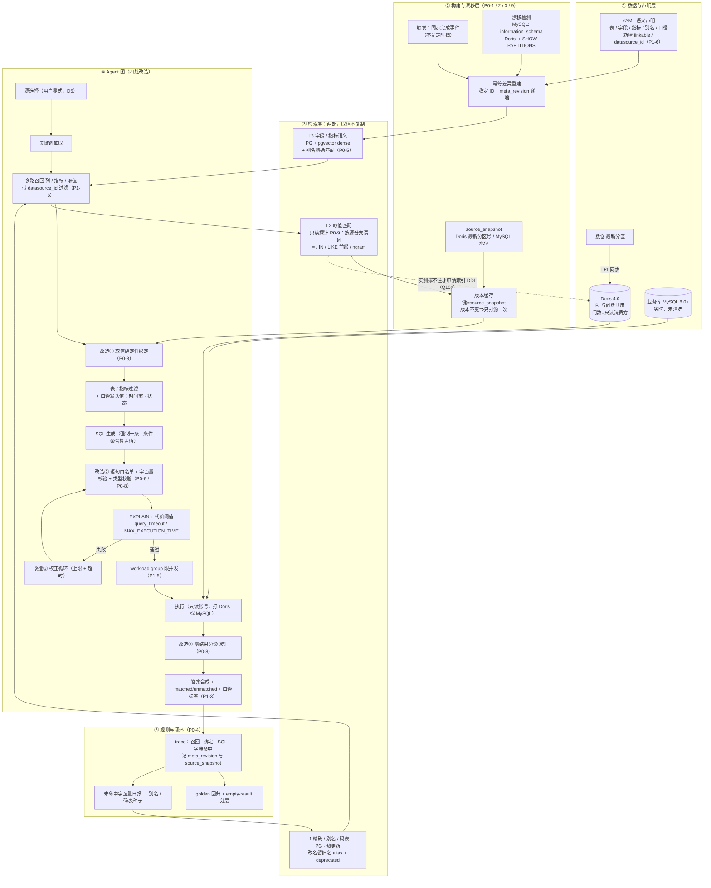

# 问数（nl2sql-service）元数据生命周期与检索质量补全方案

- 状态：**讨论稿**（本文不替使用者拍板）。§0 是当日已定裁定 8 条；§8 共 26 行——**已答 3 项（Q8 / Q9 / Q13）、待答 22 项、已拍并已执行 1 项（Q21，简历侧，二档）**（编号不连续，见 §8 说明）
- **核验状态**：**§11 已做过一轮全量机械核验**（正文全部去重引用逐条回查原文——本轮测得 161 条，计数会随编辑漂移、复测办法见 §11 开头；否定式断言改用不受 `.gitignore` 影响的原始 grep；并按脚本普查了全文表格结构）。结果：撤回/更正 13 条（§11.1）、收紧 4 条（§11.2）、新增 7 条事实（§11.3，其中 N1/N2/N4/N6 改变方案前提）。**§12 是课程实现证据的冻结快照（该目录未跟踪、即将删除，删除后不可恢复）——课程侧引用一律改读 §12。** 读本文前先读 §11.1 的 R1/R2/R7/R11/R13——五条是同类错误（搜索范围来自假设、或结构被自己的编辑破坏），不是五个孤立笔误。
- **2026-10-18 代码审计回写**：对 `applications/nl2sql-service/` 全量实读后新增 **§5.16**（15 条新发现的归属映射，完整锚点在 `docs/reviews/review-nl2sql-service-code-audit-2026-10-18.md`）+ **§5.17**（元知识表清单 + 核对 SQL + **DDL 已入库**）+ **P0-11**（生成期上下文接线）+ **S-11**（guard 无函数黑白名单）+ **Q26**（部署入口两小事）+ 验收第 23-26 条 + §11.1-R14（S-6 次数更正）+ §11.3-N8~N14。同时结项两项已执行：**§5.12.2 池工厂上移**（commit `1aec092`）与 **S-4 DSN 脱敏**（commit `c6cbea7`）。**
- **2026-10-18 范围裁定（用户口径，§4.0）**：本期只完成**最小可完成项 M0**（P0-1 / P0-2 / P0-11 / answer 最小节点）；§5.8~§5.16 与 P1/P2 的全部优化点**保留设计记录、登记后续批次 B1–B5、本期不做**。Q5 据此已答；Q18/Q23 升为本期阻塞项。
- 日期：2026-10-17
- 范围：改造对象是 `applications/nl2sql-service`（平台侧）；**`courses/zhanggui-wenda/data-agent` 作为参照实现用于取证**（P0-6 / P0-8 的缺陷证据全部来自它，不是平台侧现状）。**不含** 2025 会展问数本体（SQLBot 深度改造，代码在公司内网，本地不可读）
- 关联：ADR-0003（双驱动，已决）、ADR-0006（隔离维度契约）、ADR-0007（服务端断言租户身份）、ADR-0009（两套向量存储并存，未决）
- 触发：§2 的四个空洞是审计中逐个实读定位的，不是推测；每条都给了 `file:line`

## 0. 当日已定裁定（2026-10-17，用户口径；后续讨论不得重复推导）

| # | 已定 | 来源 | 直接影响的章节 |
|---|---|---|---|
| D1 | 问数生成的 SQL **打到 Doris**；数仓清洗后 **4 亿+**，MySQL 承载不住、Hive 延迟与分区复杂度不可接受 | 用户口径 | §2、§5.4、P1-4。**目标态**——本窗口不可达，见 §0.1 |
| D2 | Doris 里是数仓**最新分区 T+1 同步**的数据，**供 DataEase BI 展示**；问数是**只读消费方，不拥有这些表** | 用户口径 | §5.5 定档、P1-5、§7 |
| D3 | 内网 Doris 已从 2.x **升级到 4.0**（自定义分词、`score()` BM25、ANN 均可用） | 用户口径 | §5.5、§5.7；但“版本支持≠生产验证”，T1-T3 仍是前置 |
| D4 | **元数据语义层留问数自己的 PG**，不下推 Doris ANN | 用户裁定 | §5.6、P0-5 |
| D5 | 源由**用户在会话里显式选定**（现用 MySQL 与 Doris），不做静默路由 | 用户口径 | P1-3（原路由方案已撤回） |
| D6 | **默认对源不建 DDL**：取值匹配＝只读探针 + 跟随版本的缓存；索引 DDL 降级为性能债备选 | 用户原则（“不改数据源”） | P0-9、§5.7 修订 |
| D7 | “取值”二分：**定义出来的码表＝元数据（进 PG，带别名/旧名 alias/deprecated）**；**distinct 出来的自由文本＝数据（不复制）** | 本方案推论，用户采纳 | §5.7、P1-2 |
| D8 | 业务库 **MySQL 8.0+** | 用户口径 | P1-4 能力矩阵 |

### 0.1 源可达性三档（2026-10-18 追加；回答 D1 的"目标态"到底目标到哪一步）

**触发**：使用者口径——内网 Doris / MySQL **本窗口完全连不上（网络与口令都没有）**；但**允许本地自建 Doris / MySQL 并造数据做测试**。这两句合起来不是"测不了"，而是把"能测的"从一格拆成三格。**没有这三档，本文后续所有"须实测"判据都无法判断自己是否可执行。**

| 档 | 含义 | 覆盖项 | 不许越界之处 |
|---|---|---|---|
| **T-A 本地可测·结论可外推** | 与数据量、与内网实例配置无关的行为 | 驱动与方言（P0-0 的 `aiomysql` 选型、`detect_dialect` 按源传参）；**Q24 的执行侧**（sqlglot 规整后的语句在真 MySQL/Doris 上是否可执行）；每源只读机制（PG 会话 GUC／MySQL `SET SESSION TRANSACTION READ ONLY`／Doris `GRANT SELECT_PRIV`）；`information_schema` 与 `SHOW PARTITIONS` 的返回形状；**`ngram_token_size` 的行为**（默认 2、短于 token size 的查询词命中不到、改动后须重建索引）；**「ngram 是否支持 `IN BOOLEAN MODE`」这条 P1-4 矩阵里标了"实测项，勿当结论"的矛盾资料**——本地即可定；`BUILD INDEX` / `SHOW BUILD INDEX` / 倒排索引 `parser` 四值的**语义** | 测的是"这个能力存在且行为如文档"，**不是**"它在 4 亿行上够用" |
| **T-B 本地可测·结论不外推** | 耗时/吞吐类，本机硬件与数据规模都不对 | T1 索引可见延迟与 `BUILD INDEX` 存量回填耗时；M1 全库重灌耗时；M2 应用侧 BM25 建索引 P95；T2 Doris BM25 的排序质量（且缺现网 ES 对照，交集率无从算起） | 只能给**量级直觉与机制会不会超时**，不得写进对外口径，不得当 §5.3 那条「M1 > 1 h ⇒ 禁止索引时把 IDF 乘死」的执行结果——本地跑出来的 M1 与现网 M1 不是同一个数 |
| **T-C 只能现网·本窗口永久不可得** | 依赖真实数据分布、真实集群、跨团队授权 | Q10a/b（Doris DDL 权限，问 BI/DBA）；Q15（workload group 申请与多 FE 排队，验收第 10 条）；**BI 大屏影响确认**（D2，只能由 BI 团队说）；Q10c/Q11（真实 distinct 量级、列文本长度实况）；Q19/Q22 中**内网实例的配置现值**与能否重启（行为在 T-A，现值在 T-C）；P0-8⑤ 未命中字面量日报（服务未部署，无线上流量） | 这一档的待答项**不许再以"等一次实测"作结**——要么跨团队要授权，要么显式标为"待现网窗口" |

**对本文其余章节的三条直接约束**：

1. **D1 重定性（不改裁定内容，只改时态）**：「SQL 打 Doris」是**目标态**。本窗口问数的源**只有 PostgreSQL 可达**——这不是降级，是与既有代码对齐：`dw_db` 本来就是 PG（`repositories/postgres/dw/dw_repository.py` 用 psycopg + `SET default_transaction_read_only`），元数据在 PG、向量在 PG。⇒ 本窗口可端到端闭环的形状是「以 PG 为源出答案」，Doris/MySQL 族按 §0.1-T-C 走现网窗口。
2. **§6 验收按档分口径，不再平铺**：T-A/T-本地可全绿的是第 1、4、9、12 条与第 11 条的①②④⑤；第 2、3、5、6、7、8 条在本地只能用 PG 扮演的"模拟源/模拟多源"验**机制**，其真源语义属 T-C，判据须写成"机制层通过 + 真源待现网"两段，不许合并成一句"已通过"；第 10 条**永久 T-C**。
3. **取值层选型结论降档**：§5.3 的三轴判据、§5.5 的 T1–T3、§5.7 路线一的"实测撑不住才申请 DDL"这套因果，**其判据输入全在 T-B/T-C**。⇒ 在拿到现网窗口前，路线一 vs 探针的取舍只能是**纸面推荐**；`docs/reviews/review-plan-nl2sql-meta-lifecycle-2026-10-17.md` §5 已按此降级（其「路线一才是消除探针的正解」这一判断已被本文 §5.8-C9 采纳，但采纳的是**契约形状**，其**成本结论仍待 T-B/T-C**）。

**与 §3、§5.8 的分工**（避免两处漂移）：跨源合并的拍板在 **§3 非目标**；探针的单一入口与超时/缓存/降级契约在 **§5.8 C1–C9**；本节只管**可达性分档**这一件事，不复述它们的结论。

## 1. 问题定义

元数据侧目前**没有生命周期**。四个具体空洞：

| # | 空洞 | 后果 |
|---|---|---|
| H1 | 生产侧元数据构建入口是 stub | 平台服务里"元知识库"这条路根本没有实现，只有 API 入参注入 |
| H2 | 无刷新触发器（无 cron / CI / 管理端点） | 上游表加了列、改了类型、删了字段，系统不知道也不问 |
| H3 | 重建不幂等、无差异计算 | 重跑一次就多一整套副本；被删的取值永远留在索引里 |
| H4 | 无质量反馈回路（无 trace 落库、无 golden 回归） | 答错了无法定位是"召回错"还是"生成错"，准确率只能靠人工抽样认定 |

⇒ 这四条合起来就是"像 demo"的技术根因：**不是 YAML 这个载体不好，是声明之后的链路没有闭环**。

## 2. 现状事实（逐个实读，非模式猜测）

| 实现 | 位置 | 向量/检索 | 元数据来源 | 刷新触发 | 幂等 | 漂移检测 |
|---|---|---|---|---|---|---|
| 生产服务 | `applications/nl2sql-service` | Postgres + **pgvector**（列/指标/取值三路召回同库，`agent/context.py:6-8`、`agent/nodes/recall_*.py`） | `config/metric_config.example.yaml` + API 入参注入 | **无**——全服务只有一个路由：`api/routers/query_router.py:15` 的 `POST /api/query`（`routers/` 目录仅此一个文件，`@router.*` 全服务命中 1） | n/a | 无 |
| 生产构建脚本 | `nl2sql_service/scripts/build_meta_knowledge.py:20-24` | — | `MetaKnowledgeService(meta_repo=...)` 构造后即丢弃，print「use the service API」 | 人工 CLI | — | — |
| 服务层 | `services/meta_knowledge_service.py:23` `build_from_tables` | — | — | **零调用方**（全仓 grep 只命中定义行） | — | — |
| 课程实现 | `courses/zhanggui-wenda/data-agent` | **Qdrant**（dense）+ **ES**（全文）+ MySQL 元数据 | YAML 手填语义 + `show columns from {t}` 取类型（`dw_mysql_repository.py:9-11`）+ `select distinct {col} limit {limit}` 取样本；**两个 limit 不是一个数**：列的 `examples` 用 10（`meta_knowledge_service.py:56`），ES 取值字典用 **100000**（`:141-143`） | 人工 `python -m app.scripts.build_meta_knowledge` | **不幂等**：point id 用 `uuid.uuid4()`（`services/meta_knowledge_service.py:85/92/99`），`ensure_collection` 只"不存在才建"、从不 drop（`repositories/qdrant/column_qdrant_repository.py:16-20`）；ES 只 `index`、**课程侧 ES/Qdrant 检索层无 delete 路径**（订正：上一版写"全仓无 `delete_by_query`"，`delete_by_query` 确实命中 0，但"全仓检索层没有删除路径"过宽——knowledge-service 的 Milvus 路有 `client.delete`，见 `node_import_milvus.py:316`） | 无 |
| 上游参照 | `github.com/dataease/SQLBot` `apps/data_training/` | 独立"数据训练"模块（`api/data_training.py`＝`page`/`create_or_update`/`delete`/`enable` CRUD） | 后台人工维护 | 人工 | — | — |

**数据链路（2026-10-17 用户口径，此前本文未登记）**：数仓最新分区的值**同步进 Doris**（BI 层；`Resume/analysis/Phase3-简历打磨与开投清单-2026-08-23.md:27` 亦记「BI 当前主用 Doris + DataEase」）。两个直接后果：① 同一问题分两次查询不会跨快照 ⇒ 本文 §4 之前用“快照漂移”论证“必须一条 SQL”**理由过强**，一条 SQL 的真实理由见 §5.4；② 取值字典的变更时点因此是**确定且批量**的（每日同步完成之后），把“刷新触发”从“要设计定时扫描”降级为“挂在同步任务下游”。**已答（2026-10-17 用户口径，Q9）：生成的 SQL 实际打 Doris。** 且同日补口径定性——**Doris 里放的是数仓清洗后的最新分区数据，供 DataEase 做 BI 展示；问数是只读消费方，不拥有这些表。**这一句把本文两个前提改了写：P0-7 的“加内建索引”与 §5.5 的“元数据 ANN 下推”都要跨团队要 DDL 权限（Q10），并引入一个必做项 **P1-5 负载隔离**（问数的 ad-hoc SQL 不能拖垮 BI 大屏）。 排除项的理由也一并登记，因为它们是可对外陈述的设计依据：数仓清洗后数据量 **4 亿+**，放 MySQL 不合适；直连 Hive 太慢且要处理分区裁剪。业务库口径同日补充：**MySQL 8.0+**（⇒ CTE / 窗口函数 / ngram FULLTEXT / 函数索引 / 不可见索引 / `EXPLAIN ANALYZE` 均可用，细节见 P1-4 能力矩阵）。⇒ 本文一切“下推到查询引擎”的论证成立；下表课程实现连 MySQL 只是教学环境，不代表现网（见 §7 归属边界）。

两点要正视：

- 上游 SQLBot 本身就是**人工维护 + 离线训练**的形态。所以"平台侧没有自动同步"不是抄漏了，是沿用了同一个月球模型却没补上生产该有的那一环。
- 简历/对外材料里"Qdrant + Elasticsearch + 自动抽取取值样本"这套，**本地只有课程实现撑着**。平台侧对应实现是 pgvector，且构建入口是 stub。这两件事必须分开陈述（见 §7）。

## 3. 目标与非目标

**目标**：把"元数据从声明到可被信任地检索"这条链路补成有生命周期的一块钱。
**非目标**：不做多租户 SaaS 化；**不做问内跨源合并**（2026-10-18 追加拍板）；不改模型选型与节点链拓扑（但**要改生成上下文的注入契约**——P0-8① 的 examples → 结构化绑定、P0-6① 的 prompt 变量修复，均属此范围，原表述与 §4 冲突，已收紧）。**（2026-10-18 再收窄）**"不改拓扑"指不重排既有 12 节点、不换架构形态；**追加 answer 节点与 `execute_sql → answer` 边**是 §5.11 已登记的计划改动，M0-4 只取 answer 节点一件，execute 条件边仍留 B1（§4.0）。

**问内跨源合并非目标（D5 的下一层，2026-10-18 用户追问“跨源语义”后的拍板）**：D5 已定“源由用户在会话里显式选定”，但“**同一问题是否需要横跨多源合并**”未答——此处拍板：**单问单源，nl2sql 一次调用只面向一个显式选定的源；跨源合并是编排层职责**（联邦 main_agent 分子代理调用后合并），不在本服务内做 federated query。三条理由：① **代价不对称**——现在写一句非目标≈0 成本，事后补=口径标签+返回体契约+合并语义全套 retrofit（缓存键已由 §5.8-C6 的 `datasource_id` 维度先行覆盖，这是唯一已铺的一块）；② **技术未到**——平台侧 datasource 维度尚未新建（Q17：`grep datasource` 在 `nl2sql_service/` 命中 0）、Doris 执行目标物理不可接（依赖清单无 MySQL 协议驱动），在未建的能力上讨论合并语义是空中楼阁；③ **与平台既有形状一致**——`agent_federation` 的 text_to_sql 子代理模式已是“每源一次调用、上游合并”（AGENTS.md §90 横切统一/领域独立 + Plan-F 单 Runtime 多 Planner 的同款判据：把两套方言、两套快照语义、一套合并逻辑塞进单个 Text2SQL 服务即耦合）。**失效点**：若将来确需问内跨源（同一指标天然横跨 Doris+MySQL 且拆不开问），连同 Q17 一起复议，本非目标即失效——不是“永远不支持”，是“现在不支持 + 复议触发条件明确”。

**与 ADR-0009 的关系（本方案隐含做了一个决定，须点破）**：§5.6 定档“元数据语义层留 PG + pgvector”，等于**就 nl2sql-service 一侧**结束悬置；ADR-0009 里 knowledge-service（Milvus）那一侧本方案不触碰，故该 ADR 整体仍标未决。**但上一版“需回填一条 nl2sql 侧已选 pgvector”的措辞不成立**：`docs/adr/0009-vector-store-selection.md:10-13` 的现状表**只有两行**（knowledge-service = Milvus、agent_server = pgvector），**根本没有 nl2sql-service 这一行**，全篇 `grep nl2sql` 命中 0 ⇒ 动作是**新增一行**，不是回填既有条目。新增时还要顺手改一处：ADR-0009 `:25` 的理由写的是“pgvector 无等价的引擎侧稀疏向量”——方向对、理由要换（pgvector **有** `sparsevec` 类型与 HNSW 算子族，缺的是**引擎侧 DF/IDF/BM25**，见本文 §5.1 订正），否则下一个读者会拿这句去反驳实测结果。另注：两者都用 pgvector，但接法不同（agent_server 走 `agent_runtime.db`，nl2sql 走自己的 `pgvector_client_manager`），新增那行要写清是**第三套接法**而非复用。

## 4. 分层方案

### 4.0 本期最小范围（M0）与后续批次登记（2026-10-18 用户口径）

**口径**：使用者 2026-10-18 定——"本期项目暂不做那么多功能，就只完成最小可完成项；优化点列进规划，后面做，本期不做"。据此：**本章以下（P0/P1/P2）、§5.x、§6、§8 的设计记录与判据全部保留、结论不改**，本节只管**时序**。"登记"不是"删除"：后置项留在原章节，开工时回读，不重新推导、不重新论证。

**M0 的四条准入标准**：① 缺了它链路不存在或结果错误（不是"质量不够好"）；② 不依赖任何未拍板项（Q 系列）；③ 不引入新架构分叉（不碰 Q25 / 租户 / 多轮）；④ 以"接线 + 补测试"为主，不含新子系统。

| 项 | 最小形态 | 判据（本期门槛） | 明确不包含（拆去后续批次） |
|---|---|---|---|
| **M0-1 ＝ P0-1** 实装构建入口 | YAML 声明 → meta 库全链路；**列/指标/值三类 embedding 都写入**（修"指标向量召回从没通过"）；合并 P3 的 N+1；`nl2sql_*` 表 DDL 进版本控制 | 跑一次能把声明落到元数据库；`nl2sql_metric_info`/`nl2sql_value_info` 的 embedding 非空；构建报告可查 | 管理后台 UI（Q4 → B4）、漂移检测（P0-3 → B2）、影子切换（P2 → B5） |
| **M0-2 ＝ P0-2** 稳定 ID + 差异重建 | 点 ID = `hash(table.column)`；upsert + 删旧点；灌库收尾按规模重建索引（ivfflat REINDEX 是**规模触发项**而非定期项——小库阶段规划器多走顺序扫描，见 P0-2 行内修订） | 同一份输入连跑两次，点数与内容完全一致（当前翻倍） | 定期 REINDEX 运维排期、HNSW 切换（随 Q18 → B2） |
| **M0-3 ＝ P0-11** 生成期上下文接线 | ①`date_info` 注入（业务日期与系统日期分开）②`metric_infos` 接 `state.metrics` ③库路径表清单进 `state.tables` 且有消费方（**最小形态：列聚合派生，不等 §5.14 关系表**）④correct 轮不少上下文 ⑤column/metric 共享一次 embedding | "上个月销售额"类相对时间问题通过；生成 prompt 四槽非空（**单测可证，不依赖 trace 落库**）；单请求 embedding 调用 = 1；`filter_metric` 的调用因输出被消费而不再是无效调用 | 关系召回、aliases（§5.14 → B4）、多轮继承（§5.13 → B4） |
| **M0-4 ＝ §5.11 拆出** answer 合成最小节点 | 新增单节点 + `execute_sql → answer` 边；吃 sql + result 生成一段人话；**喂模型明细先截 100 行/50KB（双上限的最小内联版，不做 state 注入与配置项）**；修 `query_service.py:31` 恒空 | 任一成功执行返回非空 `answer`；失败路径原样返回 `error` | 异常三分类回灌、execute 条件边、correct_count 接线、matched/unmatched/口径标签——全部留 §5.11/B1 |

**本期的显式代价（接受，不是遗漏）**：无 trace 落库（P0-4/B2）⇒ 错答定位靠复现不靠回放；无漂移检测（P0-3/B2）⇒ 上游改 schema 靠人工发现；取值层维持现状 ⇒ "未识别取值 vs 计数 0"本期不区分；无标识符白名单（P0-10/B3）。**另：本期不新增任何"能力"**——M0-1 到 M0-4 全部是接线、幂等、补契约空字段，不引入新子系统。

**后续批次登记表**（判据在原章节，此处只登记存在性与顺序理由）：

| 批次 | 内容 | 为什么后置 | 关键前置 |
|---|---|---|---|
| **B1 答案可信度** | §5.11 全套（双上限分离/异常三分类/execute 条件边/correct_count）、answer 完整契约（matched/unmatched/口径标签）、P0-6③、P0-7 取值下推、P0-8 五道闸、P0-9 探针+版本缓存、P1-2 基数闸门 | 答得准不准，不是链路在不在；多项卡 Q10a/Q16/Q20 未答 | M0-4 已铺节点；Q10a/Q16/Q19/Q20 |
| **B2 检索质量与生命周期** | P0-3 漂移检测、P0-4 trace+golden 回归+门禁、P0-5 检索层契约（含中文词典断点）、§5.16-I0 残留清理 | 质量与可观测性增强，不影响链路存在 | Q7；Q1-Q3 取证 |
| **B3 安全与隔离** | §5.9 三层纵深、§5.10 S-1~S-11、P0-10 标识符白名单、P1-1 权限下推、平台租户计划（`plan-platform-tenant-workspace-identity-2026-10-18.md` T0-T6） | 横切平台决策，不在单服务最小闭环内 | Q6；租户计划自身顺序 |
| **B4 语义消歧与多轮** | §5.13 多轮上下文继承、§5.14 R1-R6（relations/aliases/关系召回/两个失效节点完整救活）、R7 本体（挂起）、§5.15 载体分层落地、Q4 后台形态 | 效果增强层；M0-3 已用最小替代形态堵住最痛处 | Q4/Q18；R7 待想明白 |
| **B5 多源边界与稳态** | P1-3/P1-4/P1-5/P1-6、P2 全部、Q25 收敛、Q26① `/ready` 探池、Q17 | 依赖 Doris/MySQL 现网窗口（§0.1-T-C）与 Q25 拍板 | 现网窗口；Q25；Q12 |

**执行纪律三条**：

1. **不扩范围**：M0 项若撞上后置批次的依赖，取最小替代形态并在上表"明确不包含"列记一句（例：M0-3③ 用列聚合派生替代关系表），不得顺手把依赖项做了。
2. **一行修白名单**：只允许随 M0 带走的非设计类修改——§5.16-I0 家族（`tokenizer` 死配置、`.env` 的 `EMBEDDING_MODEL`/`VECTOR_DIM` 矛盾、两处 `pg_pool.py` 文档漂移、5 个死 prompt 文件）+ Q26② console script 指向（它就是 M0-1 的入口）。每条单独登记，其余"顺手"一律按 B 批次排。
3. **判据不搬家**：本节不复制后置项的判据，只指位置；开工时回读原章节——防止两处判据漂移（§11 的教训）。

### P0 让链路真的存在（缺了它，其余都是空谈）

**本期只做 M0（§4.0）**：P0-1 / P0-2 / P0-11 + answer 最小节点；P0-3~P0-10 后置 B1–B5，行内设计记录与判据原样保留，开工时回读。

| 项 | 做什么 | 判据（可测） | 涉及 |
|---|---|---|---|
| P0-1 **实装构建入口** | `build_from_tables` 接上脚本与服务，或删掉 stub 换成明确的服务端点。**判据含 2026-10-18 审计补款**：列/指标/值**三类都有 embedding 写入路径**——当前 `build_from_tables` 只给列写 embedding，metric/value 的 embedding 无任何写入方 ⇒ `MetricRepository.recall` 对这两类恒空（`metric_repository.py:16-17` 要求 embedding 非 NULL），"指标向量召回"这条路从来没通过 | 跑一次能把 YAML 声明 + DDL 派生结果落到元数据库，重建后 `nl2sql_metric_info`/`nl2sql_value_info` 的 embedding 列非空，并产出可查的构建报告 | `scripts/build_meta_knowledge.py`、`services/meta_knowledge_service.py` |
| P0-2 **稳定 ID + 差异重建** | 向量点 ID 用 `hash(table.column)` 而非随机；重建走 upsert + 删除不在源里的旧点；灌库收尾 `REINDEX`（ivfflat 持续插入后召回质量衰减需定期重建；或改建库即 HNSW 免此维护，选型随 Q18） | 同一份输入连跑两次，索引内点数与内容**完全一致**（当前是翻倍） | 向量仓库层 + ES 仓库层 |
| P0-3 **漂移检测** | 定时或触发式比对 `information_schema`（或 `show columns`）与元数据库，输出新增/删除/类型变更三类差异；差异默认**报警不自动改语义**，只有类型与样本自动跟 | 造一次"加列 / 改名 / 删列"，检测能在下一周期报出且不误报 | 新增脚本或 `/metadata/diff` 端点 |
| P0-4 **trace 落库 + golden 回归** | 每次问答记录：召回到的表/字段/取值、生成 SQL、EXPLAIN 结果、耗时、模型与 prompt 版本、所用**元数据 revision**；并攒 20–50 条 golden 题目做回归 | 任一线上错答可离线复现；回归可一键跑并出门禁读数 | agent 节点 + eval |
| P0-5 **检索层契约重划**（原“PG 全文补洞”，范围已按 P0-7 收缩） | **字段名 / 指标名 / 别名层**：① 取值路从 PG 退役（转 P0-7），PG 不再承担中文长文本模糊匹配；② 这一层的主路是**别名精确匹配 + dense 向量**，`ts_*` 全文只作已登记短语别名的兜底；③ 兜底路查询侧从 `plainto_tsquery`（AND）改**显式 OR**（逐 lexeme 转义后拼 `\|`）。**2026-10-18 审计修订**：词典层是比 OR 更底的断点——`plainto_tsquery('simple', …)` 的 simple 配置对中文不分词，整串当一个 lexeme，tsvector 侧无同 lexeme 即零命中 ⇒ **在修词典之前，OR 修法无效**；正确顺序是先定中文分词载体（`zhparser`/`pg_search` 一类扩展，或 `to_tsvector` 侧同配置生成），再谈 OR 拼装（**2026-10-18 已落地查询侧**：`build_tsquery()` 做 OR + 单引号转义 + 纯标点丢弃 + 20 词上限，`fulltext_search` 改收 tokens、`value_repository` 直接下传关键词；索引侧 `value_tsvector` 生成方式仍不可见，卡 Q23）；④ 阈值从绝对分改**相对截断**（top-k + 分差）；⑤ 短文本不需要中文分词器，**`zhparser` / `pg_search` 一类扩展不在本项范围**（那是副本索引路线的议题，见 §5.1 状态）——⚠️ 此句与 ③ 的表面矛盾按范围读：⑤ 说的是"不为短文本召回引扩展"，③ 说的是"若保留 ts 兜底路则必须先有中文分词载体"，二者共同的落点是 Q7（pgvector 服务端扩展版本） | 一条含 3 个以上关键词的中文问法不再空召回；`EXPLAIN` 显示走索引而非全表扫；PG 里已无取值表残留 | `clients/pgvector_client_manager.py`、`repositories/pgvector/{column,metric}_repository.py`（`value_repository.py` 转 P0-7） |
| P0-6 **自校验闭环与结果语义（复合问法暴露出来的三处断点）** | ① 校正节点的 PromptTemplate `input_variables` 与 prompt 占位符一致性测试；② 只读保障落到**语句白名单 + 只读账号**，不写在 EXPLAIN 名下；③ 区分"取值未匹配"与"计数为 0"，空召回必须显式拒答而非返回 0 | ① 造一条 EXPLAIN 必挂的 SQL（错表名），校正节点能跑通并产出新 SQL（**课程侧直接抛异常；平台侧已能跑通**，对平台侧本条只是加一致性测试）；② `EXPLAIN DELETE ...` 被执行前就被拦下；③ 问一个库里不存在的城市，返回"未匹配到该取值"而不是 0 | `app/agent/nodes/correct_sql.py:27`（课程）、`nodes/validate_sql.py` + `repositories/mysql/dw/dw_mysql_repository.py:27-28`（课程，`validate_sql` 方法体只有 `explain {sql}`；**订正**：上一版写 `:29-34`，那是 `execute_sql`，不是 EXPLAIN 证据）、平台侧对应层 |
| P0-7 **取值匹配下推到查询引擎**（见 §5.4 / §5.7） | 默认形态＝**只读探针**：匹配动作以查询形式发到数据所在的源，**不在源上建任何 DDL**；索引 DDL 降级为性能债选项。PG 只存取值的**摘要与开关**（基数、码表、是否允许模糊），不存取值全集 | 取值召回与查询落在同一份数据上，“索引落后于数据”这一类故障无从发生；未声明 `linkable` 的列不会被探针查询（默认关）。⚠️ 注意：`sync` 是**课程实现**的 YAML 字段，平台侧 `conf/meta_config.yaml` 目前只有 `meta_db / dw_db / pgvector` 三段、**无该字段** ⇒ 白名单机制要随 P1-6 一起新建，不能当作已有能力 | `repositories/pgvector/value_repository.py:18-28`（副本退役）、取值召回节点、Doris DDL 仅在实测撑不住时按 Q10a 申请 |
| P0-8 **值字面量五道闸**（见 §5.4） | ① 召回值改结构化绑定（不再塞 `examples`）② 执行前用 sqlglot 抽 `(列, 常量)` 回字典校验 ③ 零结果分诊探针 ④ 返回体带 `matched/unmatched` ⑤ 未命中字面量日报 | 问一个库里不存在的城市 → 返回“未识别取值”而非 `0`；类型不匹配（编码列写成字符串）在校验层被拦 | `merge_retrieved_info.py:38-46`、生成/校验节点、SSE 协议 |
| P0-9 **只读取值探针 + 跟随版本的缓存**（本轮讨论的落点，见 §5.7 修订） | ① 取值匹配以参数化查询发到**该列所在的源**，问数对源只读、不建 DDL；候选列由 YAML 的 `linkable` 白名单控制（默认关），带 `LIMIT` 与探针超时；② 定义并落两个版本号——`meta_revision`（元数据构建批次，P0-4 trace 记它）与 `source_snapshot`（数据版本：Doris 取最新分区号 / MySQL 取水位，**缓存键用它**），二者不可混用；③ 缓存仅在 `source_snapshot` 变化时失效 ⇒ 不是定时刷新 | 同一版本内重复问同一取值只打源一次；分区/版本推进后新取值立刻可被召回；对源的连接账号无写权限 | 取值召回节点 + 缓存层 + `meta_config.yaml`（新增 `linkable` / 版本字段，联动 P1-6） |
| P0-10 **标识符白名单**（把既有 S4 收进方案，不再只挂链） | 凡把表名 / 列名 / `filter_clause` / `tsvector_col` 拼进 SQL 字符串的位置一律加标识符校验，直接复用 `packages/agent-runtime/agent_runtime/db.py:164-169` 的 `_IDENT` 正则（`^[a-z_][a-z0-9_]*$`），不新造机制。覆盖面四处：`pgvector_client_manager.py:28-70`、`repositories/postgres/meta/meta_repository.py:18,25,32`、`models/postgres/postgres_model.py:16`、`packages/agent-core/agent_core/memory/vector_backend.py:313,320,341` | ① 传入含引号 / 空格 / 分号的表名或列名时**在校验层抛错，不落 SQL**；② 上述四处各有用例；③ P0-9 探针链路上跑一次，确认参数化查询与标识符校验两条防线同时生效 | 上述四文件 + `agent_runtime/db.py:164-169` 的既成正则（**本仓 `docs/tech-debt/tech-debt-audit-2026-09-22.md:228-237` 自 2026-09-22 登记为 S4，至今未修**） |
| P0-11 **生成期上下文接线**（2026-10-18 代码审计新增；修 A1-A4 + B2，映射见 §5.16） | ① `date_info` 注入当前日期（**业务日期与系统日期分开**：Doris 是 T+1 快照，"上个月"的锚点是数据日期不是今天）；② `metric_infos` 槽接 `state.metrics`（修 `generate_sql.py:30`/`correct_sql.py:34` 的恒空串，与 §5.14-R3 的"修掉 `metric_infos=""`"是同一件事，合并计数）；③ 库路径下表清单进 `state.tables` 且有消费方（关系表并集或列聚合派生，与 §5.14-R3 的 filter_table 救活合并）；④ correct 轮上下文不少于生成轮——E3 只记了 metric/date 空串，此处补 `tables` 槽缺失；⑤ column/metric 召回共享同一次 embedding 计算（当前两分支各调一次 `embed_query(" ".join(keywords))`，`recall_column.py:25`/`recall_metric.py:26`） | 问"上个月销售额"类相对时间问题 golden 通过；库路径下 trace 可见生成 prompt 四槽非空；单请求 embedding API 调用次数 = 1；`filter_metric` 的无效 LLM 调用从 trace 消失（与验收 21 合并计数） | `nodes/generate_sql.py`、`nodes/correct_sql.py`、`nodes/recall_column.py`、`nodes/recall_metric.py`、`services/query_service.py` |

**P0-7 的退让形态**（原写在表格里，会截断表格，故移到表后）：↳ **无 DDL 权限时的退让形态（问数是只读消费方，这条很可能触发）**：下推的价值主要来自“数据在同一处、口径天然一致”，**不主要靠倒排索引**。低基数枚举列（城市 / 状态 / 类型）用 `=` 与 `IN` 就能查对——**这是正确性层面成立，不等于性能层面成立**：Doris 的前缀索引只在 key 列生效，非 key、非分区列的等值过滤要扫该列的列存数据，4 亿行仍是秒级开销，官方对这类列的常规做法正是建一个**不分词倒排索引**（`parser` 留默认 `none`）。⇒ 措辞按此收紧：无 DDL 权限时**功能照样对，性能可能不够**；只有自由文本型取值（展会名、场馆名）的模糊匹配才真需要倒排——那部分若无 DDL 权限，**先按 P0-9 探针实测延迟、判定是否真的不够**，不够才谈外部索引（§5.7 修订里的备选序列）。⇒ **所以“ES 能否退役”取决于 Q10（权限），不取决于 Doris 版本。**

**P0-6 ① 的代码证据**：`courses/.../app/agent/nodes/correct_sql.py:27` 声明 `input_variables=["query","metric_infos"]`，而 `prompts/correct_sql.prompt` 含 **7 个占位符**（`{table_infos} {metric_infos} {date_info} {db_info} {query} {sql} {error}`）。逐文件比对结果：其余 6 个 prompt 与各自声明**全部一致**，只有 correct_sql 不匹配 ⇒ LangChain 在构造 `PromptTemplate` 时即因缺变量报错。而 `graph.py` 把 `state["error"] is not None` 路由到 correct_sql ⇒ **一旦 EXPLAIN 失败，图必然在自修复这一步终止**，"生成→EXPLAIN 校验→校正→执行"的闭环当前不成立。

**P0-6 ② 的事实基础**：MySQL 自 5.6 起 `EXPLAIN` 支持 INSERT/REPLACE/UPDATE/DELETE，因此 `explain {sql}` **不拦写操作**；上游 SQLBot 侧同样没搜到语句白名单（`grep -i 'only select|readonly' backend/apps/db backend/apps/datasource` 命中 0，执行路径 `llm.py:846-858` 直接 `exec_sql`）⇒ 只读保障的真实落点是**数据源账号权限 + 单语句执行**，纸面/口述都不得把它记在 EXPLAIN 名下（`generate_sql.prompt:20` / `correct_sql.prompt:35`（订正：上一版误写 `:7`，`:7` 是「可用数据表信息如下：」这行标题）的"只能查询"是提示词约束，不是强制）。

**平台侧（2026）只读守卫的实况（2026-10-17 查证；本节上一版曾断言“白名单层不存在、guard.py 悬空”——**该断言错了**，错因是把 `find` 限定在 `applications/nl2sql-service/` 目录，而守卫实际在包里）**：

- **白名单守卫存在且是完整的**：`packages/agent-core/agent_core/sql/guard.py:34-67`，规则四条——① 禁分号堆叠（`:39`）② 顶层必须是 `exp.Select`（`:50`，`WITH` 归一为 Select）③ `walk()` 拦藏在子查询里的写节点（`:52-54`，`FORBIDDEN_NODES :18-31` 含 Drop/Delete/Update/Insert/Create/Alter/Command/Transaction/Commit/Rollback/Set/Into）④ 缺 `LIMIT` 强制补 `max_rows`、超上限截到上限（`:56-65`）。`nl2sql_service/agent/nodes/validate_sql.py:6` 导入、`:15` 调用（dialect 硬编码 `"postgres"`，**订正**：上一版写 `:10-14`，那段是函数头 + `sql` 取值）。
- **依赖已就位**：`sqlglot>=25.0` 在 `applications/nl2sql-service/pyproject.toml:24`（agent-core 侧是可选 extra `sql`）。⇒ 补白名单**不是新增能力，是接线与测试**。
- **平台侧没有“修完不复核”的洞**：`graph.py:74` 是 `correct_sql → validate_sql` 回环；那个洞属**课程实现**（`courses/.../graph.py` 是 `correct_sql → execute_sql` 直连）。两条不得混述。
- **真实缺陷只有一个（②已在本次全量核验中撤回）**：① **nl2sql-service 侧两个配置项没接线**——`sql_read_only_guard`（`settings.py:39/85`、`app_config.yaml:21`）与 `sql_max_rows`（`settings.py:40/86`）都只有定义与读取，**无执行路径消费**：`validate_sql.py:13` 从 `state` 取 `sql_max_rows`，而 state 由 `services/query_service.py:25` 组装、只塞 `query`/`context`/`llm` ⇒ 守卫恒定执行、LIMIT 恒为默认 1000，改配置无效。**范围必须写死为 nl2sql-service**：agent_server 侧是接线的（`applications/agent_server/sql/pipeline.py:111,121` 直接用 `settings.sql_max_rows`），federation 另有第三值（`applications/agent_federation/tools/sql_guard.py:25`）⇒ 这是**三个服务三套接法**，不是"平台没接线"。② ~~契约测试只锁开关值不锁行为、没有任何 guard 用例~~——**该断言错了**（2026-10-17 全量核验撤回）。守卫行为**有测试**：`tests/nl2sql_service/test_nodes_validate_sql.py:7-49` 六个用例覆盖 SELECT 放行 / DELETE 拒 / 多语句拒 / DROP 拒 / 缺 LIMIT 补齐 / 超上限截断 / 空 SQL 拒。错因＝只看了 `applications/nl2sql-service/tests/` 这一棵，漏了**仓库根的 `tests/nl2sql_service/`**（本仓有两棵测试树）。剩下的真实缺口比原表述窄：测试**手工在 state 里塞 `sql_max_rows`**，不经过 settings ⇒ ①那条配置链无人验证；`sql_read_only_guard` 这个开关也没有行为用例，因为守卫根本不受它控制（无条件执行）。另有一处文档与代码不一致：docstring `:7` 声称禁止 `GRANT`，但 `FORBIDDEN_NODES`（`:18-31`）里没有 `exp.Grant`——顶层 `isinstance(exp.Select)`（`:50`）已挡住，无实际漏洞，但一旦有人放宽顶层类型判定就会漏。
- **守卫的存在不是本次发现**：`docs/tech-debt/tech-debt-audit-2026-09-22.md:430` 早就把 `agent_core/sql/guard.py:34-67` 列为正面案例（"用 sqlglot 解析，只放行单条只读 SELECT"）⇒ 本文上一版断言"白名单层不存在"不仅错，而且**与仓库既有文档相悖**，属可避免的错误。

**全量核验新增四处平台侧实况（2026-10-17，此前本文未登记；前两条直接改写 P0-5 / Q18 的前提）**：

- **① `meta_config.yaml` 的 `pgvector` 段是死配置**：`conf/settings.py:67` 确实加载了该 YAML，但只取 `meta_db.table_prefix`（`:90-91`），`dimension: 1536` / `index_type: ivfflat` / `metric: cosine`（`:11-13`）**无任何读取方**；实际相似度算子是 `clients/pgvector_client_manager.py:28` 里硬编码的 `<=>`（cosine distance）。⇒ **Q18 的"1536 vs 1024 之争"目前是纸面之争**：那个 1536 根本不参与运行。正确顺序是先接线、再定维度，否则改了 YAML 也不会重灌、也不会报错。
- **② 字段/指标召回是单路，不是双路**：`repositories/pgvector/column_repository.py:15-17` 与 `metric_repository.py:15-17` 的 `recall(keywords, embedding, top_k)` **完全忽略 `keywords`**（`embedding is None` 直接返回 `[]`）；全文路 `fulltext_search` 只有 `value_repository.py:19` 一处调用。⇒ §2 那句"列/指标/取值三路召回同库"成立，但**每列内部**只有取值是"全文 + 向量补位"，字段/指标只有向量。P0-5 想要的"别名精确匹配优先于向量"当前**没有代码落点**，属新增而非改造。
- **③ 检索层还没有源/租户过滤的入位**：`vector_search` 有 `filter_clause` 形参（`pgvector_client_manager.py:26,29-30`）但**所有调用方都不传**；`fulltext_search`（`:37-54`）**根本没有这个形参**。⇒ P1-1 权限下推与 P1-6 `datasource_id` 过滤在 PG 检索层的落点就是这两处，且取值路要先加参数。
- **④ nl2sql-service 没有任何 DDL 进版本控制**：`find applications/nl2sql-service -name '*.sql'` 命中 0，全服务搜 `CREATE TABLE` / `CREATE INDEX` 也命中 0 ⇒ `nl2sql_*` 表与（若有）向量索引由库外手段创建，**存在性与是否建索引均不可知**。同仓先例：`tech-debt-audit-2026-09-22.md:125-131` 已为 `agent_runtime/db.py` 的 6 张 embedding 表登记过"全部缺 HNSW/IVFFlat 索引"，但**没覆盖 nl2sql 这几张表**。⇒ P0-5 的"`EXPLAIN` 走索引"判据要先补 DDL 脚本才有对象可验。
- **⑤ 本文若干项属"已登记项的重述"，须挂链不得当新发现**：标识符拼接（`pgvector_client_manager.py:28-70` 的 `table`/`embedding_col`/`filter_clause`）是 **S4 已登记项**，同项还含 `repositories/postgres/meta/meta_repository.py:18-34`、`models/postgres/postgres_model.py:16-31`、`agent_core/memory/vector_backend.py:313-347`，正面案例是 `agent_runtime/db.py:164-169` 的 `_IDENT` 正则白名单（`tech-debt-audit:228-237`）；`build_from_tables` 的 N+1（逐条 embed + 逐条 INSERT）是 **P3 已登记项**（同文 `:139-143`）⇒ **P0-1 实装构建入口时必须合并 P3**，否则新入口一上线就带着一个已知性能缺陷。

P0-4 是**唯一能把"准确率"从人工抽样认定升级成可复现读数**的路径，也是 H4 的正面解。

### P1 边界与规模（ToB 场景必答题）

**全部后置（§4.0）**：P1-1 → B3；P1-2 → B1；P1-3/P1-4/P1-5/P1-6 → B5。本期不实施。

| 项 | 做什么 | 判据 |
|---|---|---|
| P1-1 **权限下推**（**落点已存在，属照抄而非设计**） | 复用 ADR-0006/0007 的租户身份与服务端断言，把行级过滤条件注入生成的 SQL；敏感列（证件号/手机号）出脱敏投影。**脱敏与表/行级权限的完整三层设计（账号+视图 → 生成期 guard → 结果层投影）见 §5.9，安全问题清单见 §5.10**（2026-10-18 细化：此前"出脱敏投影"无实现形态）。PG 检索层的插入点已核实：`clients/pgvector_client_manager.py:26,29-30` 的 `filter_clause` 形参**存在但所有调用方都不传**，`fulltext_search`（:37-54）**根本没有该形参需先加**；行级隔离的现成形状抄 `applications/agent_server/sql/schema_store.py:17-54`（`sql_ddl`/`sql_docs`/`sql_examples` 每张表都已带 `tenant_id` + `workspace_id`） | 越权问数返回空/拒答，且 SQL 文本里能看到下推条件；跨租户召回＝0 |
| P1-2 **取值列的基数闸门（措辞已随 P0-9 改：不再问“灌不灌索引”，而问“开不开 `linkable`”）** | 按列基数与列类型决定该列是否允许被探针查询：枚举/城市/行业开，UUID/时间戳/手机号/长文本一律关；开着的列必须带 `LIMIT` 上限与探针超时；`distinct` 类扫描加超时保护 | 关列永不出现在候选里且**记录原因**；单列不再出现 `limit 100000` 级扫描；开列的探针 P95 在预算内 |
| P1-3 **源分片与口径标注**（原“静默路由”已撤回） | 用户口径（2026-10-17）：**源是用户在问数时显式选定的**（现用 MySQL 与 Doris 两源）⇒ 不需要“数仓优先”这类猜测路由。仍必须做的三件事：① 元数据按 `datasource_id` 分片，**召回阶段就带源过滤**（不能等 EXPLAIN 报“表不存在”才发现串源）；② 返回体带口径标签（`数仓 T+1、已清洗` / `业务库、实时未清洗`）；③ 业务库侧强制只读账号 + 只读副本 + `MAX_EXECUTION_TIME` + 表白名单 | 选定 Doris 时，MySQL 的表不会进入候选；答案里能看出这个数字是哪个源、什么口径 |
| P1-4 **方言分支**（业务库已确认 **MySQL 8.0+**，据此细化） | 见下方“两源能力矩阵”：谓词模板按源分支，`add_extra_context` 已注入 dialect 与 version（`dw_mysql_repository.py:19-23`）可直接作分支依据 | 同一条问法在两个源上都能命中；把 `MATCH_ANY` 发给 MySQL、把 `WITH PARSER ngram` 发给 Doris 都在**生成期**就被拦下，而不是运行时报错 |
| P1-5 **与 BI 共享集群的负载隔离** | 问数是 LLM 生成的 ad-hoc SQL、BI 是固定已知查询，共用一个 Doris 集群 ⇒ 给问数单独 workload group：`max_concurrency` / `max_queue_size` / `queue_timeout` 限并发与排队，`max_cpu_percent` / `max_memory_percent`（4.0 统一命名；2.x 作 `cpu_hard_limit` / `memory_limit`）限资源，`GRANT USAGE_PRIV ON WORKLOAD GROUP` 绑到问数专用账号；会话侧再叠 `query_timeout` / `sql_select_limit` + EXPLAIN 代价阈值。⚠️ 官方明确：**排队参数只在单 FE 粒度生效、不感知 FE 个数**，实际并发≈`max_concurrency` × FE 数，配错等于没配。要完全隔离得用 Compute Group / 独立 BE（进程间隔离），Workload Group 只是进程内隔离 | 问数跑一条无 `WHERE` 的 4 亿行聚合时，DataEase 大屏不受影响；超限查询被排队或拒绝而非 OOM |
| P1-6 **元数据的 datasource 维度** | 元数据表加 `datasource_id`，抽取 / 漂移检测 / 召回 / 指标模板全链路按源分支；`POST /api/query` 入参加源选择（Q17） | 选 Doris 时 MySQL 表不进候选；同一份 YAML 声明能描述两个源而不互相污染 |

**P1-4 的两源能力矩阵（业务库 MySQL 8.0+ 为 2026-10-17 用户口径）**

| 能力 | MySQL 8.0+ | Doris 4.0 | 对方案的影响 |
|---|---|---|---|
| CTE、窗口函数、`SUM(CASE WHEN ...)` 条件聚合 | ✔ | ✔ | §5.4 那条“强制一条 SQL”的写法**两源通用**，方言差异比预想小 |
| 取值精确 / 前缀匹配 | `=`、`LIKE 'x%'`（需列上有索引才不走全表） | `=`、`IN`（非 key、非分区列仍可能扫该列全量） | 默认探针路线**在两源都能跑**，性能都要实测 |
| 中文模糊匹配 | FULLTEXT `WITH PARSER ngram`；`ngram_token_size` **默认 2、非动态变量（改配置需重启，且改动后必须重建索引）**；短于 token size 的查询词命中不到 | `parser="chinese"`（3.1+ 支持自定义 analyzer） | ⚠️ 两者都是**服务端级配置**：内网托管实例改不动就直接退精确匹配。另注：ngram 是否支持 `IN BOOLEAN MODE`，两份资料结论相反 ⇒ **实测项，勿当结论** |
| 归一化匹配（全角半角、去空格、大小写） | 8.0.13+ **函数索引 / 生成列 + 索引**；排序规则 `utf8mb4_0900_*_ci` 本身大小写不敏感 | 需在写入侧或视图侧预处理 | 取值“字面不匹配”有一类是**格式差异**而非词表差异，PG 别名层与源侧归一化各管一半 |
| 验证索引到底有没有用 | **不可见索引**：`ALTER TABLE ... ALTER INDEX ... INVISIBLE` 低成本 A/B；`EXPLAIN ANALYZE`（8.0.18+）看真实行数与耗时 | 只能靠 `EXPLAIN` 谓词 + A/B 计时（§5.7 第 3 项） | MySQL 侧的验证比 Doris 干净，别用同一套验证方法照搬 |
| 只读与资源护栏 | `MAX_EXECUTION_TIME`（**仅对只读 SELECT 生效**，正好匹配探针）、`sql_select_limit`、只读账号 + 复制账号 | `query_timeout`、workload group（P1-5） | 两源都要设，参数名不同 ⇒ 护栏配置也属于“按源分支”的一部分 |
| 源专有、不可互发 | `WITH PARSER ngram`、`MATCH ... AGAINST` | `MATCH_ANY/ALL/PHRASE`、`score()`、`SHOW PARTITIONS` | 生成期按 dialect 白名单拦，别指望运行时报错兜底 |

### P2 稳态运维（想到即可，不必先做）

- **影子切换**：新 revision 灌到影子集合/别名，验证后原子切换，失败不影响线上（挡住"一次失败→线上一半新一半旧"）。
- **双路径一致性**：同一问题走"指标直取"与走"生成 SQL"给出两个数时必须可比对，否则业务方会怀疑整个系统。
- **成本护栏**：生成 SQL 强制 LIMIT、`statement_timeout`、只读账号 + 只读副本、EXPLAIN 之上加代价阈值。
- **降级与拒答**：召回为空宁可不答；校正循环有上限与超时；模型不可用时退化到只走指标直取。
- **契约与状态卫生**（2026-10-18 审计新增，三件小事）：① `entities/` 五件套与 `MetricConfig` 双契约分叉（§11.3-N13）——删 entities 或改为 MetricConfig 的 re-export，契约测试重定向到运行契约，消灭"改运行契约没有测试红"；② `state` 携连接池/llm 对象（§11.3-N10）——平台统一 checkpoint 上线前必须拆成可序列化引用，属 §5.13 存储批次前置约束；③ dw 池 `SET default_transaction_read_only` 与连接层 read_only 的重复往返——保留三道防线不动，只加一条测试钉住 autocommit 语义下 SET 的持久性。

## 5. 关键取舍（备选与代价）

**范围说明（2026-10-18）**：本章是取舍与代价的设计记录，**不构成本期范围**。§5.8~§5.16 各条的批次归属见 §4.0 登记表（B1–B5），本期不实施其中任何一条（§5.12 的池工厂上移与 S-4 已结项的部分除外）。

| 决策点 | 备选 | 代价 | 备注 |
|---|---|---|---|
| 元数据声明放哪 | A YAML 入 Git ／ B 存库 + 管理后台 ／ C 双向同步 | A 无 UI 就改不动、非技术同事参与不了；B 丢 diff/review/回滚；C 最贵且两套真源易漂移 | 选 A 就必须承认"口径评审靠 Git 流程"，并把 YAML lint/schema 校验做上（否则 H2 只解决一半） |
| 静态/动态分界 | 语义人工写、类型与样本机器抽 | 机器抽的样本会随数据变，**样本本身也要有刷新频率** | 这条是本方案真正的承重设计，不是格式之争 |
| 刷新触发 | 定时 diff ／ 数仓发布钩子 ／ 纯手动 | 定时=多一套 job 与告警；钩子=要数仓侧配合（跨团队）；纯手动=漂移靠人记得 | 低频变更场景下"手动 + 定时 diff 报警"是成本最低的组合，但**必须在文档里写明"手动"这件事本身** |
| 向量存储 | 沿用 pgvector ／ 引入 Qdrant+ES | 引第三方引擎要付运维成本；且 ADR-0009 已记录 Milvus 现网稳定性账 | 本文默认**沿用 pgvector**，不动 ADR-0009 的悬置 |

### 5.1 检索层选型（ES → PG 这条替换的准确边界）

> **状态：备查手册。** 本节讨论的是“取值全文匹配落在 PG 还是 ES”，而默认路线已改为**取值不进任何副本索引**（P0-7 / P0-9 / §5.7 修订）。技术事实（PG 函数语义、扩展能力、`sparsevec` 订正）仍成立，保留作“Q10a 通过且实测证明探针撑不住”时的选型依据；**其中的路线结论已作废，以 §5.7 修订为准。**

先纠三处容易写错的判断：

- `plainto_tsquery` 是 **PostgreSQL** 的函数，不是 ES 的。PG 官方语义：裸词全部 AND（`'The Fat Rats'` → `'fat' & 'rat'`）。
- `websearch_to_tsquery` 的裸词**也是 AND**，只有显式写 `or` 关键字才产生 `|`；不存在 `array_to_tsquery`（只有 `array_to_tsvector`，它拼的是 tsvector 不是查询）。要 OR 只能自己拼 tsquery 文本（逐 token 做 lexeme 转义后用 `|` 连）或把 token 拆成多个 `@@` 条件再 OR。
- ES 的 `min_score=0.6` 本身不严谨：BM25 绝对分跨查询不可比，固定阈值对单词查询过松、多词查询过紧。正确做法是相对截断（top-k + 分差）或 rerank。

当前 PG 实现是 `'simple'` 解析器 + `plainto_tsquery`（AND）+ `ts_rank`：**不分词、语义过刚、无 IDF 三项同时缺**（`ts_rank` 不计算 IDF，官方与 TigerData 发布公告均确认）。而"不分词"比"没有 BM25"严重得多。

可选补口，按职责分（不是互斥选项）：

| 补什么 | 工具 | 代价 |
|---|---|---|
| 只补分词（仍走原生 FTS 管线） | `zhparser`（基于 SCWS）／`pg_jieba` | 排序仍是 `ts_rank`，IDF 依旧缺 |
| 分词 + 排序 + 索引一起换 | ParadeDB `pg_search`（Rust/pgrx + Tantivy，索引访问方法 `USING bm25`，v0.25.0 起改名推荐 `USING paradedb`、`bm25` 留作兼容别名；tokenizer 内置 `jieba` / `chinese_compatible` / `ngram` / `chinese_lindera`） | 要 `shared_preload_libraries = 'pgsearch'`（**库名无下划线，与扩展名 `pg_search` 不同**）+ 重启 + `CREATE EXTENSION`；内网/托管 PG 能否改此参数是前置门槛。⚠️ **许可 AGPL-3.0**（内网商用要过法务）；且其 bm25 访问方法与 `pg_textsearch`、`vchordbm25` **冲突** ⇒ 本表这两行是**互斥选项，不能同装** |
| 要 true BM25 的另一实现 | TigerData（原 Timescale）`pg_textsearch`（PG 17/18） | **仍是 prerelease，官方明确不建议生产使用**；同样要 `shared_preload_libraries`；与上一行互斥 |
| learned sparse 权重（BGE-M3 sparse / SPLADE） | pgvector `sparsevec`（0.7.0 起的**数据类型**，HNSW 有 `sparsevec_l2_ops` 等算子族）/ Qdrant sparse / Milvus `SPARSE_INVERTED_INDEX` | **pgvector 缺的不是索引，是引擎侧语料统计**：它是"带距离运算符的稀疏数组类型"，无倒排、无 DF/IDF、无 BM25，IDF 必须在写入前自己乘死 → 语料一变就全库重灌；索引还有硬门槛（每向量 ≤1,000 个非零元才能进 HNSW，存储上限 16,000） |
| 零扩展兜底 | 应用层 jieba 分词 + `rank_bm25` 类库自算 | 语料要拉到应用侧，索引优势丧失，只适合小字典 |

jieba 与 BM25 是流水线**相邻两环**：jieba 只分词（前缀词典 DAG + HMM 新词发现），不建索引、不打分。另有一处必须验证的冗余：课程实现查询侧先用 jieba 切词、再交给 ES `match`，而 ES `value` 字段配了 `search_analyzer = ik_max_word`——**ES 会把已切好的词再切一次**，jieba 与 IK 词表不一致时 token 粒度错位（「退款单」这类最容易）。

**结论：这活的正确结构是四层降级，而不是选某个引擎。**

1. **精确 / 前缀 + 别名词典**（主力）：枚举列取值有限（`city` 几十个、`status` 十几个），等值与别名表最准最便宜；高频口语说法（"退款单"→`退款`）应由别名解决，不该压给相关性打分。
2. **模糊词匹配 + IDF**：说法不标准、错字、自由文本型取值（展会名、场馆名）——这才是 ES/IK、`pg_search`、或 learned sparse 的战场。
3. **语义别名**：`销售额 → gmv`，走稠密向量。
4. **兜底**：都不中就拒答或退指标直取，别让模型裸猜。

每层记录命中来源。高基数列（UUID、时间戳、手机号）**一律不进全文索引**——这条比"哪个引擎相关性更好"更决定成败，见 P1-2。

⚠️ **两处措辞订正（2026-10-17，已核 pgvector README master 与 CHANGELOG）**：本行上一版写过"pgvector 有 sparsevec 但没有稀疏索引、只能顺序扫描"——**错**。核实结果：`sparsevec` 是 pgvector **0.7.0（2024-04-29）加入的数据类型**（不是插件、不是字段修饰符），列定义 `embedding sparsevec(5)`，字面量格式 `{1:1,3:2}/5`；HNSW **支持**它（README 的 Supported types 明确列 `sparsevec`，并注明用 `sparsevec_l2_ops` 一类算子；IVFFlat 的示例未列该类型）。真正的限制是三条，与"有没有索引"无关：
① 每向量 **≤1,000 个非零元**才可进 HNSW（存储侧上限 16,000）；
② pgvector 只算距离，**不认识"词"**——没有倒排、没有实时 DF、没有 IDF/BM25，权重必须写入前算死；
③ **服务端扩展版本本仓未固定**（只 pin 了 Python 客户端 `pgvector>=0.3`，compose/deploy 里搜不到 pgvector 镜像 tag），现网 PG 上 `sparsevec` 到底可不可用属未证项，见 Q7。
2025/课程实现用的 Qdrant 原生支持稀疏向量，并有引擎侧动态 IDF（`modifier: "idf"`，源码注释原文 "weight modification, which will be applied to sparse vectors **at query time** … based on statistics of the collection"，`lib/segment/src/data_types/modifier.rs`），见 §5.2。

### 5.2 检索链路两条不变量 + 零新依赖的升级路径（2026-10-17 追加）

> **状态：两条不变量有效，末段的升级路径已作废。** 不变量一（分词职责唯一）在探针模式下照样约束——探针 SQL 只能有一套匹配语义（`LIKE` 前缀 / `MATCH_*` / FULLTEXT ngram，选一个写进契约）；不变量二（高基数不进模糊层）在探针模式下的落点就是 `linkable` 白名单。本节末尾“把取值召回迁 Qdrant、ES 退役”不再是默认答案。

**不变量一：分词职责必须单一，禁止两套词表串联。** 用户明确判定课程实现「先用 jieba 切、再交给 ES 的 `ik_max_word` 切」是 **demo 方案，禁止采用**。它的实际缺陷有三层，一层比一层深：

1. **词表不一致**：索引用 IK（`ik_max_word`，最细粒度），查询关键词来自 `jieba.analyse.extract_tags`（`app/agent/nodes/extract_keywords.py:31`）。两套词典切出来的 token 粒度不同，命中全靠运气；复合取值（「世博馆」「退款单」）被 IK 再切后，`min_score` 的行为不可预测。
2. **职责重叠**：ES 本来就能分词，jieba 这一步对检索没有任何不可替代的作用——它的存在只是把"关键词抽取"和"分词"两件事混成一件。
3. **N 次串行查询**：`recall_value` 对每个关键词单独 `await value_es_repository.search(keyword)`（`app/agent/nodes/recall_value.py` 里的 `for keyword in keywords`），关键词数量直接线性放大时延，且无并发、无批量。

⇒ 合规做法只有两类，且必须选一类写进契约：**要么**引擎侧一套分词到底（Qdrant 稀疏 tokenizer / ES+IK / pg_search 的 jieba tokenizer，查询传原句），**要么**应用层一套分词到底（引擎侧用 `keyword`/`raw` 不再切）。混用即违约。

**不变量二：高基数取值不进模糊层。** UUID/时间戳/手机号/长文本型字段直接跳过全文与稀疏索引（P1-2 的基数闸门），否则 §5.1 的四层降级会被噪声淹没。

**零新依赖的升级路径（这条修正 §5.1 的结论）：** Qdrant 自 1.7 起原生支持稀疏向量（必须 named），v1.10 起 dense+sparse 同 collection + RRF 融合；更关键的是 sparse 索引可配 **`modifier: "idf"`，由引擎按实时集合统计动态维护 IDF**——新增/删除文档无需重索引。这是 ES/OpenSearch **没有**的等价能力（那边要把 IDF 在索引时乘进向量、语料一变就全量重算）。而课程实现的 Qdrant collection 只声明了 `VectorParams(size, COSINE)` 的稠密向量（`column_qdrant_repository.py:16-20`），**稀疏这条路一直摆在手里没用**。⚠️ 边界：Qdrant **不做服务端分词**，稀疏向量必须由调用方算好送进来（FastEmbed 的 BM25 / miniCOIL，或模型侧 BGE-M3 sparse 头）——"`modifier: idf` 让 IDF 不过期"说的是**引擎补的那一跳**，不是"引擎帮你出向量"。

**（以下为备选路线结论，已非默认；默认见 P0-9 与 §5.7 修订）**⇒ 所以「补 IDF」的最小代价路径不是装 PG 扩展，而是：**在既有 Qdrant 上加 named sparse 向量 + `Modifier.IDF`，把取值召回从 ES 迁过去，ES 整个组件可以退役**；稀疏权重来源二选一——**词法侧**自己出 token 权重（分词器任选一个，但只能选一个：IK、jieba、或 `pg_search` 的 jieba tokenizer，见不变量一）或**模型侧** BGE-M3 sparse。后者词表偏英文多语言，对中文新专名命中不如字面分词。若要"引擎自带分词 + 现算 BM25"这条路，本仓唯一现成载体是 **Milvus 2.5+ 的 full-text search（BM25 function + analyzer）**——注意 knowledge-service 现在用的是 BGE-M3 sparse + IP（`milvus_utils.py:138-169`），**并没有走 Milvus 的原生分词**。因此 §5.1 的第 1 层（精确/别名）**仍然必须存在**。

**同仓已有两条路的对照（可直接当证据）**：`agent_server/rag/store.py:1,17,142` = 应用侧 `rank_bm25.BM25Okapi`，查询时把语料拉进内存建索引；缓存签名是 `(count, max_id, tenant_id, workspace_id)`（`store.py:125`，**订正**：上一版只写"(行数, 最大 id)"，漏了租户与工作区两维，照那个描述去复刻会做出跨租户串缓存），新鲜度**主要不靠签名**、而是写入路径显式调 `_invalidate_bm25_cache()`（`:32` 定义，`:82` insert 后、`:98` delete 后调用）；上限 `_BM25_LOAD_LIMIT = 10000`（`:24`，在 `:135` 作 `LIMIT`）——**统计永远新鲜，代价是语料出库、且被 10,000 行截断**（超限静默丢弃，不报错）；`knowledge-service` 的 Milvus 稀疏路 = 权重在写入前由模型算死——**可 ANN、可扩容，代价是语料一变需重灌**。这两条正好是 §5.2 表格的左右两列，选型时按数据量与变更频率判，不要凭"哪个先进"判。

### 5.3 检索层选型的判定策略（2026-10-17 追加，回答"按数据量与变更频率判"到底怎么判）

> **状态：判据有效，默认结论已被 §5.7 修订改写一次。** 三个轴、变更动作分诊表、O1-O3 观测、反模式清单全部适用（观测项在默认路线下主要盯探针命中率与延迟）；但“默认路线”表里凡写“建副本索引”的格子，默认答案现在是探针 + 版本缓存。

**轴 1：候选集规模 N——按"这一层要匹配的条目数"计，不是按库行数**

| 层 | N 的口径 | 实测取数方式 |
|---|---|---|
| L1 别名词典 | 词条数 | 后台词典表 `count(*)` |
| L2 取值字典 | Σ（通过基数闸门的列的 distinct 值） | 逐列 `select count(distinct col)` |
| L3 schema 层 | 表数 + 字段数 + 指标数 | `information_schema` / YAML 目录 `count` |

⚠️ **禁跨项目挪数**：`Resume/master.md` 的 ~1019 张表是**找客易数仓（mingyang-warehouse）**口径；问数侧的表/字段量级本仓未登记，必须实测后填（P0-1 的元数据扫描顺带就能出这个数）。

**轴 2：变更类型——三种变更的代价完全不同，混为一谈是选型出错的根因**

| 变更 | 影响什么 | 正确反应 | 是否要求"引擎现算统计" |
|---|---|---|---|
| (a) 取值增删（value churn） | DF / IDF 统计 | 入索引即可 | **量大时是** |
| (b) 别名 / 口径修改 | L1 词典 | 热更新，秒级 | 否 |
| (c) schema drift（表 / 字段 / 指标增删改） | L3 + 元数据抽取 | **走重建**（P0-1..P0-6） | 否 |

推论（最容易搞混的一条）：**IDF 陈旧只在 (a) 上致命**。(c) 再频繁也不构成"必须动态 IDF"的理由——drift 本来就要重建。反过来，**只有 (a)、且没有重灌作业的系统，才是"索引时把权重写死"的禁区**。

**轴 3：查询预算**（问数是 SSE 流式，用户在前台等首 token）

**判定规则（一句话可背）**：变更**走不走重建** → 决定权重能不能写死；语料**出不出得了库** → 决定能不能用应用侧 BM25；两者都不允许 → 只能用引擎现算统计（ES 原生 BM25 / Milvus 2.5 BM25 function / Qdrant sparse + `modifier:"idf"`）。

**两个必须先实测的数（不实测就没有策略）**

- **M1 全库重灌耗时** = N ÷ batch 吞吐，预发跑一次记录。**若 > 夜间窗口（建议默认 1 h）→ 禁止选"索引时把 IDF 乘死"的路线**。
- **M2 应用侧 BM25 建索引 P95**（直接压 `agent_server/rag/store.py` 那套 signature 缓存）。**若 > 首 token 预算（建议默认 800 ms）→ 禁止应用侧路线**，回到引擎。

**四层落位的默认选择（阈值是建议默认值，不是实测结论）**

| 层 | 默认路线 | 判据 |
|---|---|---|
| L1 精确 / 别名 | MySQL + 进程内字典；前缀走 `text_pattern_ops` 或 `LIKE 'x%'` | 词条 ≤2,000 时**别建向量/倒排**；等值与别名最准最便宜 |
| L2 取值模糊 | **默认＝只读探针（P0-9），不建副本索引**。仅当实测证明探针撑不住延迟、且 Q10a 通过，才在备选里选：Doris 自有派生小表 ＞ Qdrant sparse + `modifier:"idf"` ＞ Milvus v2.5.10 BM25 function（本仓已在跑，见 §5.2 对照） | 三轴判据仍成立，但默认答案已变成“既不走重建、也不出库” |
| L2 基数闸门 | 单列 distinct **>5,000** 降级为精确 + 前缀；**>50,000** 禁模糊 | value linking 的语义是"选一个存在的取值"，不是"找相似文本"；高基数进模糊层会把噪声灌进 SQL 的 `WHERE` |
| L3 字段 / 指标语义 | 稠密向量 + 幂等全量重建（P0-2） | 变更走 (c) 重建 → 权重写死可接受；万级重灌是分钟级 |
| L4 兜底 | 指标直取 / 拒答 | 前三层都不中就别让模型裸猜 |

**陈旧性必须可观测（否则策略不可执行，且退化是静默的）**

- **O1 新数据曝光比** = 近 7 天入库条目在 top-5 的占比 ÷ 其在集合中的占比。**< 0.5 判陈旧**——这条专门抓 §5.2 那个"新取值挤不进 top_k"的形状。
- **O2 df 漂移**：对高频查询词记 df 周环比；单周 **>30%** 且该词出现在 >10% 查询里 → 触发重灌或确认动态 IDF 生效。
- **O3 引擎一致性抽查**：同批 query 双跑（ES 与目标引擎）比 top-5 交集率；**<0.6 时先查分词器差异**，别急着调权重。

**反模式（见到即否，不进入讨论）**

1. 两套词表串联（不变量一）。
2. 给 L1 词典上 ANN / 向量。
3. 高基数列进模糊层（P1-2）。
4. **在无重灌作业的前提下把 IDF 乘死**——最容易上线后静默坏掉的形状。
5. 用 BM25 绝对分数设跨查询固定阈值：`value_es_repository.py:35` 的默认参数 `score_threshold=0.6` 在 `:42` 原样作为 `min_score` 传给 ES，就是这种误用（不同 query 分数不同尺度）。**订正两处**：上一版写 `:14`，而 `:14` 是 `ik_max_word` 的 mapping 行；参数名是 `score_threshold` 不是 `min_score`。⚠️ 同一个 0.6 也出现在 Qdrant 路（`column_qdrant_repository.py:31`、`metric_qdrant_repository.py:31`），但那里是 cosine 相似度、跨查询可比 ⇒ **同一数字在两个引擎上含义相反，只有 ES 那处算误用**，别一并否定掉。

**环境前提（2026-10-17 核实，决定哪些格子真的可选）**

- `applications/knowledge-service/docker-compose.yml:117` = `milvusdb/milvus:v2.5.10` → "引擎自分词 + 现算 BM25"在本仓**零新增组件**可用；但 knowledge-service 当前走 BGE-M3 sparse 头（`milvus_utils.py:138-169`），**未启用原生 analyzer**。
- 课程只 pin 了 `qdrant-client>=1.16.2`（`data-agent/pyproject.toml:20`），`conf/app_config.yaml:26-29` 无 server 版本 → sparse 需 server **≥1.7**，属未证项。
- 课程 ES 客户端 `>=8,<9`（`pyproject.toml:9`），而 2025 现网是公司既有 **7.x 定制版**（master §2.7）→ **课程环境 ≠ 现网**，别把课程结论当现网结论。
- nl2sql 侧 PG 服务端 pgvector 版本未 pin（Q7）；`pg_textsearch` 明确只支 PG 17/18 且仍 prerelease，`pg_search` 要改 `shared_preload_libraries` + 重启 → 内网 / 托管实例上大概率不可行。

**轴 2 细化：变更动作分诊表（2026-10-17 追加，回答"value churn 到底指什么"）**

轴 2 那张表把 (a) 写成了"取值增删"，容易被读成"改了某个值"。这两件事在检索侧的处置完全不同，必须拆开：

| 动作 | 例子 | 实际改了什么 | 检索侧必须做 | 与 DF/IDF 有关吗 |
|---|---|---|---|---|
| **增** | 每届新展会名入库、新企业名每日同步 | N↑，若干词 df↑ | append 即可 | **有关**——这是唯一需要"引擎现算统计"的一类 |
| **删** | 展会取消、取值停用 | N↓，df↓ | 显式 delete by key | 有关，且**必须真删**，否则幽灵值 |
| **改名** | 崇明县→崇明区（2016 撤县设区）、企业更名 | 同一实体的文本变了 | **delete 旧点 + insert 新点**，key 要稳定可寻址 | **无关**——这是删除语义问题，不是统计问题 |
| **改码** | adcode / 枚举编码规则调整 | L1 的"编码↔名称"映射 | 更新映射表，热生效 | **无关** |
| **改口径/别名** | "退款单"→"退款申请单" | 词典 | 词典热更新 | 无关 |
| **指标语义变** | 销售额 → GMV 的映射调整 | 别名词典 / L3 稠密向量 | 重建该条 dense 向量 | 无关 |

由此得两条硬结论：

1. **低基数枚举列本来就不该谈 IDF**。北京 16 区这种集合里"每个词的 df 都接近 1、N=16"，df 分布均匀 ⇒ IDF 无区分度；用户说的"朝阳"是**精确名**，走 L1。IDF 起作用的前提是**集合大 + 词频分布不均**（自由文本型取值：展会名、场馆名、企业名、行业标签）。
2. **改名要保旧名，不能抹掉**。数仓历史事实表里存的可能是旧名/旧码，所以旧文本不能从索引里消失——正确形状是**旧名降级为 alias，指向新编码，并打 deprecated 标记**（否则用户问"崇明县 2019 年的展会"直接失效）。

**课程实现里这条链是断的（实测代码证据，对应 P0-2 与 §6 验收第 1 条）**

- `app/services/meta_knowledge_service.py:145-149`：ES 文档 id = **`f"{column_info.id}.{value}"`，身份由值文本派生**。⇒ 改名必然是新文档，**结构上不存在"原地更新"**；而全仓检索层**没有任何 delete / delete_by_query 路径**（`app/repositories/es/value_es_repository.py` 只有 `ensure_index` / `index` / `search`）⇒ 旧值**永久残留并可被召回**，召回后生成的 `WHERE area='崇明县'` 在数仓里已不存在 → 查询返回空，且看起来像"模型生成的 SQL 有问题"，实际是索引脏。
- 同文件 `:85 / :92 / :99 / :192 / :199 / :206`：Qdrant point id = **`uuid.uuid4()`**，而 `:119 / :222` 走 `upsert` ⇒ id 每次全新，**覆盖永不发生，重跑一次就追加一整套副本**（字段/指标候选里出现重复，直接挤占 top_k）。这就是 §6 第 1 条"同一输入重跑两次向量点数不变"当前必然不通过的根因。
- 附带风险：id 内嵌值文本且以 `.` 连接，**值本身含 `.`**（版本号、"金额(元).含税"类）时身份可歧义。

**修法（仅副本索引路线适用；默认路线取值不进索引，见 §5.7 修订）**：id 改由**稳定业务键**派生（`md5(f"{column_id}:{value}")` 或直接用维表的 code），删除走**按列覆盖**——ES `delete_by_query(term column_id=X)` + 重新 index 该列，Qdrant `delete(filter=MatchValue(column_id=X))` + upsert。这样 (a) 增删靠引擎现算统计自动新鲜，改名/停用有确定的删除语义，重建代价与单列基数成正比而非全库。

### 5.4 取值匹配的正确位置：下推到查询引擎，而不是养一份独立副本（2026-10-17 追加）

**这一节推翻 §5.1 / §5.2 的隐含前提。** 那两节都在争“取值索引放 ES、PG 还是 Qdrant”，即默认**取值字典必须是一份外部副本**。但取值本来就住在数仓同步出来的 Doris 表里——副本索引带来的一整族问题（幂等、幽灵值、陈旧统计、基数爆炸、`sync` 开关漏配）是**复制的代价**，不是问题本身。

**Doris 能力矩阵（官方 docs 已核，版本门是关键）**

| 能力 | 版本门 | 对本项目的意义 |
|---|---|---|
| 倒排索引 `INDEX ... USING INVERTED` | 2.x 起广泛可用 | 建在取值列上，取值匹配不再需要外部索引 |
| `MATCH_ANY / MATCH_ALL / MATCH_PHRASE(_PREFIX/_EDGE) / MATCH_REGEXP` | 随倒排索引 | 存在性探针、前缀联想、短语匹配，一条 SQL 搞定 |
| 中文与自定义分词 | `parser`（索引属性，取值 `none`/`english`/`chinese`/`unicode`）随倒排索引；自定义 `analyzer`（tokenizer `standard`/`chinese_compatible`/`icu`/`ngram`/`edge_ngram`/`keyword` + `token_filter`）为 **3.1+** | ⚠️ 上一版把 `parser` 与 `analyzer` 的取值列在同一格里，读起来像同一项参数的不同写法——**它们是两套机制**（前者是索引属性枚举，后者是 3.1+ 的自定义分析器）。中文取值分词质量仍须实测，别照搬课程侧 IK 的效果假设 |
| BM25 相关性打分（`score()` / `SEARCH()` DSL） | **4.0+** | **只有到 4.0，Doris 才能承担“排 top-k 相关取值”**；否则它只做谓词过滤，排序要交给外部引擎或 LLM |

⇒ ~~Q8 决定架构分叉~~（**已由 §5.7 修订取代**）：版本只决定“有索引时能做到多完整”。默认路线**压根不加索引**（问数对源只读），所以真正的分叉变量是 **Q10a/Q10b（权限）** 与 **探针实测是否撑得住延迟预算**，不是 Doris 版本。

**“下推”确实省掉一半同步问题，但不是全部（本段已按 §5.7 核实的 `BUILD INDEX` 事实更正）**：Doris 内建倒排索引对**建好之后的新写入**随数据自然构建，因此不需要一条独立的索引同步链路，value churn 与陈旧统计这两项确实消失。但两点必须留着：① **存量数据不会自动获得索引**——`ADD INDEX` 只写定义，必须显式 `BUILD INDEX`（§5.7）；所以本文早先那句“不存在独立于数据的索引生命周期”**是错的**，准确表述是“新数据无生命周期、存量有一次性回填”。② 幽灵值与改名仍取决于**表模型**：明细表按分区整批替换时旧值随分区消失，派生字典表若走追加就不消失。另外的代价项：DDL 权限（Q10a/b）与高基数列的查询代价控制（P1-2）。

**但 L3 不能下推**：schema linking 要的是语义泛化（“销售额”→`gmv`），不是文本匹配，仍是 dense 向量。收敛后的形态是 **一个 OLAP 引擎做取值 + 一个向量库做语义**，而不是三个引擎各存一份文本。

**值字面不匹配的检测：五道闸（回答“链路里怎么检测出来”）**

| 闸 | 位置 | 机制 | 失败时行为 |
|---|---|---|---|
| ① 确定性绑定 | 生成前 | 召回到的取值不再塞进列的 `examples`（课程做法 `merge_retrieved_info.py:38-46`），改为结构化 `value_bindings` 传入或由代码注入参数 | 模型没有“自由写字符串”的机会 |
| ② 字面量校验 | 生成后、执行前 | 用 **sqlglot** 解析 AST，抽 `(列, 字符串常量)` 逐列回字典 / Doris 做存在性检查 | 不命中即拦截 → 走别名解析或直接拒答，**不允许执行** |
| ③ 零结果分诊 | 执行后 | 空结果或全 0 且含维度过滤 → 探针 `select 1 from t where city match_any '廊坊 廊坊市' limit 1`，区分**“值不存在” vs “存在但计数 0”** | 前者答“未识别的取值”，后者才可答 0 |
| ④ 返回体语义 | 服务层 | SSE `result` 增 `matched_values` / `unmatched_terms` / `dict_hit`，前端显示“未识别地点：廊坊”而非“0 个” | 把静默错答变成可见拒答 |
| ⑤ 离线 + 线上闭环 | trace | golden 专放字面变体题（北京/北京市/京、廊坊/廊坊市）；线上每个未命中字面量落 trace，日报 top N | 未命中清单直接成为别名词典种子；empty-result rate 分层读数把“准确率”从人工认定升级为可复现（P0-4） |

**附带一条类型陷阱**：编码列（int / bigint）被写成字符串 `'110100'` 触发隐式转换，MySQL / Doris 上**分区裁剪与索引失效**，表现是偶发慢查询而非错答。列类型元数据已有（`dw_mysql_repository.py:9-11` 的 `show columns`），生成与校验时按类型决定加引号或 cast。

**一条 SQL 仍然必要，但换理由**：不是因为快照会漂（见 §2 数据链路），而是因为①一次执行 = 一次 EXPLAIN + 一次代价控制；②差值在库里算完，**不让 LLM 做算术**；③两个切片的口径（分区、状态过滤）写在同一语句里，可被同一条校验规则检查；④两次执行的延迟与成本翻倍，`< 500 ms` 更撑不住。可移植写法（Doris / MySQL / Hive 通用）：

```sql
select sum(case when city = '廊坊' then 1 else 0 end) as lf_cnt,
       sum(case when city = '北京' then 1 else 0 end) as bj_cnt,
       sum(case when city = '北京' then 1 else 0 end)
     - sum(case when city = '廊坊' then 1 else 0 end) as diff
from   dwd_exhibition
where  dt = '${latest_partition}' and status in ('confirmed','ended');
```

### 5.5 组件收敛：Doris 已确认 4.0，Qdrant / ES 谁退役（2026-10-17 定档）

先把"替换"拆开——**Doris 4.0 能承担三件事，但只有一件是它现在就该接的**：

| 检索职责 | Doris 4.0 能力 | 已核实的约束 | 判定 |
|---|---|---|---|
| L2 取值匹配（数据在 Doris） | `USING INVERTED` + `MATCH_ANY/ALL/PHRASE…` + `score()` BM25（4.0+） | 要 DDL 权限（Q10a/b），存量还须 `BUILD INDEX`；中文 `parser` / 自定义分词 3.1+，效果须实测 | **能力上该接，但默认不接**（问数对源只读，走 P0-9 探针）；ES 退役与否取决于 Q10a 与实测，不取决于版本 |
| L3 元数据语义（dense） | ANN 索引 4.0 起（Faiss 实现，`hnsw`；4.1 增 `ivf` / `ivf_on_disk`），`l2_distance_approximate()` | 表模型**只能 `DUPLICATE KEY`**；向量列 `ARRAY<FLOAT> NOT NULL` 且维度须等于索引 `dim`；`metric_type` 仅 `l2_distance` / `inner_product`（**余弦要先归一化**） | **可接，但属运维取舍**（Q13） |
| L2 取值匹配（数据在 MySQL 业务库） | ✗ 数据不在 Doris 里 | — | **接不了** ⇒ 这才是外部索引的唯一正当理由 |

⇒ **统一判据（比"哪个引擎先进"好用）：要匹配的东西在不在某个查询引擎里？在，就下推；不在，才允许它存在外部索引。**

**回应"保留 Qdrant，因为我们还有业务库"：方向对，理由要换一个。** 需要保留的不是"Qdrant 这个向量库"，而是"**一个不属于 Doris 的检索位置**"。而业务库取值若是低基数枚举，这个需求由 **MySQL 自己**（`=` / `LIKE 'x%'` + 前缀索引，必要时 FULLTEXT `ngram`）就满足了，外部索引仍然不需要。所以选甲还是乙取决于 **Q11（业务库需模糊匹配的列的基数与文本长度实况）**，不取决于"我们有多个源"——**多源本身不构成保留向量库的理由：元数据（万级行）可以复制到任何引擎，业务数据不必**。

**三种终态（按 Q11 / Q13 定档）**

| 终态 | 组成 | 适用条件 | 代价 |
|---|---|---|---|
| **甲 单引擎** | Doris（取值倒排 + BM25 + 元数据 ANN）+ MySQL 只做元数据 CRUD 与低基数精确匹配 | 业务库需模糊匹配的列都是低基数 | 问数的检索可用性绑在 BI 集群；元数据"改一条"变 append + revision 裁剪 |
| **乙 一内一外** | 甲去掉元数据 ANN，加 Qdrant（dense 元数据 + **只服务非 Doris 源**的 sparse + `modifier:"idf"`） | 业务库确有自由文本型取值，或不愿把元数据检索绑到 BI 集群 | 3 个引擎；**边界写死：Qdrant 不存 Doris 侧数据的任何副本** |
| **丙 现状式** | ES + Qdrant + pgvector 并存 | — | 就是 §5.4 批判的形状：三个索引族各自有同步问题，pgvector 那条连分词器都没有 |

**「版本支持 ≠ 生产可用」——刚从 2.x 升到 4.0，`score()` 与 ANN 都是本版新引入，必须先实测**

- **T1 索引可见延迟与存量回填**：灌完一批新分区后，`MATCH_ANY` / `score()` 多久能查到？原措辞是"验证 §5.4 那条论断"——**该论断已按 §5.7 的 `BUILD INDEX` 事实撤回**，所以 T1 现在只测两件事：新分区数据的索引可见时延；一次性存量回填 `BUILD INDEX` 的耗时与对集群的冲击。
- **T2 排序质量对照**：同批取值查询，Doris BM25 与现网 ES 的 top-5 交集率；< 0.6 先查 `parser` 分词设置，别调权重（§5.3 O3）。
- **T3 ANN 语义核对**：元数据灌进 Doris ANN 后与 Qdrant COSINE 的结果交集率。Doris 无 cosine metric，**不归一化直接用 `inner_product` 会静默改变排序**。
- 配套工程点：ANN 仅支持 `DUPLICATE KEY` ⇒ 元数据更新天然是"追加新版本"，于是 **revision 列 + 查询裁剪成为前置条件**——而它与 P0-4（trace 要记"所用元数据 revision"）、P2（影子切换）共用同一套机制，这正是甲方案划算的地方。

**定档修正（同日，用户补“Doris 供 DataEase BI、问数只读消费”口径后）**

- **甲方案基本出局**：问数不拥有 Doris 的表，把问数自己的元数据与向量表建进 BI 生产集群，既越界（要跨团队 DDL），又把 OLTP 形状的小更新塞进为 BI 设计的 OLAP 集群。**乙方案成为默认终态**：元数据语义层留在自己的存储（PG + pgvector 或 Qdrant，二选一，别两个都留），Doris 只承担它本该承担的——**被查询的数据 + 取值匹配的数据源**。
- **上表第三行判定不变、第一行判定加权限前提**：取值匹配下推在无 DDL 权限时仍成立大半（低基数枚举不需要索引），自由文本取值那半段是否下推，等 Q10。
- **新增必做项 P1-5（负载隔离），见 §4。**

### 5.6 多源显式选定后的各层落位（2026-10-17，用户确认：元数据留 PG；源为 MySQL / Doris 二选一）

终态定为 **乙-PG 变体**：PG 存元数据与 dense 语义索引，Doris / MySQL 各自承担自己那份取值匹配。落位如下——

| 层 | 落在哪 | 相对现状要动的地方 |
|---|---|---|
| L3 字段 / 指标语义（dense） | **PG + pgvector**（不动，范围缩小） | 召回必须带 `datasource_id` 过滤；别名精确匹配优先于向量 |
| L1 精确 / 别名词典 | PG 元数据库 | 词典按源分片；改名保留旧名 alias + deprecated（§5.3） |
| **L2 取值匹配** | **下推到该取值所在的源，且默认只读**：Doris 用 `=` / `IN`（有索引才 `MATCH_*`），MySQL 用 `=` / `LIKE 'x%'` 必要时 FULLTEXT `ngram`；探针结果按 revision 缓存（§5.7 修订） | ⚠️ **平台侧 `repositories/pgvector/value_repository.py:18-28` 那份取值副本要退役**——它现在做“全文 + 向量补位”，而取值本来住在被问的源里，复制进 PG 就是 §5.4 批判的形状换了个引擎重演 |
| 元数据抽取 / 漂移检测 | 按源分支两套 SQL | MySQL：`information_schema.columns`；Doris 亦兼容该视图，但**分区元数据要 `SHOW PARTITIONS` / `partitions_meta`**，不能同一套 SQL 跑两源 |
| SQL 生成与执行 | 按选定源的方言（`db_info` 已有注入机制，见 P1-4） | 平台侧请求体尚无 `datasource_id`（Q17），是 schema 级前置项 |

**这条落位顺带消解了 §5.1 整节的痛点。** 那一节花大篇幅讨论“PG 没有中文分词器、`ts_rank` 没有 IDF、要不要装 `zhparser` / `pg_search`”——那些前提都是**用 PG 承担取值全文匹配**。取值层一旦下推到源，PG 只剩字段名 / 指标名 / 别名这类**短文本、低基数、主要靠精确与语义**的召回，中文全文分词与 BM25 打分对它根本不是瓶颈。⇒ **回到最初那个问题“ES 能不能用 PG 替代”：正确答案是“两条替代路线都不用选，因为那一层被拆掉了”**——问题消失，而不是被解决。

**归属边界（进 §7）**：“支持选择不同数据源问数”属 **2025 内网系统（SQLBot 深度改造，其 `apps/datasource/` 即多源模块）** 的能力；平台侧 `nl2sql-service` 当前无 datasource 维度。两者不得混述。

### 5.7 “给 Doris 的取值列加索引 DDL”到底指什么（Q10 拆解 + 可执行清单）

**它是一句建表/改表 SQL，不是一项运维动作。** Doris 的倒排索引是**表定义的一部分**（列级索引对象），写在 DDL 里：

```sql
-- 建表时声明
CREATE TABLE nl2sql_value_dict (
    datasource_id  VARCHAR(64)  NOT NULL,
    column_id      VARCHAR(256) NOT NULL,
    value          STRING       NOT NULL,
    revision       BIGINT       NOT NULL,
    INDEX idx_value (value)   USING INVERTED PROPERTIES ("parser" = "chinese", "support_phrase" = "true"),
    INDEX idx_col   (column_id) USING INVERTED                       -- 不分词，等值过滤
) ENGINE = OLAP
DUPLICATE KEY (datasource_id, column_id)
DISTRIBUTED BY HASH (column_id) BUCKETS 8;

-- 已有表追加（两条语法皆可）
ALTER TABLE t ADD INDEX idx_value (value) USING INVERTED PROPERTIES ("parser" = "chinese");
CREATE INDEX idx_value ON t (value) USING INVERTED PROPERTIES ("parser" = "chinese");
```

⚠️ **最容易踩的坑**：`ADD INDEX` / `CREATE INDEX` **只写索引定义**，此后**新写入**的数据才带索引；**存量数据必须显式触发**：

```sql
BUILD INDEX idx_value ON t;   -- 默认全表所有分区，可指定分区
SHOW BUILD INDEX;             -- 看进度
```

没跑 `BUILD INDEX` 就下结论“索引没用”，是最常见的一次误判。删索引同样异步，官方明确警告删除会降低查询性能——共享集群上属需报备的回滚操作。

**三条路线（Q10a / Q10b 的答案决定选哪条）**

| 路线 | 做法 | 需要的权限 | 判定 |
|---|---|---|---|
| **一 派生取值字典小表**（推荐） | 在问数自己的 Doris 库里建 `nl2sql_value_dict`，行数 = Σ distinct 取值（万~几十万，**不是 4 亿**），同步任务后 `INSERT OVERWRITE` 整表替换或小分区 + `ALTER TABLE REPLACE PARTITION` 原子切换 | 只需 Q10a，**不求 BI 团队** | “副本”在这里是可接受的：它是**派生聚合表**，每次全量覆盖 ⇒ §5.3 的幂等 / 幽灵值 / 陈旧统计三个问题**结构性不存在** |
| **二 改 BI 生产表加索引** | `ALTER TABLE ADD INDEX` + `BUILD INDEX` 跑存量 | Q10b，且存量构建吃集群 IO/CPU，可能影响大屏 | 除非问数就是这些表的建设方，否则**不选** |
| **三 不加索引** | 取值只走精确 / 别名，模糊匹配退回外部索引 | 无 | ES 保留，成本继续付 |

**修订（同日，用户提出“问数对源只读，不改数据源”原则后）**：上面的路线一不该当默认。采纳用户原则后重排优先级：

- **默认＝只读探针**：`value linking` 不发源于“预建的取值索引”，而是向候选维度列（YAML 里逐列显式声明 `linkable: true`，默认关）向**该源**发一次参数化查询（MySQL：`=?` / `LIKE 'x%' LIMIT k`；Doris：`= / IN /` 有界扫描，有索引才用 `MATCH_*`）。
- **配套必须有的一条：跟随数据版本的缓存。** 数仓→Doris 是 T+1 批量 ⇒ 取值集合在同一个分区版本内**根本不会变** ⇒ 探针结果可按 `revision` / 最新分区号做键缓存：版本不变则永久有效，版本一变即失效。**这不是“定时刷新”，是“跟随数据版本”**——同步语义从“我要不要重建索引”降为“缓存失效条件”，复杂度大降，且天然按源隔离、零副本、无陈旧统计、无幽灵值。
- 代价要说清：每次问数可能多打一次源 ⇒ 必须有候选列白名单、`LIMIT` 上限、探针超时，并与 P1-5 的 workload group 排队联动。
- **索引 DDL（路线一/二）保留为性能债的备选**：只有当实测证明“探针在有界扫描下撑不住延迟预算”时才申请，申请的是**问数自有库里的派生小表**，不改 BI 生产表。

**“取值”里混着两种东西，归属相反——这是本节最重要的一条判据**

| 种类 | 来源 | 归属 | 用法 |
|---|---|---|---|
| **定义出来的**（码表：行业分类、展会等级、行政区划 adcode） | 人工维护的业务字典 | **元数据 ⇒ 进问数 PG**，带别名、旧名 alias、deprecated 标记 | 名称→编码的**解析**在 PG 完成，生成的 SQL 注入的是编码 |
| **distinct 出来的**（展会名、场馆名、自由文本取值） | 从数据本身聚合 | **是数据不是元数据 ⇒ 不复制**，在源上做匹配 | 只读探针 + 版本缓存 |

⇒ 这条二分同时解释了为什么“把别的数据源的元数据同步进 PG”是对的：**同步的应该是 schema、指标口径、码表，而不是 distinct 结果**。后者一旦进 PG 就变成一份要维护同步/幂等/删除/统计新鲜度的副本，也正是本文从 §5.3 起一路在拆的那个形状。

**parser 怎么选（已核）**

| parser | 行为 | 用于 |
|---|---|---|
| 默认 / `none` | 不分词，整体作为一个词 | 编码、枚举、标识符；**不计算 BM25 打分**（只支持精确匹配） |
| `chinese` | 中文分词，性能低于 `english`；有 `parser_mode`（`fine_grained` 等） | 展会名、场馆名等中文取值——**要用 `score()` 排序必须是分词型** |
| `english` | 按空格与标点、不分大小写 | 英文专名（HOTELEX 这类） |
| `unicode` | 多语言混合，**中文按字符切**，能处理邮箱前后缀 / IP / 字母数字混合 | 中英混排、编码与文本混在同一列 |

配套两个属性：`support_phrase="true"` 才支持 `MATCH_PHRASE`；`omit_term_freq_and_position="true"` 省空间但**放弃短语匹配**——取值字典文本短，这一项通常可以开。

**做完必须验的三件事（否则等于没做）**

1. 索引在不在：`SHOW INDEXES FROM db.tbl;`，以及 `SHOW CREATE TABLE` 里应出现 `INDEX idx_value (value) USING INVERTED PROPERTIES(...)`；
2. 存量建好没：`SHOW BUILD INDEX;`；
3. **查得到 vs 用得上**：先拿一个库里确实存在的取值做 `MATCH_ANY`，**返回 0 基本就是 parser 选错**（不是数据问题）；再判断是否走索引——`EXPLAIN` 看谓词，并以“同构两张表，一张有索引一张没有”做 A/B 计时为准（profile 里的计数器名与版本相关，**不要凭名字猜**）。

**别把这条读成“什么都塞 Doris”**：路线一的表只放**取值字典**（派生、可全量覆盖、无需人编辑）；L1 的**别名词典与指标口径**是人工维护、要事务、要审核，仍然留在问数自己的 PG。分工判据还是 §5.5 那一句：要匹配的东西在不在某个查询引擎里——在就下推，不在才留外部。

### 5.8 探针单一入口契约（2026-10-18 追加；对 P0-8 / P0-9 的约束，实现时不得违背）

**触发**：用户要求解决四瓶颈之首“探针双重触发”。本节先把问题形状讲精确（含一处对早前表述的更正），再把收敛方案钉成契约。

**问题形状（精确化；早前“P0-8② 生成后按字面量探针”的表述不准，此处更正）**：

- **②是字典校验，不打源**：P0-8② 的动作是 sqlglot 抽 `(列, 常量)` 回**问数 PG 里的字典**校验（§5.4 的 D7 二分：码表=元数据在 PG）——本地查询，零源成本。它不构成第二触发。
- **真正的第二触发是 P0-8③ 零结果分诊探针**：执行后结果为空/全 0 且含维度过滤时，才对字面量发一次**成员校验**源查询（§5.4 零结果分诊行）。
- 于是双重触发的准确形状是：**触发一（每问必付）** P0-9① 召回阶段对每个候选列（白名单默认关，开则上限 5）发一次源查询取**值集合**，冷缓存 = 5 RTT；**触发二（条件付）** 仅空结果时对 1–3 个字面量发成员校验。两处形状不同（集合 vs 成员）、缓存键不同 ⇒ 触发一取回的值集合**不被第二处复用**，且两处各自要实现超时/降级/熔断——实现量与故障面翻倍，这才是“双重”的代价，不是简单的 2× RTT。

**契约 C1–C9（P0-8/P0-9 实现验收的组成部分）**：

| # | 规则 | 违反的后果 |
|---|---|---|
| C1 | **单一入口**：全服务只有一个 `ValueResolver` 向源发查询；P0-9① 与 P0-8③ 都走它，不各建各的发送路径 | 双重触发的根源就是两个独立实现；分开写必然复发 |
| C2 | **召回阶段零源查询**：召回只用本地能力（别名表、码表、`linkable` 配置）；候选列的值集合**不在召回阶段取** | 冷缓存 5 RTT 全额计入生成前预算，与 800ms 直接冲突 |
| C3 | **生成后只验实际字面量**：每问 1–3 个，**批量 `IN` 一次查完**，不逐字面量一发 | 逐字面量查询把条件触发放大成每问 N 发 |
| C4 | **集合复用**：触发一已取过且 `source_snapshot` 未变的列，成员校验优先在本地集合内做，不再打源 | 取了集合不用，等于白付触发一 |
| C5 | **分区裁剪强制**：探针 SQL 必须带分区谓词（Doris `dt=<latest>`；MySQL 水位等价物随 Q16 定）；不带分区谓词的探针**不允许发** | 4 亿行非 key 列无分区过滤 = 扫整列列存，秒级起步 |
| C6 | **缓存键** `(datasource_id, source_snapshot, column, query_shape)`；版本不变永久有效、版本一变即失效；**MySQL 无水位期间 `min(snapshot, 15min)` TTL 兜底**（Q16 答后按答案收紧） | Q16 未答时实时源等价于永久缓存，陈旧召回不报错 |
| C7 | **超时与并发闸**：探针超时**不能靠池级 `statement_timeout`**（dw 池 30s 是给执行查询的，对探针太松）；resolver 内 `asyncio.wait_for` 取消 + 连接级 `SET LOCAL statement_timeout` 双保险；探针并发上限 2–4（信号量，超限排队不新建） | 探针与执行查询共用 dw 池（`dependencies.py` 两池拓扑），无闸则探针挤占执行、超时太松则探针长持有 |
| C8 | **降级链是默认能力不是 P2**：resolve 超时 → 退别名表/码表 → 都不中 → 明确拒答/提示；**不允许静默用错值** | 源抖动时“取值链接整条断”且无话术，用户侧看到错答或空答 |
| C9 | **派生字典兜底定位**（§5.7 路线一）：权限（Q10a）下来后**字典优先、探针兜底**；权限未下时探针是唯一形态，但按 C5–C7 约束 | 把路线一当“性能债备选”会长期停留在探针形态，而它才是消除探针的正解 |

**与已完成工作的接口**：连接池改造（dw 池 `max_size=10`、池级 `statement_timeout=30s`、`GET /api/pools` 可观测）已铺底，探针落地只需在 resolver 内按 C7 加信号量与取消逻辑，不需要再改池。

**顺序纪律（本节最重要的落地约束）**：探针契约（C1–C9）+ 池 + 索引可观测必须**先于 P0-5 召回质量修复**。现状两路取值召回实际是死分支——`recall_value.py:22` 硬编码 `embedding=None`，`value_repository.py:26` 向量分支 `if embedding and ...` 恒不执行；剩下那路 `plainto_tsquery('simple', ...)` 配 bigram 切分（`extract_keywords.py:70`）对中文问句近零命中 ⇒ **当前扫描成本被“召回为空”掩盖着**。等 P0-5 修好召回、开始返回结果，探针 + 全表顺序扫描（N4：无 DDL 无 HNSW）的成本会同时兑现——不先铺好 C1–C8，就是在故障形态上修功能。

**给 P0-8/P0-9 补的验收判据**（原有判据未覆盖探针成本面）：

1. 冷缓存单问源查询次数 ≤ 3（C3 批量合并后），且探针 SQL 文本 100% 带分区谓词（抓文本断言）；
2. 同一 `(源, 快照, 列)` 的第二次成员校验不打源（缓存命中可从 trace 观测）；
3. 模拟源挂起：走降级链（C8）且 dw 池 `in_use` 不涨（`/api/pools` 快照前后对比）；
4. 源不可用时返回“未识别取值”类明确拒答，**不返回 `0`、不静默用错值**。

### 5.9 敏感数据与数据权限：三层纵深（2026-10-18 追加；P1-1 的细化设计）

**触发**：用户问"身份证号 / 手机号这类敏感数据怎么处理、有没有脱敏、数据权限（有些人只能看某些表）怎么做"。本节先给实测现状，再给设计。

**现状（2026-10-18 逐个实读）：三层全部为零**

| 层 | 实测 | 证据 |
|---|---|---|
| 脱敏 | 全服务 grep `脱敏/mask/敏感/sensitive/PII/身份证/手机号` **零命中**；meta 配置无敏感度标记；列模型是通用 CRUD | `conf/meta_config.yaml` 仅 dsn/table_prefix/pgvector 参数；`models/postgres/postgres_model.py` 无 sensitivity 字段 |
| 表级权限 | 无。`filter_table` 是 LLM 按问题选表，没有权限概念；meta 配置无表清单，召回面向全库 | `agent/nodes/filter_table.py:17-19` |
| 行级权限 | 无。`execute_readonly` 只 `SET default_transaction_read_only` 后直接执行，不注入任何 WHERE | `repositories/postgres/dw/dw_repository.py:16-21` |
| SQL 守卫 | **语句级**白名单：单 SELECT、禁 DML、LIMIT 上限。不看查了哪些表、不看 SELECT 列表有哪些列 | `packages/agent-core/agent_core/sql/guard.py:34-67` |

即：今天 LLM 生成 `SELECT id_card, phone FROM users LIMIT 100`，guard 放行、DW 执行、明文原样返回。**没有任何一层会拦。**

**一个必须澄清的区分**：P1-2 的"手机号不进全文索引"**不是脱敏**——它只禁止手机号作为可模糊匹配的取值列参与召回，LLM 照样能生成 `SELECT phone ...`，结果照样明文返回。"不索引取值"与"查询结果脱敏"是两个层面，现方案只覆盖前者；后者的落点是 P1-1 里"出脱敏投影"那句话，而它此前没有实现形态。

**设计：三层纵深，重心在数据库层**

理由：LLM 生成的 SQL 是自由文本，应用层拦截永远是黑名单对抗，漏一个模式就是全量泄露。第一道必须放在 LLM 够不着的地方。

| 层 | 做什么 | 落点 | 性质 |
|---|---|---|---|
| **L1 账号 + 视图** | 问数账号 `GRANT SELECT` 只到授权表；敏感表建视图，只暴露脱敏后列（PG 例：`'138' ‖ right(phone,4)` 或全掩码；Doris 侧同理：授权表 + 视图/列权限） | DW 库 | **第一道，最可靠**。LLM 连敏感表都 select 不到时，应用层漏什么都没有后果 |
| **L2 生成期 guard 扩展** | guard 从语句级升级到表 + 列级：SELECT 列表出现未授权表 / 敏感列即拒，返回可读原因 | `agent_core/sql/guard.py`（平台共享件，nl2sql / agent_server / federation 三服务同时受益） | 纵深防御。拦不住全部，但挡掉 LLM 幻觉出的敏感表名 |
| **L3 结果层投影脱敏** | 确需返回的敏感列按角色投影：管理员看全量、分析师看掩码 | nl2sql 出口（`execute_sql` 之后、答案合成之前） | 精细到人的可见度只能在这一层 |

**敏感列清单：一份声明，两处消费**。进 meta 配置 `sensitive_columns: {table: [col, ...]}`，同时驱动 L2 黑名单与 P1-2 的 `linkable` 闸门（P1-2 已规定手机号 / UUID / 时间戳一律关 linkable）——同一份清单，不搞两套。

**行级权限（某人只能看某区域 / 某门店）**：落点是"把过滤谓词注入生成的 SQL"，形态必须是结构化三元组 `(column, op, param)`，**不接受 `filter_clause` 整段 SQL 字符串**——后者正则校验不了（S4 已登记的最高危拼接点），且恰是权限谓词最该被校验的地方。谓词来源 = 服务端断言身份（ADR-0007）+ 用户角色→数据范围映射；形状抄 `applications/agent_server/sql/schema_store.py:17-54`（每表带 `tenant_id` + `workspace_id`、tenant 漏传 fail-fast、拒绝"空 workspace = 全库"旁路）。

**与租户体系的关系（Q6 的回答方向）**：数据权限建在平台身份断言之上，不另立一套。nl2sql meta 语义层的租户维度按平台计划 T0-D1（schema 出生即带 `tenant_id`/`workspace_id`）落地；本层 L1–L3 是数据面隔离，与租户维度共用同一份断言身份。

### 5.10 安全问题清单（2026-10-18 系统性排查；均为新发现，此前方案未登记）

**顶层框架**：这个服务本质上是"一个只受语句级 guard 约束的 SQL 执行代理"，身份门 observe 档不拒绝（`identity_assembly.py`，`DEPLOY_ENFORCE_IDENTITY` 默认关）。以下每条按此框架定位。

| # | 问题 | 证据 | 严重度 | 修法 | 归属 |
|---|---|---|---|---|---|
| S-1 | 服务整体是无认证 SQL 执行代理：guard 语句级（无表白名单 / 列黑名单 / 行级过滤）、身份门不拒绝、联邦出站不带签名头 | `guard.py:34-67`；`api/server.py:27`；`agent_federation/agent/async_subagents.py:114-119` | 高（架构性） | §5.9 的 L1–L3 + 平台租户计划 T2/T5；本条是框架不是单点 | P1-1 + 平台批次 |
| S-2 | **`metric_config` 客户端任意注入且直进召回与 prompt**：可声明任意表 / 列 / 指标定义；注释自由文本 = prompt 注入面；同名表伪装（给真实敏感表配 benign 注释）可诱导 LLM 对真实表生成 SQL；入参无体量上限还可把 prompt 撑爆 | `api/schemas/query_schema.py:16`；`config/metric_config_schema.py:36-50`；`agent/nodes/generate_sql.py:27-33` | 高 | 二选一或叠加：① 入参配置按服务端白名单校验（表必须存在于授权清单）；② 定性为"仅可信内部调用方可传"——联邦路径已不传（payload 仅 query/session_id/tenant_id/trace_id），保持不传并写进入参契约文档 | P1-1 |
| S-3 | **DB 错误原文回显客户端**：`execute_sql` 把 `str(exc)` 写进 state.error，`query_router` 原样进响应体——表 / 列存在性、权限拒绝、PG 版本信息可被枚举探测（information disclosure oracle） | `agent/nodes/execute_sql.py:29-31`；`api/routers/query_router.py:26` | 高 | 错误分类：对外只给分类消息（"查询执行失败"），详情进日志与 trace；`permission denied` / `does not exist` 归同一句话，不可区分 | I0（不依赖拍板） |
| S-4 | **DSN 密码进日志**：`dsn[:30]` 的前 30 字符对 URL 格式 DSN 必含 `user:password@`；构建脚本 print 同样形状 | `clients/postgres_client_manager.py:48-53`；`scripts/build_meta_knowledge.py:22` | 高（凭据泄露） | 脱敏后打印，只留 `user@host:port/db`；加测试断言日志文本不含密码段 | I0 |
| S-5 | **LLM 超时是死配置**：`llm_timeout` 解析入 settings 但 `LLMClient.invoke` 不消费——LLM 挂起会无限期持有 HTTP 请求。同族：`sql_max_rows`/`sql_max_correct_retries` 连 state 注入都没有（§5.11-V2，比"只断言默认值"更严重） | `conf/settings.py:125`；`agent/llm.py:31-42`；`services/query_service.py:25` | 中 | `invoke` 内 `asyncio.wait_for`；这是死配置家族第 5 个（第 6 个 rerank 见 S-9，第 7/8 个见 §5.11-V2；前四个：`rrf_k`/`retrieval_top_k`/`sql_max_correct_retries`/`sql_read_only_guard`，§11.1-R1 已登记同类：只有定义与读取，无行为用例） | I0 |
| S-6 | **无限流 / 无并发闸**：单请求 LLM 调用最多 ~~10~~ **7** 次（~~extract×1 + extend×3 + filter×2 + generate×1 + correct×≤3~~ extract×1 + filter×2 + generate×1 + correct×≤3；更正见 §11.1-R14），全服务无 rate limit / semaphore | grep `rate/semaphore` 零命中；`agent/graph.py:52-54` 三路并行召回 | 中（成本放大 + DoS） | 应用侧信号量（并发问数上限）+ 每问 LLM 调用计数进 trace；Doris 侧 P1-5 workload group 管不到应用侧这条 | P1-5 扩展 |
| S-7 | **`correct_sql` 把 DB 错误原文喂回 prompt**：错误文本（可含攻击者可控的列值）进 LLM 上下文，扩大注入面 | `agent/nodes/correct_sql.py:32-40` | 中 | 与 S-3 同一处修：进 prompt 前分类截断，不给原文 | 随 S-3 |
| S-8 | **二阶 prompt 注入**：召回数据含列注释自由文本，注释含指令性文本时注入 LLM——这是数据驱动的注入，脱敏改造不覆盖它。**锚点纠正（2026-10-18 实读）**：本文原表述"构建脚本从 information_schema 写入 meta 库"不成立——`scripts/build_meta_knowledge.py` 全文 38 行是无 catalog 读取的 CLI 空壳，元知识经 `meta_knowledge_service.py:23-30` `build_from_tables` 由**调用方喂 dict** 入库；注入面在喂方（外部 DDL/文档提供者），不在构建脚本。未来若接 catalog 自动抽取 feeder，同一注入面再现，需按下方选项治理 | `services/meta_knowledge_service.py:23-30,40-51`；`generate_sql.py:27-33` | 中 | 三选一或叠加：① 注释进 prompt 前做指令特征过滤 / 长度截断；② 改结构化（JSON 字段）而非自然语言拼块；③ **人工受控修订入口**（2026-10-18 调研新增，Chat2DB"自定义 AI 数据集"同构）——审核过的列注释替代自由文本，过滤对象从不可信自动收窄为可信人工输入，且列注释是 LLM 理解列语义的最强信号，效果与安全合流（附录 §3.1-D-D；落地即 P1-6 组件，与 §5.14-R2 的 table_comment 补库共用数据基础） | P1-1 |
| S-9 | **rerank 配置面漂移**：`.env.example` 五个 `RERANK_*` 键，全服务无 rerank 代码——外部端点被文档化但不存在 | `.env.example`；grep `rerank` 在 `nl2sql_service/` 零命中 | 低（配置漂移，第六个死配置） | 删键或补实现，二选一；与 S-5 同族 | I0 |
| S-10 | **响应体回显生成 SQL**：设计使然（透明度）；P1-1 注入行级谓词后，谓词文本对客户端可见 | `api/routers/query_router.py:26` | 低（备查） | 接受并登记：验收第 14 条要求"SQL 文本里能看到下推条件"，二者是同一事实的两面 | 备查 |
| S-11 | **guard 无函数黑白名单**（2026-10-18 审计新增）：`SELECT pg_sleep(30)` 是合法单 SELECT，`walk()` 只查 `FORBIDDEN_NODES`，函数层零设防 ⇒ LLM 幻觉即可占满 dw 池（statement_timeout 30s × max 10 是唯一护栏） | `packages/agent-core/agent_core/sql/guard.py:52-54`；`FORBIDDEN_NODES :18-31` 全是语句节点 | 中 | 至少禁 `pg_sleep`/`pg_sleep_for`/`dblink`/`dblink_exec` 家族（黑名单）或转函数白名单（与 L2 同批）；随 P0-10 加用例。**已落地（2026-10-18）**：`FORBIDDEN_FUNCTIONS` 覆盖 PG 阻塞/外部连接/服务端文件/运维面/set_config + MySQL sleep/benchmark，`_function_name()` 归一 schema 限定名；用例在 `tests/governance/test_sql_guard.py` | I0（已执行） |

**已登记项挂链（不当作新发现）**：标识符拼接（`pgvector_client_manager.py:28/46-49/68` 的 `table`/`embedding_col`/`tsvector_col`/`filter_clause`、`meta_repository.py:18-34`、`postgres_model.py:16-31`）= **S4 已登记**，正面范本 `agent_runtime/db.py:164-169` 的 `_IDENT`，修复项即 P0-10；`meta_config.yaml` 的 pgvector 段死配置 = §2-① 已登记。

### 5.11 结果体量治理与异常反馈闭环（2026-10-18 新增；两个问题的现状都比预想差）

**批次（2026-10-18 §4.0）**：本章整体属 **B1**；其中 **answer 合成节点的最小形态**（单节点 + `execute_sql → answer` 边，不带双上限/三分类/条件边，喂模型明细内联截断）已拆出归 **M0-4**——先让契约字段不恒空，本章其余判据随 B1。

用户问题原话："查出来的数据量如果很大怎么办？这期间异常怎么办？能不能给到模型，然后让模型来不断地反馈调整？"本节先给代码实证，再给设计。核心结论：**LIMIT 硬闸已存在但值没接线；correct 回路已存在但只覆盖"guard 拒绝"一类，执行期异常直接断链——模型永远不知道它的 SQL 在真实 DB 上失败了。**

#### 11.1 结果体量：闸门在，但三个口子

| # | 事实 | 证据 | 后果 |
|---|---|---|---|
| V1 | **LIMIT 硬闸已生效**：无 LIMIT 时 guard 注入 `max_rows`，超限改写为 `max_rows` | `agent_core/sql/guard.py:56-65` | 结果集不会无限大，这是唯一在线的防线 |
| V2 | **闸门值是死配置**：`query_service.py:25` 的初始 state 只注入 `query/context/llm/metric_config`，**没有 `sql_max_rows`**；`validate_sql.py:13` 与 `correct_sql.py:28` 的 `state.get(..., 默认)` 永远回落默认 1000/3 | `services/query_service.py:25`；`agent/nodes/validate_sql.py:13` | settings 改 `sql_max_rows` 不生效——比 §11.1-R1 登记的"只断言默认值"更严重：**连 state 注入都没有**。死配置家族第 7/8 个（口径：S-5 第 5、S-9 第 6）**2026-10-18 审计再 +1（第 9 个）**：`tokenizer` 同样没进 state（`extract_keywords.py:25` 从 state 取，无人注入）⇒ YAML 的 `tokenizer.type` 也是死配置；且 **jieba 不在 `pyproject.toml` 依赖里**，"jieba" 选项是 ImportError 静默降级 bigram 的永假分支（§11.3-N8） |
| V3 | **1000 行上限的设计前提正在失效**：`settings.py:58` 注释原话"结果由前端 UI 展示而非注入 LLM prompt"——这是 1000 行的合法性来源。但 answer 恒空（A1）意味着这个前提从未被兑现；一旦补 answer 合成节点，1000 行宽表（几十 MB）直接进 prompt 爆上下文 | `conf/settings.py:58`；`agent/graph.py:75` | 结果体量必须按**两个用途分两个上限**，一个数不够用 |

**设计（三条，均为 P0-8 范围内的落地约束）**：

1. **双上限分离**：`sql_max_rows`（返回 UI，维持 1000）与新增 `sql_max_rows_for_prompt`（进模型，默认 100 行或 50KB 双阈值取先达）。answer 合成节点只吃前者，明细全量走响应体给前端——`settings.py:58` 的注释假设随之改写。
2. **中档结果带摘要进 prompt**：超过 `for_prompt` 上限但未超 UI 上限时，进模型的是"汇总统计（总行数/聚合值/分布）+ 前 N 行样例"，不是截断的原始行——模型要回答"总数多少"这类问题，截断行给了它也会答错。
3. **聚合引导**：生成期检测到"无聚合函数的明细 SELECT"且候选表行数估值大时，prompt 内追加引导优先聚合。行数估值复用 P0-3 漂移检测本来就要算的表统计，**不新建估算机制**。

**非目标**：异步导出、游标分页、结果集落盘（用户要"看更多"由前端分页 + 重查解决，不走服务端游标——游标跨 HTTP 请求持有连接，与池配额冲突）。

#### 11.2 异常反馈：correct 回路存在，但执行期异常整段断链

| # | 事实 | 证据 | 后果 |
|---|---|---|---|
| E1 | **correct 回路只挂一类异常**：图结构是 `validate_sql →(条件边) correct_sql → validate_sql`，即只纠正 **guard 拒绝**（语法/多语句/非 SELECT/LIMIT 非法） | `agent/graph.py:69-74` | 这一类恰恰是模型最擅长的 |
| E2 | **执行期异常无回路**：`execute_sql → END` 是无条件边。DB 报错（列不存在、类型不匹配、权限拒绝、超时取消）只写进 `state.error`，图直接结束，错误原文回显客户端（=S-3） | `agent/graph.py:75`；`agent/nodes/execute_sql.py:29-31` | **模型永远不知道它的 SQL 在真实 DB 上失败了**——列名幻觉这类最高频的执行期错误没有任何自动纠正 |
| E3 | **correct 的 prompt 也丢上下文**：`metric_infos=""`、`date_info=""` 硬编码空串，`table_infos` 只有 retrieved_info | `agent/nodes/correct_sql.py:32-40` | 与 generate_sql 同款缺陷（§4-A3）；纠正轮拿着比生成轮更少的信息改 SQL |
| E4 | **两个回路计数不合并**：`correct_count` 单字段但 execute 回路当前不存在；新增后若各计 3 次，单问 LLM 调用最多 10+3 次 | `agent/nodes/correct_sql.py:28`；`agent/graph.py:28` | 无总闸 |
| E5 | **超时与空结果无处理**：dw 池 `statement_timeout=30s`（已改造）到顶即异常断链；空结果与"查询成功但无数据"同形返回 | `clients/pg_pool.py`；`agent/nodes/execute_sql.py:28` | P0-8③ 零结果分诊未实施 |

**设计（核心原则：先机器分类，再决定喂不喂模型）**：

**外部对标（2026-10-18 调研）**：开源最好水平是 Chat2DB"SQL ERROR 一键修复"（人工在环，用户点一下才回送模型）与宣传口径的生成期自检；**无一家实现机器三分类自动闭环**——本设计是自研增量，无外部基准可抄，验收判据必须自建（详见 `appendix-open-source-text2sql-benchmark-2026-10-18.md` §6）。

| 异常类 | 判据 | 处置 | 为什么不都喂模型 |
|---|---|---|---|
| **可纠正** | 语法错、列/表名不存在、类型不匹配、函数不存在——DB 错误信息可机器识别且改 SQL 可能解决 | 进 correct 回路：错误原文 + 相关对象 schema 片段 + 已尝试历史 | 这类信号明确，模型纠正命中率高 |
| **可改写** | 超时取消、结果超限、扫描过大 | 进 correct 回路但带**改写目标**（"加分区条件 dt=latest"/"改聚合"），不是裸错误文本 | 模型需要知道"往哪个方向改"，否则 3 轮全试错 |
| **不可纠正** | 权限拒绝、连接失败、源不可用、认证失败 | **不喂模型**：明确拒答 + 分类可读原因 | 喂 3 轮也改不出来，纯烧 LLM 成本还延长用户等待；且错误原文进 prompt 扩大注入面（S-7） |

图结构修正（P0-8⑤，与 answer 节点同一处改动）：`execute_sql` 改条件边——成功 → answer 合成；失败且可纠正/可改写且 `correct_count < 上限` → `correct_sql`（state 带执行错误与分类）；失败且不可纠正或达上限 → 带"已尝试 SQL 序列 + 分类原因"结束。**`correct_count` 双回路共用**，`sql_max_correct_retries` 随双上限改造一并接进 state 注入（修 V2）。**2026-10-18 审计补款**：达上限必须落**错误终态**，不能路由回 `execute_sql`——当前 `_route_after_validate`（`graph.py:28-29`）达上限时返回 `execute_sql`，安全性完全依赖 `execute_sql.py:19` 的 `error` 非空提前返回，这是隐式耦合：correct 达上限分支的 error 一旦被改空，未校验 SQL 会被真执行。

feedback 契约（每轮进 prompt 的）：① 错误分类与截断后原文（S-3/S-7 的分类截断在此复用）；② 出错对象的相关 schema（从 meta 库取，不是全量表）；③ 本次已尝试的 SQL 与错误序列——没有 ③，模型会把同一处错改三遍。

空结果分诊挂接（P0-8③ 的实施约束）：结果为空且含维度过滤 → 走 §5.8 的 `ValueResolver` 探针校验字面量 → 未命中则给别名/前缀建议并允许重生成一次 → 探针命中但 SQL 无误则明确回答"该条件下无数据"，**不硬造答案**。

**一个有效性前提必须写明**：这个闭环的命中率取决于 meta 库 schema 的准确与新鲜（列名/类型/注释）。拿着过期 schema 改 3 轮也改不对——P0-1（构建入口）+ P0-3（漂移检测）是这个闭环的地基，不是可选项。这也解释了为什么本节的批次必须排在 P0-1/P0-3 之后、与 P0-8 同批实施。

#### 11.3 验收判据（并入 §6）

- 构造返回 1000+ 行的查询：响应体全量 ≤ `sql_max_rows`；进 prompt 的行数 ≤ `sql_max_rows_for_prompt` 且带汇总统计；改 `sql_max_rows` 配置**实际生效**（断 V2 死配置）。
- 构造"列名不存在"执行错误：触发 execute→correct 回路，≤3 轮内成功或带原因收尾；双回路合计 LLM 调用不超上限（E4）。
- 构造"权限拒绝"：**不触发** correct，返回分类拒答且响应体不含 DB 原文（S-3 联动）。
- 构造空结果 + 维度过滤：走探针分诊，链路可观测（trace 里能看到探针命中/未命中），终态不是裸空数组。

### 5.12 归属与上移设计（2026-10-18 新增；回答"这些基础内容会不会放到 Agent runtime / Agent core 的合理位置"）

会，且必须——但要有判据、有顺序、有反模式警告。先摆一个已经发生的事实：**本轮连接池改造的产物 `pg_pool.py` 现在落在 `applications/nl2sql-service/nl2sql_service/clients/`，这是 `agent_runtime/db.py:52-63` 池范式的第二个实现**。当时放在应用内是止血语境下的合理第一步（不动共享包、不影响其他服务、可独立验证），但按 AGENTS.md §90「单一实现：逻辑收敛 kernel，不在各 app 复制」，它的终局不在应用里。仓里已有这个隐患的现实案例：db.py 范式建好了 nl2sql 没抄（自建变体）、`agent_server/sql/pipeline.py:76` 每次新建连接不池化、`vector_backend.py:253` asyncpg 另建一池——连接层是平台里"范式在、复制品也在"的重灾区。

#### 12.1 归属总表（方案各项 → 落点 → 判据）

| 方案项 | 当前计划落点 | **应属** | 判据（§4 三条） | 时机 |
|---|---|---|---|---|
| 池工厂 `create_pool` + `pool_stats`（已完成，暂居 nl2sql） | `nl2sql_service/clients/pg_pool.py` | **agent-runtime**（db.py 同层新导出） | ① 连接配额/超时/只读的解释不能每服务一份——一家漏 `statement_timeout` 就是一家会挂死 | **立即上移**（加法式，见 12.2） |
| SQL guard 表+列级扩展（§5.9-L2） | 方案已写 `agent_core/sql/guard.py` | **agent-core** | ① nl2sql/agent_server/federation 三服务共用同一语义，复制即三份漂移 | 随 P1-1 |
| 取值解析 `ValueResolver`（§5.8） | 未定 | **agent-runtime 新中间件** | ① 探针/快照缓存/降级链是 Text2SQL 通用基建，第二个应用来时只能复制不能复用就是"单 Runtime 被架空" | 随 B3（依赖 Q16/Q10a） |
| LLM 超时接线（S-5） | `nl2sql_service/agent/llm.py` | agent-core `llm/protocols` 若覆盖则修共享件；nl2sql 私有包装先本地修 | ②/③ 视 LLMClient 归属定，不强行上移 | I0 本地修 |
| 限流/并发闸（S-6） | nl2sql | **agent-core `guardrails/ratelimit`**（`SlidingWindowRateLimiter` 已存在，复用不新建） | ① 现成件 | 随 P1-5 |
| 池/召回可观测出口（`/api/pools`） | nl2sql 路由 | 格式定义上移 agent-runtime observability；端点形状留本地 | ③ 端点是领域装配 | 随 T3 |
| trace 落库/golden 回归 | nl2sql | 既有 otel 链；eval 后置 | ③ | B4 |
| **answer 合成节点** + matched/unmatched/口径标签契约 | nl2sql 节点 | **nl2sql（领域）** | ③ "SQL→人话"是问数领域逻辑，runtime 不需要知道 | **M0-4（最小件）+ B1（完整契约）** |
| 指标语义、别名/码表、linkable 白名单、prompt | nl2sql | **nl2sql（领域）** | ③ | B2 |
| 语义层 store + 生命周期 | 依赖 **Q25** | 收敛路：nl2sql 退化为 `agent_server/sql/schema_store` 的 builder 之一 | ② 这是架构分叉不是实现细节 | B0 拍板后；**外部参照 WrenAI MDL（附录 A1），可作收敛后形态的验收参照系** |

#### 12.2 pg_pool 上移的具体设计（加法式，零行为风险）

**原则：新增导出，不改现有行为**——`get_pool()`（agent_server 正在用）一行不动，新工厂以新名字导出，nl2sql 切换为 import，agent_server 后续自愿迁移。这样共享包的既有用户无感，上移不引入回归面。

1. **上移内容**：`create_pool(dsn, *, min_size, max_size, timeout, statement_timeout_ms, read_only, name)` 与 `pool_stats(pool)` 原样搬入 agent-runtime（db.py 尾部或同层新模块 `pool_factory.py`），连同 `build_options()`（libpq `options` 串构造）与 17 条测试一并搬（测试落到 `packages/agent-runtime/tests/`）。
2. **db.py 与工厂的关系**：db.py 的 `init_pool` 是"单例 + pgvector register + schema 迁移"的运行时装配（领域化），工厂是"配额/超时/只读/统计"的纯连接层原语。**工厂不依赖单例，单例可选用工厂建池**——但本轮不重构 `init_pool`（动了它就动了 agent_server 的现网行为，违反加法式原则），只把工厂导出。
3. **nl2sql 侧**：`clients/pg_pool.py` 删除，`dependencies.py`/`postgres_client_manager.py` 改 `from agent_runtime.pool_factory import create_pool, pool_stats`；`test_pool_factory.py` 搬走后，nl2sql 测试目录留一条 import 级冒烟（防依赖面断裂）。
4. **验收**：agent-runtime 侧测试（原 17 条）+ nl2sql 冒烟 + 两包各自 ruff；`test_env_template` 门禁不受影响（配置面仍在 nl2sql settings，属应用配置不是包配置）。
5. **顺序**：此项**不依赖租户批次任何拍板**，可与 T1 并行；但它动共享包，按仓库惯例单独一个 commit，不混在 nl2sql 的批次里。

#### 12.3 反模式警告（上移的三条禁令）

1. **不把领域逻辑塞进 runtime**：取值字典的"哪些列算敏感""指标口径怎么算"是问数领域决策，上移的只有解析机制。把领域语义上移 = 把复杂功能耦合进共享包，正是"统一而不耦合"要避免的。
2. **不为统一而改现网行为**：`get_pool()` 的单例语义、agent_server 的池参数本轮不动。上移是加导出，不是重构用户。
3. **不留双实现过渡期无限延长**：pg_pool 上移后 nl2sql 内不留转发 shim（一处 import 切换干净利落）；db.py 的 `init_pool` 可后续自愿迁到工厂，但要在计划里登记，不许无限期"两份并存"。

### 5.13 多轮上下文继承（2026-10-18 新增；开源调研输入，现状四层全空）

**触发**：开源调研发现 DB-GPT（指代消解/表别名延续/口语时间转 SQL）、SQLBot（历史对话检索）、Vanna（错题回流）三个独立项目把"多轮上下文"做成了核心能力，而我们的现状比预想更空。详见附录 §3.1-D-A。

**现状（2026-10-18 逐个实读；四层全空，不是"没设计"是"整条链没接"）**：

| 层 | 现状 | 证据 |
|---|---|---|
| 契约层 | `session_id` 字段**在**（"对话状态隔离"语义，兼容旧名 `thread_id`） | `packages/shared-schemas/shared_schemas/query.py:21-25` |
| 消费层 | nl2sql `api/` + `services/` 全目录 grep `session_id` **零命中**——请求进来不读不注入 | 同上文件不在消费路径 |
| 状态层 | `DataAgentState` 纯单轮字段，无 session / 历史 / previous 槽位 | `agent/state.py:6-24` |
| 节点层 | `extract_keywords` 只 `state.get("query")` 处理当前轮，无继承/指代逻辑 | `agent/nodes/extract_keywords.py:22-38` |

即：今天每轮 query 都是全新状态，"那上个月呢""上述三个城市"这类追问会被当作独立问题重新理解——**第二轮要把第一轮的发现重做一遍，且指代必然丢**。契约层反而先行（平台设计时预留了多轮位），是应用层没接。

**契约 M1–M6（实现验收的组成部分）**：

| # | 规则 | 违反的后果 |
|---|---|---|
| M1 | **入口接线**：`session_id` 从请求读入并注入 state；**不传 session_id 时行为与现状逐字节一致** | 无回归底线；契约有字段从不读是 G2 同款病 |
| M2 | **继承四元组**：session 状态显式携带（时间窗 / 实体 / 候选表 / 已生成 SQL）四项；**不存整个 `retrieved_info` 大文本** | 存大文本会随 schema 漂移快速 stale，且每轮 prompt 膨胀 |
| M3 | **指代与时间替换分型**，且都在 generate 前完成、**不改写用户原始 query**（trace 要能看到改写前后）："上述/那些/它们"→继承实体不动其余；"那上个月呢"→只替换时间窗 | 两类继承混作一团会把"换时间"错实现成"换实体"；改写原始 query 则 trace 失真、无法复盘 |
| M4 | **继承不跨源**：换 datasource = 上下文清零重来 | §3"单问单源"的直接推论；跨源实体串味比不继承更糟 |
| M5 | **correct 回路上下文不少于生成轮**：执行期纠错 prompt 必须带全继承四元组 | E3（`correct_sql.py:35` `metric_infos=""`）已犯过"纠正轮比生成轮信息少"——多轮场景再犯就是同一坑栽两次 |
| M6 | **历史问答对双用**：session 内已确认的 NL→SQL 对既作继承源又作范例召回（P1-6 回流）；**人不确认的（错题）不进范例库**，只进 trace | 错题自动入库会把错误口径固化成范例（Vanna 回流的前提也是人工修正后 `vn.train`） |

**存储归属**：短期 nl2sql 自持——meta 库 session 表（列含 `tenant_id`/`workspace_id`/`session_id`/`turn`/四元组 JSON/`created_at`），tenant fail-fast 纪律形状抄 `applications/agent_server/sql/schema_store.py:17-54`。中期判据同 §5.12：若平台出统一 session/checkpoint 服务（仓内已有 checkpointer 相关计划），按"各服务各存一份会让隔离语义有解释分歧吗"决定上移。TTL 与租户数据保留策略一致，具体值随平台计划 T0-D1 定。

**关联登记（产品层，不占 P0/P1 资源）**：WrenAI 的"推荐问题 + 追问生成"（新对话从最相关表生成 3 个候选问题、每答生成追问）是问数产品的冷启动设计，同时是可回答域的自文档化。nl2sql 侧只需暴露"基于指标清单 / `linkable` 白名单生成候选问题"的能力，交互落上层（agent_server/前端）。此处登记为产品项（P2），与简历口径"内含可回答文档"同思想两种形态。

**批次定位**：不依赖任何拍板项（T0-D* 均不涉及）；依赖 P0-1（schema 准确新鲜——继承的实体要落到真实表列）。建议随 P0-8 同批实施（同属"执行前后上下文"层），或作 P1 条目紧随。

**给 P0-8 补的验收判据**（并入 §6，第 16–18 条）：

1. 构造二轮追问（第二轮仅含指代"上述"或时间替换"那上个月呢"）：继承生效可从 trace 观测（改写前后 query + 四元组快照均在）；**不传 session_id 的请求行为与单轮现状逐字节一致**（M1 回归底线）。
2. 二轮场景触发执行期纠错：prompt 含第一轮继承的四元组（M5，不断 E3 第二次）。
3. 同 session 切换 datasource：第二轮不继承第一轮的实体/表候选（M4）。

### 5.14 表间关系断裂与三个失效节点（2026-10-18 新增；由用户追问"表间关系是 LLM 猜的"引出，全链路逐行凿实）

#### 5.14.1 现状：四层断裂 + 三个失效节点（全部有锚点）

**存储层**：meta 库只有列/指标/值三张表的 CRUD（`repositories/postgres/meta/meta_repository.py:17-36`），无关系表；`services/meta_knowledge_service.py:40-51` 的 `_save_column` 只收 `table_name/column_name/column_comment/data_type`，**表注释被丢弃不存**（R2 顺手补）。

**契约层**：`agent/state.py:6-24` 有 `tables`/`metrics` 槽、无 `relations` 槽；entities 五件套 + MetricConfig 四件套（`config/metric_config_schema.py:12-42`）无关系实体、**也无别名/同义词实体**——口语变体（"销售额"/"GMV"/"成交金额"）今天零声明载体，只能靠向量召回撞运气（§10 架构图 G0 的 YAML 节点早已列出"别名"，本方案的 aliases 契约是其落地）。

**召回层**：`recall_column.py:30`、`recall_metric.py:29`、`recall_value.py` 三路召回均不返回表候选；`merge_retrieved_info.py:28-32` 仅在 `metric_config` 入参时透传 tables。

**生成层**：`generate_sql.py:27-33` 的 `table_infos=retrieved_info`（列/指标/值融合 JSON），`metric_infos`/`date_info` **硬编码空**，且不读 `state.tables`、不读 `state.metrics`。

由此确认三个失效节点。**注意成本形态只有一种**（2026-10-18 逐行复核，修正早前"两个都白烧 LLM"的不准确说法）：

| 节点 | 失效形态 | 成本 | 锚点 |
|---|---|---|---|
| `filter_metric` | **真浪费**：`recall_metric.py:29` 使 metrics 通常非空 ⇒ `filter_metric.py:17-20` 发起 LLM 调用；过滤结果写回 `state.metrics`（:25）但**零消费方**（`add_extra_context.py:6-8` 纯透传不读；`generate_sql.py` 不读）。且 `merge_retrieved_info.py:24` 早已把**未过滤**三路融合进 `retrieved_info`——过滤发生在一条输出即死的分支上 | 每次请求约 1 次无效 LLM 调用（metrics 命中时） | filter_metric.py:14-27 |
| `filter_table` | **空转**：默认路径下无任何节点写 `state.tables`（全目录 grep `"tables":` 仅 filter_table 自身三处），`filter_table.py:14-15` 提前返回——**此路径不产生 LLM 调用**（修正早前表述）；仅 `metric_config` 传 tables 时执行 LLM 过滤（:17-19），输出仍无人读 | 默认路径零成本；metric_config 路径 1 次无效调用 | filter_table.py:14-15 |
| `add_extra_context` | **空实现**：8 行纯透传，零逻辑 | 零 | add_extra_context.py:6-8 |

净效果：LLM 在"没有表注释、没有 JOIN 键、指标槽还空着"的情况下，于 `generate_sql` 单次调用里**一次性猜完三件事：选哪些表、怎么 JOIN、指标什么口径**。S-6 登记的"每请求最多 10 次 LLM 调用"里，有 1 次（filter_metric）结果被完全丢弃。

#### 5.14.2 失败模式（会展场景，全部静默）

- **同名错 JOIN**：`exhibitor_id` 在订单/日志/支付表语义不同（正是支付域 5 套标识不统一的既有痛点），LLM 同名推断静默连错；
- **异名漏 JOIN**：`booth_id` vs `stand_id`（主场/运营两套命名），该连的不连，结果少数据；
- **多跳断裂**：A→B→C 只连一跳；
- **最危险的是静默**：SQL 合法、能执行、结果非空、数字看着合理——§5.11 的异常三分类管不了（无异常可捕），guard 管不了（合法 SELECT）。**这是全链路唯一无感知的错误类别**。

#### 5.14.3 设计：轻量关系声明（R1–R7，不引入本体）

**R1 契约**：entities + MetricConfig 加轻量 `relations` 与 `aliases` 两段声明：

- `relations`：`left_table/left_column/right_table/right_column/type/note`，`type ∈ {many_to_one, one_to_one, one_to_many}`（MDL relationships 的最小子集，不造 DSL）；
- `aliases`：`target_kind(表|列|指标)/target_name/alias/source(人工|机提)`——同义词显式化，补 5.14.1 契约层登记的零载体缺口；它同时是 **P0-5 别名检索层"已登记短语别名"的登记处**（P0-5 管怎么检索，本段管声明从哪来，两者是产销关系）。

**演进兼容约束**：relations 的 `type`/`note` 即未来类型化属性（类 + 属性）的种子槽位——本体方向挂起期间（R7）不建类型系统，但槽位不得写死成无类型扁平串，foreclose 升级路径。

**R2 存储**：meta 库加 `nl2sql_relation_info` 表；`_save_column` 补 `table_comment` 入库（与 §5.10-S-8 选项③的人工修订台共用数据基础）。

**R3 召回与生成接线**（一并救活失效节点）：

- 新增关系召回：按问题相关表/列召回关系声明；
- **关系涉及表的并集 = `filter_table` 的候选输入**——空转节点接上真管线，或按 §90 删掉（二选一，不留死代码）；
- `generate_sql.py:30` 的 `metric_infos=""` 修掉：`filter_metric` 的过滤结果进它该进的槽——**浪费节点的输出首次有消费方**；
- prompt 加"表间关系"槽位，相关 JOIN 条件显式注入。

**R4 种子三档**（回答"能自动发现吗、人工在哪"）：

| 档 | 内容 | 人工角色 |
|---|---|---|
| T1 全自动零人工 | PK/UK/FK 约束（`pg_constraint` contype p/u/f）+ 表/列注释（`information_schema.columns` + `pg_description`）——物理声明即设计意图，照单全收 | 无 |
| T2 机器提名人工确认 | 跨表同名列候选 JOIN 对（按 `column_name` group by）——`exhibitor_id` 类同名不同义在会展数仓是现实，机器只能提名；右表有 PK/UK 时附基数暗示（many_to_one 候选） | 确认界面 = S-8 选项③的"元知识修订台"（列注释修订 + 关系确认合流一个台子，不另起炉灶） |
| T3 纯人工声明 | 跨命名（`booth_id`/`stand_id`）、多跳、语义关系——来自 DBA/分析师 | 唯一纯人环节 |

**前置核实（未测，设计两种都接住）**：dw 库的 FK 声明数——一条 `select count(*) from pg_constraint where contype='f'` 可定；本会话无活库连接未实测。Kimball 数仓无物理 FK 是常态，但设计不假定答案。自动发现的上限 = T1 全收 + T2 提名；**指望全自动发现关系，在无 FK 的数仓里不成立**。

**R5 服务期封闭**：查询路径只读 meta 库冻结的关系集，零人工、无确认弹窗；缺关系的失败模式与今天相同（静默错 JOIN 或拒答），不升级为"问用户"。人工只出现在建库期——与 Chat2DB"一键修复"（人工在环）的路线分界，同 §5.11"验证责任在系统层"一条线。

**R6 与 Q25 的关系**：关系是收敛后语义层的第四件套（DDL + 文档 + 范例 + 关系）。nl2sql 侧元知识按三态落地（§5.15 术语纪律）：作者格式改 YAML 模板（加 relations/aliases 段）、契约改 pydantic（R1）、服务层落 `nl2sql_relation_info` 表（R2）。Q25 拍收敛时它自然成为统一 store 的 builder 输入——与"元知识服务层为事实源"定位一致，不另起炉灶。

**R7 本体方向（2026-10-18 用户决定：暂不引入，挂起登记）**：本体思想能覆盖 5.14.2 全部失败模式——类型化属性消歧（同名不同义按类归属拆分）、路径声明消歧（多跳显式列出中间类）、SHACL 约束 + 数据抽样验证（声明 `many_to_one` 后验左表键在右表覆盖率，声明可疑机器可判）；且 Kimball"无物理 FK"困境在建模层被消解（关系以公理存在，不依赖物理约束）。但 OWL 开放世界假设（未知 ≠ 假）与 pipeline"未声明 ⇒ 不 JOIN"的封闭决策直接冲突，完整推理机对本场景是负资产。挂起期间登记两个未来决策点：

- **D7 本体来源**：nl2sql 自带轻量本体 / 从 mingyang-warehouse TTL 导出 / 平台级共享本体服务。前置核实：nl2sql 的 dw 库与 warehouse ontology 是否同一套表（同域大概率，同表未验证，禁假定）；
- **D8 表达力上限**：L1 类型化关系（推荐）/ L2 SHACL 验证（推荐）/ L3 完整 OWL + 推理机（不推荐：工具链重、OWA 冲突、场景用不到）。

R1 的 relations 槽位按本体演进兼容设计（见 R1 约束）——本方向不 foreclose、也不预付实现。

#### 5.14.4 验收判据（并入 §6，第 19–22 条）

1. **JOIN 链与关系声明一致**：含多跳（A→B→C）的会展问题，生成 SQL 的 JOIN 链与关系声明一致（golden 回归）。
2. **同名错连防御**：`exhibitor_id` 对照实验——有声明时按声明连/拒连，无声明时不静默错连。
3. **失效节点清零**：trace 里 `filter_metric` 的无效 LLM 调用消失、`filter_table` 输出有真实消费方（或节点按 §90 删除）。
4. **别名召回生效**：声明 `GMV → 销售额` 后，问"上个月 GMV"能召回该指标定义并生成正确 SQL（无声明时维持撞运气现状，不退化）。

#### 5.14.5 工作量与批次

R1–R4 约 3–5 人日（nl2sql 域内）；R4 种子三档约 2–3 人日。依赖 P0-1（schema 准确）；建议挂 P1-6（语义层）或紧随 P0-8 同批（同属"生成期上下文"层）。不依赖任何 T0 拍板项；本体方向（R7）挂起，不影响本批次实施。

### 5.15 配置与元知识的载体分层（2026-10-18 新增；回答"YAML 是静态的，动态配置怎么办/为什么不用表"）

**判据：变更随什么变，就放哪层——"动态"不是给载体加热加载，是选对层。**

| 层 | 实例 | 载体 | 动态性 | 锚点 |
|---|---|---|---|---|
| L-A 部署引导配置 | DSN、池大小/超时、pgvector 维度与索引类型、`sql_max_rows` | `app_config.yaml`/`meta_config.yaml` + env | 进程级：`get_settings()` `@lru_cache`（`settings.py:113-117`），变更 = 重启 | settings.py:113-117 |
| L-B 租户配置 | 每租户 rows 上限、可用数据源、知识范围 | 表（meta 库，`tenant_id` 列） | 运行时 | 随平台计划 T0-D1 同批落地；本窗口（§0.1 PG-only 单源）不预设 |
| L-C 元知识 | 表/列/指标/值 + relations/aliases | **表为服务层**（`nl2sql_*`），YAML 是作者格式之一 | 运行时：写库即生效，下条请求召回即见 | §5.14-R2 |
| L-D 单请求上下文 | `metric_config` 入参 | API 入参 | 每请求 | `query_schema.py:16`；`recall_*.py:13-15` |

**为什么 L-A 不整层入表**（曾议"用表支持动态配置"，结论：否）：

1. **引导死锁**：配置表自身的地址（DSN/凭据）只能来自 env/YAML——先连上库才读得到配置；入表覆盖不了引导配置，而池大小/超时恰是最想热调的 L-A 主体。**最想热调的部分，恰恰是唯一进不了表的部分。**
2. **故障域扩大**：配置表入 meta 库 ⇒ meta 库从"`metric_config` 注入路径的可选依赖"（`recall_*.py:13-15` 今天不碰 meta 库）升级为硬依赖——该路径今天在 meta 库故障时仍可服务。
3. **静态是特性**：进程内配置不变，消灭"配置在请求飞行途中变了"的 race（如池 `resize()` 与在途查询并发）；`lru_cache` 在此是正确语义，不是懒。
4. 附牌：YAML 变更走 PR review、按环境 diff、DSN 密码不入库（库破全泄）。
**反转点**：表 + 审计/审批/灰度/回滚 = 配置中心（Apollo/Nacos 类）；对 6 个单体部署服务的判词是"现在不需要"，不是"永远不需要"。运维若确需热调池：psycopg_pool 原生 `resize()`，在已有 `/api/pools` 观测端点旁加受控 reconfigure 端点即可，比引配置中心轻一个量级——登记为可选项，现在不做。

**术语纪律（清除"YAML 元知识库"混词，全文执行）**：元知识三态——**作者格式**（YAML 模板，Git 版本化、可 review、CI 可校验）/ **注入通道**（API 入参 JSON）/ **服务层**（meta 库，运行时唯一真相）。契约在代码（`metric_config_schema.py` pydantic），三态是同一契约的三种存在形态；YAML 不是服务层，只是写方之一（另一写方是人的零散修订，走 §5.14 修订台）。

**对 §5"元数据声明放哪"决策行与 Q4 的输入**：该行 A/B/C 三选一在引入三态后**不再是互斥选项**——C（双向同步）的"两套真源易漂移"可通过"表是唯一服务层真相、YAML 只是灌入源（upsert 幂等，P0-2）"消除：漂移只可能在表内被观测，YAML 是变更提案而非真相。残留代价：接口/UI 直写绕过 Git review，需审计列补偿。**建议 Q4 答案方向 = A + C 合流**：YAML 管批量种子与 CI 治理，管理后台管零散人工修订（含 §5.14-T2 关系确认），表是唯一服务层。

### 5.16 代码侧审计回写（2026-10-18；对应 `docs/reviews/review-nl2sql-service-code-audit-2026-10-18.md`）

**触发**：使用者问"整个问数方案还有哪些细节存在问题"。对 `applications/nl2sql-service/` 全量实读（42 个 `.py` + 8 个 `.prompt` + 配置）逐条对照本文。结论：**本文登记的结构性缺口全部仍开放**（§2 表逐条确认过）；另查出 **15 条本文未登记、或只记症状未记断点**的细节。完整锚点与证据在 review 文档，本节只做归属映射与对既有条的修订，不重复论证——两文件的分工：review 管"是什么"，本文管"归谁、什么时候做、怎么验收"。

**15 条新发现的归属映射**：

| # | 发现（一句话） | 归属 | 性质 |
|---|---|---|---|
| 1 | `date_info` 恒空串：generate/correct 都传 `""`，prompt 有槽位无输入 ⇒ 相对时间查询无日期锚点 | P0-11① | 生成期断链 |
| 2 | `metric_infos` 恒空串 + `state.metrics` 无消费方 | P0-11②（与 §5.14-R3 合并计数） | 生成期断链 |
| 3 | 库路径下 `state.tables` 恒空 ⇒ 生成层无表级视图（表清单/表注释） | P0-11③（与 §5.14-R3 filter_table 救活合并） | 生成期断链 |
| 4 | correct 轮比生成轮少 `tables` 槽（E3 只记了 metric/date 空串） | P0-11④ | 生成期断链 |
| 5 | 中文全文召回实际不可用：`plainto_tsquery('simple', …)` 的 simple 词典对中文不分词 | P0-5③ 修订（词典层优先于 OR） | 检索暗断点 |
| 6 | column/metric 两召回分支对同一输入各算一遍 embedding | P0-11⑤ | 成本（延迟+费用双倍） |
| 7 | `tokenizer` 没进 state（死配置第 9 个）+ jieba 不在依赖（永假分支） | V2 修订 + I0 一行修 | 死配置 |
| 8 | 5 个 prompt 死文件（3 extend + 2 filter），S-6 的"最多 10 次 LLM 调用"因此是错的 | §11.1-R14 + I0 清理 | 文档/资产 |
| 9 | `SELECT pg_sleep(30)` guard 全放行（无函数黑白名单） | S-11 新增 | 安全 |
| 10 | correct 达上限路由回 `execute_sql`，靠 error 非空隐式保安全 | §5.11-E2 图修正补款 | 脆弱耦合 |
| 11 | 双契约分叉：运行契约是 `metric_config_schema.py`，`entities/` 五件套只被契约测试引用 | P2 新增项（删或转发 MetricConfig，测试重定向） | 工程卫生 |
| 12 | metric/value 的 embedding 无任何写入路径 ⇒ `MetricRepository` 向量召回对这两类恒空 | P0-1 判据补款 | 检索暗断点（比 stub 深一层） |
| 13 | `.env.example` 的 `EMBEDDING_MODEL=bge-small-zh` 与 `VECTOR_DIM=1536` 矛盾 | I0 一行修；同时是 **Q18 的第三处证据**（YAML 1536、口径 1024、模板 bge-small-zh 三处互斥） | 配置矛盾 |
| 14 | 文档漂移 ×2（`app_config.yaml:25`/`.env.example:59` 引用已删的 `pg_pool.py`）+ console script 指向空壳 CLI + `/health` 恒 HEALTHTY 不探池 | I0（前两个）+ Q26（第三个） | 运维入口 |
| 15 | `state` 携不可序列化对象（连接池/llm）进 TypedDict，checkpointer 上线即炸 | §5.13 存储批次的前置约束（新增 P2 项） | 潜在炸点 |

**对既有条的五处修订已就地完成**（防同一件事两处漂移）：P0-1 判据补 metric/value embedding；P0-5③ 词典层优先；S-6 次数 10→7（§11.1-R14）；§5.11-E2 图修正补"达上限落错误终态"；V2 死配置家族 +1。

**已执行结项两项**（不再挂账）：§5.12.2 的池工厂上移已落地（commit `1aec092`，`clients/pg_pool.py` 已删，`dependencies.py`/`postgres_client_manager.py` 改走 `agent_runtime.pool_factory`，`pools_router.py` 的 `pool_stats` 快照端点同步有了）；S-4 DSN 脱敏已落地（commit `c6cbea7`，`redact_dsn` 走 libpq conninfo 解析）。残留：上移后两处注释引用漂移（映射表第 14 条）。

**执行进度（2026-10-18 当日，批 1）**：P0-11 ⑤项、S-3、S-11、V2 死配置接线（含 `tokenizer`/`retrieval_top_k`/`rrf_k`）、D3/D4、**B1 查询侧（P0-5③ 的 OR 拼装 + 转移义 + 单源 tokens）** 已落地，验证见 review §4.1（guard 33 + 根测试 22 + app 43 + federation 135 全绿；**单测级，端到端待真实元知识库**）。未动：B1 索引侧（`value_tsvector` 生成方式，卡 Q23）、P0-1 构建入口（依赖 Q23）、D5/D6（Q26 待答）、D1（P2）。验收第 23/24/25 条有对应用例，第 26 条已有 guard 用例。

**执行进度（2026-10-18 当日，批 2，分支 `feat/nl2sql-meta-build-recovery`，基线 836b0c4）**：四项已落地，一项一 commit——

| 项 | commit | 内容 | 状态 |
|---|---|---|---|
| P0-1 + P0-2 | `e847eeb` | 构建入口实装 + 幂等重建：三类 upsert（001 唯一键、写死列清单、`updated_at=now()`）、`prune_*` 差异删除、metric/value 补 embedding 写入路径（修 D2）、`search_text` 按同一套分词写入、维度校验、CLI `--config`（只接受 MetricConfig）+ `--prune` + 构建报告 | 代码面完成；**真库端到端未跑**（本机无 PG：search_text/`value_tsvector` 判据是 `META_DB_DSN` 手动用例） |
| §5.11-E2 | `23f0116` | 执行期异常三分类（correctable/rewritable/fatal）+ `execute_sql` 条件边（成功→END、可纠正/可改写且未达上限→correct、fatal/达上限→错误终态）+ `error_detail` 截断 500 只进 prompt/日志 + `attempted_sql` 进 correct prompt | 单测全绿（含图级 stub：纠正一次后成功 / attempted 跨轮累积 / permission denied 零纠正） |
| Q26 | `4a4915e` | `GET /ready` 探 meta/dw 两池（3s 短超时，200/503，`/health` 未动）；console script 指向 `api.server:main` | 单测全绿 |
| D1（P2） | `54f0b26` | 删 `entities/`，契约测试重定向 MetricConfig | 单测全绿；`grep entities` 零运行引用 |

未动（维持登记）：B1 索引侧（卡 Q23）、answer 合成节点（M0-4 其余）、漂移检测/trace（B2）。federation 单测 2 条存量环境失败（与 nl2sql 零引用关系，非本批引入）。

**执行进度（2026-10-18 当日，批 3，分支 `feat/nl2sql-meta-build-recovery`，接 836b0c4 之后）**：review §E / 方案 §5.16 里"仍为空"的项已逐条落地，一项一 commit——

| 项 | commit | 内容 | 状态 |
|---|---|---|---|
| P1-4 方言分支 | `0da1419` | `services/datasource.py`（`DataSource`/`DataSourceRegistry`/`detect_dialect` 按 DSN scheme 探测）；请求 `datasource_id` 显式选源，未知 fail-fast；方言进 validate_sql 的 sqlglot 解析 + generate/correct 的 db_info | 单测全绿；召回 datasource 过滤（C7 已建）自此端到端 |
| P1-3/P1-6 datasource 维度 | `0da1419` | 响应体带 `datasource_label`（口径标签）；datasource_id/dialect 注入 state | 单测全绿 |
| P1-5/S-6 负载隔离 | `6602008` | `services/load_guard.py`（asyncio 并发闸 + 复用 agent-core `SlidingWindowRateLimiter` 限流）；每问 LLM 调用计数（6 节点）进 state | 单测全绿；全 0 配置 = 不建闸（老部署逐字节一致） |
| S-8 二阶注入 | `53dfeb7` | `services/prompt_sanitizer.py`（折叠换行/控制字符 + 指令特征过滤 + 长度截断）；接入表/列注释、value_desc、metrics、relations note | 单测全绿；纵深防御一层，根治靠 P1-6 结构化 |
| S-2 metric_config 守卫 | `53dfeb7` | `services/metric_config_guard.py`（`allowed_tables` 白名单 + 体量上限）；进 state/召回前拦截 | 单测全绿 |
| §5.9 L2/L3 权限 | `8a03c8d` | guard 加可选 `SqlPolicy`（表/列白名单，policy=None 与旧版逐字节一致，三服务共享件零影响）+ `result_masking.py`（L3 结果层按角色投影）；L1（账号+视图）在 DB 侧、应用不建 DDL，README 文档化 | guard 用例全绿（含 agent_federation 共享消费方）；masking 节点级用例 |
| §5.13 M1-M6 多轮 | `e0f17ad` | `query_rewriter`（M3 指代/时间分型，原始 query 零改动）+ `inherit_context` 首节点 + `finalize` 终态（trace + 四元组）；meta_repository 加 session/trace 落库（002 表，Json 适配） | 单测全绿；confirmed_pairs 不自动增长（M6 留人工确认） |
| H4 质量回路 | `e0f17ad`+`f1da27d` | trace 落 `nl2sql_query_trace`（字段对齐 OTel GenAI 语义，G2）；`scripts/run_golden.py` 一键 golden 门禁（复用 lifespan，与生产路径零偏差）+ 基线/owner 文档 | 单测全绿；**真 golden 内容与基线数字待首跑回填**（诚实留空） |
| H2 刷新触发 | `3541ea7` | `POST /api/meta/refresh` 跑漂移检测返回 `rebuild_recommended`（默认只报警不自动改语义）；挂在同步任务下游 | 单测全绿 |
| §11.6 G1/G2 | `f1da27d` | ADR-0011（两条 Text2SQL 路收敛决策，未决风格）；G2 trace 对齐成文；迁移回滚路径（§11.6-①）确认已由 001/002 `.down.sql` 闭环 | 文档 |

**S-1（无认证 SQL 执行代理）维持登记**：架构性框架项，依赖平台租户计划 T2/T5 + ADR-0007 身份门落地；本批只在其上叠加 L2/L3 纵深，不替代身份隔离。**真库端到端未跑**（本机无 PG + 活 LLM）：以上均为单测/契约/图级 stub 验证；端到端判据（golden 读数、trace 落库、多轮跨请求继承）待 `META_DB_DSN`/`DW_DB_DSN` 真环境首跑。


**这一节解决什么**：Q23 只问"表由谁建"，答不出"建什么"。仓内没有 DDL（§2-④），下表是**从读写代码反推**的最小 schema——不是设计提案，是"代码要求库长成这样"。2026-10-18 全仓复核（`grep` 表名，排除 docs）：三张表名只出现在三个 repository 的构造默认参数里，**没有任何建表语句、迁移脚本或 YAML 声明** ⇒ Q23 的一种答案是"从未建过"（`META_DB_DSN` 默认空，这条路径从未在真实库上跑过）。

| 表 | 谁在读/写（代码锚点） | 代码实际用到列 | 运行必需的约束/索引 | 现状 |
|---|---|---|---|---|
| `nl2sql_column_info` | `ColumnRepository`（`repositories/pgvector/column_repository.py:11`）、`MetaRepository.save_column`（`repositories/postgres/meta/meta_repository.py:17`） | `table_name` / `column_name` / `column_comment` / `data_type` / `embedding` | `UNIQUE(table_name, column_name)`（P0-2 幂等重建的前提）；`embedding` 上 ANN 索引（算子必须配 cosine，因为查询用 `<=>`） | 未知 |
| `nl2sql_metric_info` | `MetricRepository`（`metric_repository.py:11`）、`save_metric`（`meta_repository.py:24`）、`list_metrics`（`:38`） | `metric_name` / `metric_desc` / `metric_expr` / `embedding` | `UNIQUE(metric_name)`；`embedding` ANN | 未知；且 embedding **从无写入方**（§11.3-N14） |
| `nl2sql_value_info` | `ValueRepository`（`value_repository.py:11`）、`save_value`（`meta_repository.py:31`） | `column_name` / `value` / `value_desc` / `embedding` / `value_tsvector` | `UNIQUE(column_name, value)`；`GIN(value_tsvector)`；`embedding` ANN | 未知；P0-7 定档后此表**退役**（取值改探针） |
| `nl2sql_relation_info` | 计划中（§5.14-R2），代码零引用 | 未定 | — | 不存在 |

**拿这张表去问的四个事实**（Q23 的实际答法）：

1. **三张表存在吗？列名/类型对得上吗？** 特别看 `embedding` 是不是 `vector(1536)`（要与 `Settings.vector_dim` 和 embedding 模型输出三者一致，见 §11.3-N12）。
2. **有唯一约束吗？** 没有的话 P0-2 的 `ON CONFLICT` 幂等重建跑不通，`upsert_vector(conflict_col="id")`（`pgvector_client_manager.py`）也缺冲突目标。
3. **`value_tsvector` 是谁写的？** 生成列 / 触发器 / 应用侧 `save_value` 传入，三种可能；用的哪个 text search 配置（`simple` 还是装了中文分词扩展）。**这条直接决定 B1 索引侧能不能修**——查询侧已按 OR 改造，索引侧若仍是 `simple` 对中文原文生成，中文仍召回不到。
4. **`embedding` 上有 ANN 索引吗？类型与算子类是什么？** 没有的话向量召回是全表顺序扫描（`pools_router.py` 的 docstring 已把"缺 ANN 索引导致的顺序扫描"列为已知慢查询候选，§11.3-N4）。

**四条可直接跑的核对 SQL**（在 `META_DB_DSN` 指向的库上执行，结果贴回即可回答 Q23）：

```sql
-- 1) 表与列（含 vector 维度、生成列表达式）
select table_name, column_name, data_type, udt_name, is_generated, generation_expression
from information_schema.columns
where table_name in ('nl2sql_column_info', 'nl2sql_metric_info', 'nl2sql_value_info')
order by table_name, ordinal_position;

-- 2) 唯一约束（P0-2 的 ON CONFLICT 目标）
select conrelid::regclass as tbl, conname, pg_get_constraintdef(oid) as def
from pg_constraint
where conrelid::regclass::text like 'nl2sql\_%' and contype in ('p', 'u');

-- 3) 索引（ANN 与 GIN 是否真的存在、算子类对不对）
select tablename, indexname, indexdef from pg_indexes where tablename like 'nl2sql\_%';

-- 4) value_tsvector 的生成方式与默认值
select column_name, is_generated, generation_expression, column_default
from information_schema.columns
where table_name = 'nl2sql_value_info' and column_name = 'value_tsvector';
```

**"谁建"为什么重要**：没有 DDL 入库意味着环境间漂移不可见、新环境无法自举、改索引生成方式要先找到库外那个手段的 owner。这条不是洁癖——`upsert_vector` 的冲突列、ANN 索引的算子类、tsvector 的生成配置，三者只要有一个与代码假设不符，P0-1/P0-2/P0-5/B1 就各断一截。

**DDL 已入库（2026-10-18）**：`applications/nl2sql-service/nl2sql_service/migrations/001_meta_schema.up.sql`（回滚 `.down.sql`），含五张表 + `nl2sql_schema_meta` 版本标记；应用入口 `python -m nl2sql_service.scripts.init_meta_schema`（`--dry-run` / `--status`），DSN 打印走 `redact_dsn`。两个关键实现选择：

- `value_tsvector` 改为**生成列**，只从 `search_text` 生成（`to_tsvector('simple', coalesce(search_text,''))`），`search_text` 由构建方写入同一套 Python 分词后的空格拼接结果 ⇒ **B1 的索引侧从此有确定契约**，不再依赖"库外某个手段怎么建 tsvector"。代价：构建方不写 `search_text` 时该行全文路召不到（是契约，不是 bug）。
- ANN 索引用 `DO $$` 包裹：优先 HNSW，pgvector < 0.5 自动回退 ivfflat，两者都失败只告警不中断（向量召回退化顺序扫描，服务仍可用）。算子类统一 `vector_cosine_ops`，与查询侧 `<=>` 对齐。

⇒ **N4 的"无 DDL 进版本控制"这一半关闭**；Q23 收窄为三个仍需现网确认的事实：① 生产库是否已有同名表（若有，列/约束是否与 001 冲突）；② 账号是否有 `CREATE EXTENSION`/`CREATE TABLE`/`CREATE INDEX` 权限；③ 现网 `value_tsvector` 若已由触发器按原文生成，需迁移到 `search_text` 契约。
⚠️ 本窗口**无可用 PG 实例**（无 docker/psql），该 DDL 只做了静态校验（文件发现、占位符替换、幂等/无 DROP、`$$` 成对、唯一约束齐全），**未在真实库执行过**；首次落地先 `--dry-run` 核对文件名与维度，再实跑。

## 6. 验收标准

**本期验收只有第 1 条（幂等，M0-2）**，外加 §4.0-M0 表中各项自带的判据（M0-1/M0-3/M0-4）；**第 2–22 条随所属后续批次生效**（映射见 §4.0），本期不作门槛。M0-3 的"四槽非空"本期用单测证，**不依赖 trace 落库**（P0-4 属 B2）。

1. **幂等**：同一输入重跑两次，元数据库与向量点数、内容完全一致（涵盖原第 7 条，合并以免重复计数）。
2. 制造一次加列 / 改名 / 删列，漂移检测报出且**不误报其余列**。
3. 一次线上错答，凭 trace 能定位到“召回阶段错”还是“生成阶段错”。
4. golden 回归可一键跑，输出 Recall@K / **empty-result 分层** / 未命中字面量 top N，并接进门禁。
5. P1-1 跨租户用例召回＝0。
6. **改名不留幽灵**：某列取值改名后，用旧值查询 → 召回为 0（或仅经 alias 命中新值）；旧值字面量不得出现在生成的 SQL 里。⚠️ 默认路线下取值不进索引，本条的验收对象随之变成**探针**（旧值在源里已不存在 ⇒ 探针应判“未识别取值”）。
7. **P0-9 探针与版本缓存**：同一 `source_snapshot` 内重复问同一取值，源侧只被查询一次（缓存命中）；分区 / 版本推进后，新取值在下一次请求即可召回，**无需人工触发刷新**。
8. **P1-6 源分片**：选定 Doris 时，MySQL 的表与取值**不进入任何候选**（不是靠 EXPLAIN 报错发现）。
9. **P1-4 方言分支**：把 `MATCH_ANY` 发给 MySQL、把 `WITH PARSER ngram` 发给 Doris，都在生成期被拦下并有明确报错。
10. **P1-5 负载隔离**：构造一条超预算的问数查询，结果是**被排队或拒绝**（`SHOW WORKLOAD GROUP` / 审计可查），且问数账号无写权限；大屏侧影响由 BI 团队确认（本仓库不自行声明“大屏不受影响”）。
11. **P0-8 五道闸逐条有测试**：字面不匹配 → 返回“未识别取值”而非 `0`；编码列写成字符串 → 校验层拦下。
12. **P0-10 标识符白名单**：构造含非法字符的表名 / 列名分别打到全文路、向量路、upsert 路、元数据写入路，**四条都在校验层报错且不出 SQL**；用例进门禁（与 P0-6② 的语句白名单分属两层，都要有）。
13. **L2 敏感列拦截**（§5.9）：构造含敏感列（手机号 / 证件号）的生成 SQL，guard 在生成期拦下且返回原因可读；**L1 单独可证**——用问数账号直连 DW，视图 / 权限使其拿不到明文（两道互相独立，不靠彼此存在）。
14. **行级权限注入**（§5.9）：给测试账号配"仅某区域"映射，问该区域外数据 → 返回空 / 拒答，且生成的 SQL 文本里能看到注入的**结构化谓词**（不是字符串拼接的 `filter_clause`）。
15. **`metric_config` 注入无效化**（§5.10-S2）：入参表注释含指令性文本（"ignore previous instructions…"）时，不改变生成 SQL 的语义目标；入参声明未授权表名时按白名单拒。
16. **多轮继承**（§5.13-M3）：构造二轮追问（第二轮仅含指代"上述"或时间替换"那上个月呢"），继承生效可从 trace 观测（改写前后 query + 四元组快照均在）；**不传 session_id 的请求行为与单轮现状逐字节一致**（M1 回归底线）。
17. **correct 不少上下文**（§5.13-M5）：二轮场景触发执行期纠错，prompt 含第一轮继承的四元组——E3 不在多轮场景重犯。
18. **换源清零**（§5.13-M4）：同 session 切换 datasource，第二轮不继承第一轮的实体/表候选。
19. **JOIN 链与关系声明一致**（§5.14.4-1）：含多跳（A→B→C）的会展问题，生成 SQL 的 JOIN 链与关系声明一致（golden 回归）。
20. **同名错连防御**（§5.14.4-2）：`exhibitor_id` 对照实验——有声明时按声明连/拒连，无声明时不静默错连。
21. **失效节点清零**（§5.14.4-3）：trace 里 `filter_metric` 的无效 LLM 调用消失、`filter_table` 输出有真实消费方（或节点按 §90 删除）。
22. **别名召回生效**（§5.14.4-4）：声明 `GMV → 销售额` 后，问"上个月 GMV"能召回该指标定义并生成正确 SQL。
23. **相对时间有锚**（P0-11①）：问"上个月/最近 7 天"类问题 golden 通过，且 trace 里能看到注入的日期（业务日期与系统日期分开，Doris T+1 口径）。
24. **生成 prompt 四槽非空**（P0-11②③）：库路径下表/列/指标/日期四槽全部来自 state 且有消费方；`filter_metric` 的无效 LLM 调用从 trace 消失（与验收 21 合并计数，不设双判据）。
25. **embedding 单算**（P0-11⑤）：单请求 embedding API 调用次数 = 1（当前 column/metric 两分支各算一遍）。
26. **危险函数被拦**（S-11）：`SELECT pg_sleep(30)` 在 guard 层被拦并返回可读原因。

## 7. 归属与陈述边界（不得含糊）

- 本方案落地后的完成度**只属于平台侧（2026）**。不得回填成 2025 会展问数的"当时就做了"。
- 2025 会展问数（内网 SQLBot 深度改造）的元数据刷新**实际怎么触发、旧索引怎么处理、是否真踩过口径漂移**——**尚未取证**，见 §8-Q1~Q3。取证前，对外表述止于"YAML 声明 + 人工触发的全量重建灌入索引，无自动漂移检测"，**禁写**：定时增量同步、schema 变更自动感知、重跑幂等。
- **（本次 review 兑现的活指针，§5.6 曾写“进 §7”但 §7 里没有）“支持选择不同数据源问数”只属 2025 内网那套**（SQLBot 自带 `apps/datasource/` 多源模块）；平台侧 `nl2sql-service` 当前**无 datasource 维度**（Q17 证据）。两者不得混述：说“多源”时指的是 2025 系统与现网，不是说平台版已具备。
- **只读保证的归因要说对**：被问“怎么保证只读”时，答 **只读账号 + 语句白名单**（+ HITL），**不要答 EXPLAIN**——MySQL 5.6 起 `EXPLAIN` 支持 INSERT/UPDATE/DELETE，它不拦写（P0-6②）。纸面现状与锚的缺口见 Q21，未拍前不改纸面。
- **禁写“已实现取值下推 / 只读探针 / 版本缓存”**：P0-7 / P0-9 是**目标态**，平台侧现在连取值副本都还在 pgvector 里（`value_repository.py:18-28`），一行都还没改。落地前只能说“这是我认为应该改的方向，具体三条…”。

## 8. 待使用者回答

**编号说明**：历史追加导致不连续——Q13x 已并入 Q13；Q14 曾拟用后弃用（不复用以免旧引用错位）；Q10 已拆为 Q10a/b/c。**待答 22 项：Q1-Q4 与 Q6-Q7（6）、Q10a/b/c（3）、Q11、Q12（2）、Q15-Q20（6）、Q22-Q26（5）**；Q5 已于 2026-10-18 按 §4.0 范围裁定答复（本期 = M0），Q21 已拍定二档并执行完毕，均不计入待答。**M0 阻塞（本期必须答）：Q18（embedding 维度）、Q23（表 DDL 归属）**——不答则 P0-1 无法落笔。后续批次前三优先级不变：Q10a → Q24（原 Q23 已升为 M0 阻塞）。Q18-Q21 由首轮 review 新增，Q22-Q24 由 §11 全量核验新增，Q25 由 §11.6-G1 新增，Q26 由 §5.16 代码审计新增。

| # | 状态 | 问题 | 卡住什么 |
|---|---|---|---|
| Q8 | **已答** | 内网 Doris 版本 → 2.x **已升级到 4.0**（含自定义分词、`score()` BM25、ANN 向量索引） | 定档见 §0-D3；“版本支持≠生产验证”，T1-T3 仍待跑 |
| Q9 | **已答** | 生成的 SQL 打到哪 → **Doris**；指标直取与生成 SQL 同引擎 | 见 §0-D1；P0-9 成立 |
| Q13 | **已答** | 元数据 dense 是否下推 Doris ANN → **不下推，留 PG** | 见 §0-D4；原“Q13x”重复条目已并入此行（其约束记录：ANN 仅 `DUPLICATE KEY`、`ARRAY<FLOAT> NOT NULL` 维度须等于 `dim`、余弦需归一化——既然不下推，这些约束都不再是阻塞项） |
| Q1 | 待答 | 2025 生产那套的元数据刷新，实际由谁触发、什么频率？ | §7 的表述上限 |
| Q2 | 待答 | 刷新时旧向量 / 旧索引是清库重灌、追加、还是别名切换？ | H3 是否真在当年就存在 |
| Q3 | 待答 | 有没有真踩过一次口径漂移？当时怎么发现的？ | P0-3 是“补齐”还是“新增” |
| Q4 | 待答（M0 已定作者格式） | 元数据声明继续用 YAML，还是走管理后台？ | P0-1 的实现面。**2026-10-18 §4.0**：M0 用 **YAML 作者格式 + CLI 灌库**（§5.15 三态的第一态，也是既有形态）；管理后台作为第二写方归 B4，Q4 剩余问题收窄为"后台的形态与权限" |
| Q5 | **已答**（2026-10-18，§4.0） | 本方案排在生产交付 roadmap 的哪一段？先做 P0 几项？ | 排期与工时。**用户口径**：本期只做 **M0 最小集**（P0-1 / P0-2 / P0-11 + answer 最小节点）；P0 现有 11 项按 §4.0 批次表排序、不全做 |
| Q6 | 待答 | 权限下推（P1-1）复用 ADR-0006/0007 的既有契约，还是问数侧另立一套？ | 是否与平台隔离模型分叉 |
| Q7 | 待答 | 现网 / 内网 PG 的 pgvector **服务端扩展版本**？能否 ≥0.7 与装扩展（需改 `shared_preload_libraries` 并重启）？ | 原 §5.1 三条路线的可行性（默认路线已不依赖它，降级为备选问题） |
| Q10a | 待答 | 问数账号在**自己的 Doris 库**里能否建表 / 建索引 / `BUILD INDEX` / `INSERT OVERWRITE`？ | §5.7 路线一能否成立（不求 BI 团队） |
| Q10b | 待答 | 能否给 **BI 生产表**加索引 DDL？谁批、变更窗口怎么排？ | 路线二；**默认不选** |
| Q10c | 待答 | 目标表是维表还是明细宽表、单列 distinct 量级、该列是否 key 列 / 分区列？ | 探针性能预算与 P1-2 阈值 |
| Q11 | 待答 | 业务库侧需要**模糊取值匹配**的列，基数与文本长度实况？ | 决定要不要保留外部索引（P0-9 默认路线下多半不需要） |
| Q12 | 待答 | 同一指标在数仓（T+1、已清洗）与业务库（实时、未清洗）给出两个数时，**默认答哪个源**、口径怎么标注呈现？ | P1-3 的标注形态与产品口径（源本身已由用户选，但默认值与提示文案仍未定） |
| Q15 | 待答 | 能否为问数申请**独立 workload group**（甚至独立 BE / Compute Group）？谁批？ | P1-5 能否做，还是只能靠 `query_timeout` 硬扛 |
| Q16 | 待答 | 数仓→Doris 的**分区切换方式**（`INSERT OVERWRITE` / `ALTER TABLE REPLACE PARTITION` / 双写）？切换期间查询看到什么？ | P0-9 缓存键 `source_snapshot` 的定义，以及 D1“两次查询不跨快照”的边界 |
| Q17 | 待答 | 平台侧 `nl2sql-service` **完全没有 datasource 概念**（`grep -i 'datasource\|data_source\|db_type\|dialect'` 在 `nl2sql_service/` 原始 grep 命中 0；`SqlQueryRequest`（`api/schemas/query_schema.py:9-16`）继承 `shared_schemas/query.py:14-30`，字段为 `query`/`tenant_id`/`trace_id`/`session_id`/`context`/`priority`/`user_id`/`version` + `metric_config`，**其中没有任何源选择字段**。⚠️ 上一版把入参写成”只有 `query`/`metric_config`/`trace_id`”，**漏了 5 个继承字段**——结论（无源维度）不变，但描述失真，且 `tenant_id` 已在契约里、只是无人消费，这一点恰好是 P1-1 的现成落点）。多源要在平台侧新建，还是继续只在内网那套？ | P1-6 是”补齐”还是”新增”，以及 §7 的陈述边界 |
| Q18 | 待答 | 平台侧实际调用**哪个 embedding 服务、多少维**？`conf/meta_config.yaml:11` 写的是 `dimension: 1536`（OpenAI 形状），而对外口径是 BGE（1024） | 二者只能有一个对。换维度=全库重灌；也是 P0-2 幂等与 ADR-0009 回填的前置。**2026-10-18 调研补**：五项目共识指向分层解耦（Vanna"换 LLM 不丢 training"/DB-GPT SMMF），且换 embedding 必须重建向量是行业无解问题——答案方向＝**YAML 原文层为事实源（模型无关）+ 向量层可重建 + 灌库幂等**，附录 §3.1-D-B。**卡 M0-1**：M0-1 要真写 embedding，此问从纸面变现实（三处互斥证据见 §5.16-13；写错维度 = 全库重灌） |
| Q19 | 待答 | 业务库（MySQL 8.0+）里准备开 `linkable` 的列清单？内网 MySQL **能否设 `ngram_token_size`**（非动态变量，改配置需重启并重建索引）？ | P1-2 白名单落地面；MySQL 侧能否做中文模糊（P1-4 矩阵） |
| Q20 | 待答 | 探针与缓存的**延迟预算**是多少（首 token）？`< 500 ms` 这条口径现在挂在“预定义指标直取”上，探针路线要不要单独预算？ | P0-9 的超时与 `LIMIT` 取值；纸面时限的可辩护性 |
| Q21 | **已拍·已执行**（二档，2026-10-17） | 纸面上写“执行计划自校验 + 语句类型校验 + 只读账号”三层收敛，但**锚指向 2026 平台段（master §2.13），不指向 2025 问数段（§2.7）**。逐处清单与证据见下方“Q21 详单”与 §11.1-R6 | 改纸面必同批改口述稿。受影响面＝**11 处**：纸面正文 4（`v3-complete.md:108,113`、`v4:350`、`v3-online.md:102`）＋ frontmatter 变更说明 2（`v3.md:21,28`）＋ 口述 3（`一问一答面试话术稿-2026-10-03.md:55`、`自我介绍-三层结构版-2026-10-12.md:75`、`棘手问题与解决-STAR素材库-2026-10-11.md:38`）＋ 研究稿 1（`AI简历项目取舍研究报告.md:223`）＋ 个人项目材料 1（`项目与材料盘点报告-2026-08-23.md:107,138`——**这条才是『语句类型校验』的实测锚，但归属是个人项目**）。已执行 8 文件；历史登记块不动 |
| Q22 | 待答（§11 新增） | 内网 MySQL 的 `ngram_token_size` 现值是多少、能否改？（该变量**非动态**：改配置要重启，且改完必须重建 ngram 索引） | P1-4 矩阵"中文模糊匹配"这格在 MySQL 侧到底可选还是不可选 |
| Q23 | 待答（§11 新增） | `nl2sql_*` 元数据表与向量索引**当前由谁创建**？（仓内 `find -name '*.sql'` 命中 0、`CREATE TABLE`/`CREATE INDEX` 命中 0；2026-10-18 全仓复核：表名只出现在三个 repository 的默认参数里 ⇒ 也可能**从未被创建过**，因为 `META_DB_DSN` 默认空、这条路从未在真实库上跑过）**具体是哪三张表、要哪些列/约束/索引，见 §5.17 核对清单；仓库现已自带 DDL（`001_meta_schema.up.sql`），问题收窄为：生产库是否已有同名表、账号有无 DDL 权限、现网 `value_tsvector` 生成方式是否与 `search_text` 契约冲突。** | P0-1 / P0-2 / P0-5 有没有落地对象（**卡 M0-1/M0-2**：DDL 进版本控制才有可重建的落地对象）；P0-5 的"走索引"判据能否成立；B1 索引侧（`value_tsvector` 生成方式）能否修 |
| Q24 | 待答（§11 新增，需实测不靠推理） | `guard.validate_sql` 末尾 `stmt.sql(dialect=dialect)` 会**重写** SQL 文本；dialect 目前硬编码 `postgres`，若 SQL 实际打 Doris/MySQL，重写会不会把合法语句改坏（分区语法、`MATCH_ANY`、反引号、`LIMIT` 位置）？ | N6 的连带风险；决定 P1-4 是"加谓词模板"还是"先停用规整重写" |
| Q25 | 待答（§11.6 G1 新增） | **平台内已有第二条 Text2SQL 路，本方案未覆盖**：`applications/agent_server/sql/pipeline.py:1` 自述"Vanna 式 Text-to-SQL 管线：召回上下文 → LLM 生成 → 白名单守卫 → 只读执行"，`schema_store.py:17-54` 是完整的 `store_ddl`/`store_doc`/`store_example` 三件套（**同样落 PG 表**：`sql_ddl`/`sql_docs`/`sql_examples`，:24-48）。它与 nl2sql-service 的元知识体系（契约四件套 表/列/指标/值 + 将加的 relations/aliases；三态：YAML 作者格式 / API 入参 / meta 库服务层，§5.15）**是两条并存路，还是收敛成一条**？谁是谁的超集？ | 决定 P0-1/P0-2/P1-6 是"新建"还是"复用"；不对齐就直接撞 ADR-0009 与 §7 归属边界，且会把同一套语义层建两遍。**外部调研（2026-10-18，五项目许可证/权限盲区/MDL 参照）支撑收敛判断，见 `appendix-open-source-text2sql-benchmark-2026-10-18.md` §4** |
| Q26 | 待答（§5.16 代码审计新增） | 部署入口三小事：① `/health` 恒返回 HEALTHTY 且 `dependencies == []`（`api/server.py:14-15`），不探 meta/dw 池状态——池全挂时 k8s 探针照样放行流量到坏实例。契约形状被 `tests/test_identity_gate_assembly.py` 钉死不能改，要不要单开 `/ready` 探池？② `pyproject.toml` 的 console script `nl2sql-service` 指向空壳构建 CLI（`scripts/build_meta_knowledge.py:main`）而非 server——装完包按命令名启动得到空转脚本，删 entry 还是补 server main？③ `prompts/` 下 5 个死文件（3 extend + 2 filter）随 I0 删，还是接进节点？ | k8s 就绪判定是否有效；安装后启动入口得到什么；prompt 资产是清理还是启用（S-6 的次数口径已按"删"更正，见 §11.1-R14）。**2026-10-18 §4.0 拆分**：② console script 随 M0-1（它就是构建入口，装完不能空转）；③ 随 I0 清理；① `/ready` 探池归 B5 |

**Q21 详单（从表格里移出来——上一版把这段写进单元格，嵌套代码块吃掉一个列分隔符，整行塌成 3 列；已按 P0-7 同样办法移到表后）**

本轮按原始 grep（不受 gitignore 影响）全量重跑 `只读账号` / `语句类型` / `白名单` 三个词，`Resume/` 命中 25 处。上一版三条断言均需更正：

1. **锚的归属写错了**。`master:487` / `master:504` / `Resume/interview/evidence/证据锚_ai-platform.md:52` 这三处“只读账号受控执行”都在 **`master` §2.8 深度研究**，说的是深研的数据通道，不是问数的执行守卫。问数段 **`master` §2.7（437–467）里 `只读账号` 与 `语句类型` 各命中 0**，只有 `:464` 把只读保证记在 EXPLAIN 名下。
2. **“语句类型校验无锚”不准确**。`Resume/` 内另有 4 处命中，但都不构成 2025 问数的实现锚：`AI简历项目取舍研究报告.md:223`（研究稿）、`一问一答面试话术稿-2026-10-03.md:55`（自注“补自《会展问数深度技术问答》C3”）、`自我介绍-三层结构版-2026-10-12.md:75`（口述）、`项目与材料盘点报告-2026-08-23.md:107,138`（**是个人项目 agent_server 的 sqlglot 白名单，实测过，但项目归属不同**）。
3. **受影响纸面不止 `v4:350` 一处**（下面先列本轮新查出的；完整 11 处的分类计数见本表 Q21 行——其中 `v3-online.md:102` 是列完这条之后又查出的，它属『未从 v4 派生的旧版』）。另有 `versions/ai-platform-v3.md:21,28`（frontmatter 变更说明）、`versions/ai-platform-v3-complete.md:108,113`（“经…→ 语句类型校验 → 只读账号受控执行，三层收敛”＋“负责可靠执行三层收敛落地”，均为实然形）；口述侧另有 `qa/棘手问题与解决-STAR素材库-2026-10-11.md:38` 把“连接级只读——问数只接只读账号”写成已采取的行动。

**关键事实变了**：语句白名单**确实存在且有 6 个行为用例**——`packages/agent-core/agent_core/sql/guard.py:34-67` 加 `tests/nl2sql_service/test_nodes_validate_sql.py:7-49`，本仓 `docs/tech-debt/tech-debt-audit-2026-09-22.md:430` 自 09-22 起就把它列为正面案例。所以 Q21 不是“有没有锚”，是**锚挂在哪个项目段**。两档：

- **一档**：纸面全部收敛为两层（执行计划自校验 + 只读账号），三层说法撤下。省事，但把平台侧真实存在且有测试的能力从纸面上抹掉。
- **二档（推荐＝一档的 2025 段 + 三层挂 2026 段）**：`master` §2.7 与 `v4` 问数段收敛为两层；三层口径改写到 **`master` §2.13 智能体平台段**，锚就是上面那两个 `file:line`。纸面与实现同段同锚，被追问时能当场打开文件。

**已按二档执行（2026-10-17，用户拍定并授权）**：问数段（`master` §2.7 与各版本问数 bullet）收敛为两层，"语句类型白名单"改写进 `master` §2.13 平台段——锚就是上面那两个 `file:line`，被追问能当场打开。

**两层的证据强度不同，口述时必须切开**：白名单＝代码＋6 个行为用例可自证（归属 2026 平台）；问数的"只读账号受控执行"在 §2.7 **没有代码锚**（原引三处经核实在 §2.8 深研段），依据是用户口头确认。⇒ 讲问数执行安全时按"账号权限层兜底、执行计划不拦写"说，不要说成自己实现的守卫。历史登记块（`ai-platform-v3.md:21,28`、研究稿 :223、盘点报告 :107,138）不动。

## 9. 证据清单

**路径写法约定（本次核验新增）**：以下一律写**可解析的相对仓库根路径**。**凡 `courses/...` 引用，删除该目录后改读 §12 取证快照**（§12 已冻结 13 个文件 63 行原文）。本文早先多处用基名（`graph.py:74`、`guard.py`、`llm.py:846`），而本仓有 5 个 `graph.py`、3 个 `guard.py`、6 个 `llm.py`——基名引用**不可唯一定位**，是上一版连续出错的直接助因。

- `applications/nl2sql-service/nl2sql_service/agent/context.py:6-8`（Column/Metric/Value Repository 三个 pgvector 导入）；三路并行的**权威证据是** `agent/graph.py:52-58`（`extract_keywords` 分别指向三个 recall 节点），不是各文件 `:1` 的模块 docstring
- `applications/nl2sql-service/nl2sql_service/api/routers/query_router.py:15`（`POST /api/query`，`routers/` 目录唯一文件、全服务 `@router.*` 命中 1）
- `applications/nl2sql-service/nl2sql_service/services/query_service.py:25`（state 只塞 `query`/`context`/`llm` ⇒ 配置未接线的正面证据）
- `applications/nl2sql-service/nl2sql_service/agent/nodes/validate_sql.py:6,13-16`（复用 guard、dialect 硬编码 `postgres`、`max_rows` 取自 state）
- `applications/nl2sql-service/nl2sql_service/agent/graph.py:74`（`correct_sql → validate_sql` 回环）；`agent/nodes/correct_sql.py:31-40`（用 `str.format` 显式喂 7 个键 ⇒ 平台侧无课程那个变量缺陷）
- `packages/agent-core/agent_core/sql/guard.py:18-31,34,39,46,50,52-54,56-65`（白名单四规则；`:7` docstring 提 GRANT 但 `:18-31` 无 `exp.Grant`）
- `tests/nl2sql_service/test_nodes_validate_sql.py:7-49`（守卫行为 6 用例）⚠️ 本仓有**两棵测试树**：仓库根 `tests/` 与 `applications/*/tests/`
- `applications/agent_server/sql/pipeline.py:111,121` + `applications/agent_server/config.py:41` + `applications/agent_federation/tools/sql_guard.py:18,25,34`（`sql_max_rows` 三服务三套值/接法；federation 侧 `_MYSQL_MAX_ROWS` 默认 100 且**已经用 `dialect="mysql"` 调同一个 guard** ⇒ N6/Q24 的"非 postgres 方言能否走通"在 federation 有现成参照实现，但问数侧仍要自己实测）
- `applications/nl2sql-service/nl2sql_service/scripts/build_meta_knowledge.py:20-24`（stub）
- `applications/nl2sql-service/nl2sql_service/services/meta_knowledge_service.py:23`（`build_from_tables` 零调用方，原始 grep 全仓只命中定义行 + 文档）
- `applications/nl2sql-service/nl2sql_service/conf/meta_config.yaml:11-13`（`dimension/index_type/metric`）与 `conf/settings.py:67,90-91`（只读 `meta_db.table_prefix`）⇒ **pgvector 段死配置**
- `applications/nl2sql-service/nl2sql_service/clients/pgvector_client_manager.py:26,28-30`（`filter_clause` 无人传、`<=>` 硬编码）、`:37-54`（`fulltext_search` 无过滤形参）、`:46,48`（`'simple'` + `plainto_tsquery` + `ts_rank`）
- `applications/nl2sql-service/nl2sql_service/repositories/pgvector/{column,metric}_repository.py:15-17`（`keywords` 形参被忽略）；`value_repository.py:18-28`（唯一"全文 + 向量补位"路）
- `courses/zhanggui-wenda/data-agent/pyproject.toml:9,20`（ES `>=8,<9`、qdrant-client `>=1.16.2`，仅课程侧）；`conf/app_config.yaml:26-29`（Qdrant 无 server 版本、`embedding_size: 1024`）
- `courses/zhanggui-wenda/data-agent/app/services/meta_knowledge_service.py:85/92/99/192/199/206`（`uuid.uuid4` 作 point id）、`:119/:222`（`upsert`）、`:141-143`（取值字典 `limit 100000`）、`:56`（examples `limit 10`）、`:145-149`（ES 文档 id 由值文本派生）
- `courses/zhanggui-wenda/data-agent/app/repositories/qdrant/column_qdrant_repository.py:16-20`（`ensure_collection` 从不 drop）、`app/repositories/es/value_es_repository.py`（**仅** `ensure_index`/`index`/`search` 三方法，`:14` ik_max_word、`:35` `score_threshold=0.6`、`:42` `min_score=score_threshold`）
- `courses/zhanggui-wenda/data-agent/app/agent/nodes/{correct_sql.py:27, extract_keywords.py:31, recall_value.py:37-38, merge_retrieved_info.py:38-46}`；`app/agent/graph.py:61-65`（`error` 路由到 correct_sql、`correct_sql → execute_sql` 直连）；`app/repositories/mysql/dw/dw_mysql_repository.py:9-11/9-17/19-25/27-28/30-32`
- `courses/zhanggui-wenda/data-agent/prompts/`：7 个 `.prompt`，占位符与 `input_variables` 逐一比对——**只有 correct_sql 不匹配**（7 个占位符 vs 2 个声明），其余 6 个一致
- `applications/knowledge-service/docker-compose.yml:117`（`milvusdb/milvus:v2.5.10`）；`knowledge_service/clients/milvus_utils.py:152-169`（BGE-M3 dense+COSINE / sparse+IP，未启用原生 analyzer）
- `applications/agent_server/rag/store.py:17,24,32,82,98,125,127-146`（应用侧 BM25Okapi、签名四维、写入路径显式失效、10,000 行上限）
- 上游 `SQLBot/backend/apps/data_training/api/data_training.py:13,29,38,43`（`page`/`create_or_update`/`delete`/`enable` 四路由）；`SQLBot/backend/apps/chat/task/llm.py:846-858`（`execute_sql → exec_sql`，无语句白名单）
- 本仓既有文档（**须引用，不得当新发现**）：`docs/tech-debt/tech-debt-audit-2026-09-22.md:430`（guard 正面案例）、`:125-131`（pgvector 缺 HNSW，仅覆盖 `agent_runtime/db.py` 6 张表）、`:139-143`（`build_from_tables` N+1）、`:228-237`（S4 标识符拼接 4 处 + 正面案例 `agent_runtime/db.py:164-169`）；`docs/plans/arch-audit-2026-09-24.md:300`（`sql_max_rows` 10 倍差）；`docs/adr/0009-vector-store-selection.md:10-13,25`
- **既有审计的行号有失效项，本轮已重测**（转引他人文档不复核＝本文自己批评的那个毛病）：上面 S4 的正面案例，`tech-debt-audit:235,237` 原标注为 `agent_runtime/db.py:360-368`，**但该文件全文 178 行**⇒ `:360-368` 不存在，`_IDENT = re.compile(...)` 实际在 **`packages/agent-runtime/agent_runtime/db.py:164-169`**（本文已按实测行号引用，同一条订正也应回写进那份审计，但它是已入库文档、待使用者同意再动）。其余 S4 行号复核成立：`meta_repository.py:18,25,32`、`postgres_model.py:16`、`vector_backend.py:313,320,341`；`:125-131` 那条"缺 HNSW"复核＝`db.py` 全文无 `CREATE INDEX`/`USING hnsw`，**即 09-22 登记至今未修**；`vector_backend.py:282-283` 确有 `USING hnsw`（正面案例成立）
- Doris 能力矩阵来源（官方文档，2026-10-17 核）：倒排索引 overview / 全文检索算子 / 相关性打分三页，版本门为「自定义分析器 3.1+」「BM25 `score()` 与 `SEARCH()` DSL 4.0+」；`ADD INDEX` 只登记定义、存量须 `BUILD INDEX`
- pgvector / Qdrant / ParadeDB / TigerData 来源：pgvector README+CHANGELOG（`gh api` 直取，`sparsevec` 0.7.0、HNSW 支持、≤1,000 非零元可索引 / ≤16,000 存储）；Qdrant `lib/segment/src/data_types/modifier.rs`（IDF 为**查询时**按集合统计）；ParadeDB v0.25 访问方法改名与 AGPL-3.0 许可、`pg_textsearch` prerelease + PG 17/18（见 §11 外部核验行的出处说明）

## 10. 目标架构图（修改版 / 生产级最终态）

图上每个 `P0-x / P1-x` 标记对应 §4 条目。**本版已按 §0 裁定与 §5.7 修订重绘**：取值层不再是"副本索引"，而是**只读探针 + 跟随版本的缓存**；元数据语义层落 PG（不是 Qdrant）；L1 词典落 PG（不是 MySQL）。



**与现状的差集（这张图里唯一需要背的部分）**

| 目标态部件 | 现状 | 差的是什么 |
|---|---|---|
| 触发＝同步完成事件 + `source_snapshot` | 人工 CLI / 无；无版本号 | P0-1 构建入口、P0-9② 两个版本号定义；**不是**"定时增量同步" |
| 幂等差异重建 | point id `uuid.uuid4()`、ES 无 delete、PG 取值副本仍在 | P0-2 稳定 ID + 删除语义（仅元数据层，取值层不再进索引） |
| 取值＝只读探针 + 版本缓存 | 取值被复制进 ES / pgvector 副本 | P0-7 副本退役 + P0-9；索引 DDL 降为性能债备选（Q10a） |
| 元数据语义层落 PG + 别名精确 | 平台 pgvector（全文路误用于取值）；课程 Qdrant dense | P0-5 契约重划、P0-4 维度口径核对（Q18） |
| 源分片与显式选择 | 平台侧**完全没有** datasource 概念 | P1-6 + Q17；"多源"现属 2025 内网系统（§7） |
| 取值确定性绑定 + 字面量校验 | 取值只作为 `examples` 给模型看 | P0-8 五道闸①②（含 sqlglot 解析） |
| 校正循环可用 | **平台侧回环已可用**（`graph.py:74` `correct_sql → validate_sql`，`correct_sql.py:31-40` 用 `str.format` 显式喂 7 键）；「变量不匹配、EXPLAIN 一挂即终止」是**课程侧**缺陷（`courses/.../correct_sql.py:27` 声明 2 个 vs prompt 7 个占位符）⇒ 本行对平台侧是**已具备**，缺的是重试上限的可配置性与方言覆盖 | P0-6① 对平台侧降级为"加一致性测试"，不是"修断链" |
| 只读保障 | **平台侧已有白名单**（`guard.py:34-67` + `graph.py` 接线 + 6 个行为用例），但方言硬编码 `postgres`、`sql_read_only_guard`/`sql_max_rows` 未接线；2025 内网那套未取证 | P0-6② 的落点因此是**扩展到 Doris/MySQL 方言 + 把配置接上 + 叠只读账号**，不是"从零建白名单"；纸面与锚的归属问题见 Q21 |
| 零结果分诊 / 拒答 | 返回 0 行即算成功 | P0-8③④ |
| 负载隔离 | 无（问数 ad-hoc 与 BI 大屏同集群） | P1-5 + Q15 |
| trace + golden | 无 | P0-4，准确率读数从人工认定升级为可复现的唯一路径 |

## 11. 核验台账（2026-10-17 全量机械核验）

**方法与范围**：不再按假设划定搜索目录。做法是先用文件系统索引枚举三个仓库（`agent-platform` / `SQLBot` / `noctilucent-lamp`，共 4,958 个可索引文件）的全部 `.py/.yaml/.toml/.prompt/.md`，再把本文的每条引用逐条回查原文行内容；所有否定式断言（"命中 0 / 不存在 / 从不 / 只有"）改用**不受 `.gitignore` 影响的原始 grep** 重跑。

**引用普查计数（脚本机械统计，非估算）**：三仓共 4,958 个可索引文件；本文（剔除代码围栏后）引用出现 **222 次**、去重 **161 条**＝通配 5 ＋ 路径省略 3 ＋ 正则误抓 6 ＋ **真正"本地无此文件"1**（`lib/segment/src/data_types/modifier.rs`，上游 Qdrant 源码，经 `gh api` 取得，本地不存在属正常）＋ 唯一后缀匹配 79 ＋ **基名可匹配多个文件 67**。误抓那 6 条是：`.py/.yaml/…` 这类散文、`stmt.sql`/`settings.sql` 这类函数名、以及 `v3.md:21`/`v3-complete.md:108` 两条省了 `versions/` 前缀的**真引用**（已补全路径重数一次即归位）。⚠️ 本组数随本文继续编辑会漂移，**以复测为准**：重算办法＝枚举三仓文件建索引 → 用 `[\w./-]+\.(py|yaml|toml|prompt|md|sql|json|rs)(:\d+)?` 匹配剔除围栏后的正文 → 按基名后缀命中数分类。
⚠️ **那 67 条"基名歧义"本身就是一条结论**：`graph.py` 在本仓有 5 份、`guard.py` 3 份、`llm.py` 6 份、`settings.py` 2 份、`meta_knowledge_service.py` 2 份、`pyproject.toml` 13 份。基名引用不可唯一定位，**上一轮两处假否定都长在这一点上**——所以 §9 已改为全路径写法，后续新增引用也必须全路径。
- **逐条回查行内容**：所有承载事实断言的引用（即去掉"仅出现一次且不作为任何结论依据"的那些）已逐条打印原文比对；下表只登记**结果有变化**的条目。

⚠️ **本轮最重要的一条不是某处错误，而是工具默认**：本仓 `.gitignore:100` = `courses/`，而全文证据最密集的就是 `courses/zhanggui-wenda/data-agent`。⇒ **任何用尊重 gitignore 的搜索器（含 ripgrep 默认）在本仓做否定式断言都偏向"不存在"**。上一轮"白名单层不存在"的错误与本轮"没有 guard 用例"的错误，同一根因：**搜索范围来自假设、且被工具默认再削一刀**。

### 11.1 已撤回或更正（本文原表述为错）

| # | 原断言 | 证据（实测行内容） | 处置 |
|---|---|---|---|
| R1 | "契约测试只锁开关值不锁行为，**没有任何 guard 用例**" | `tests/nl2sql_service/test_nodes_validate_sql.py:13-43` 六个行为用例：DELETE 拒 / 多语句拒 / DROP 拒 / 缺 LIMIT 补齐 / 超上限截到 100 / 空 SQL 拒 | **撤回**。错因＝只查 `applications/nl2sql-service/tests/`，漏了仓库根 `tests/`（本仓有两棵测试树）。真实缺口收窄为：用例手工塞 `sql_max_rows`、不经 settings ⇒ 配置链无验证；`sql_read_only_guard` 无行为用例（守卫无条件执行）。已改 §4 |
| R2 | 守卫的存在是"本次查出" | `docs/tech-debt/tech-debt-audit-2026-09-22.md:430` 自 09-22 起就把 `agent_core/sql/guard.py:34-67` 列为正面案例 | 措辞改为"本仓既有、既有审计已登记"；新增一条"上一版断言与仓库既有文档相悖"的自省。**这是可避免的错误** |
| R3 | "`correct_sql.prompt:7` 的'只能查询'" | `:7` = `可用数据表信息如下：`；该句实际在 **`:35`**（课程与平台两份文件行号相同） | 行号改 `:35` |
| R4 | "`dw_mysql_repository.py:29-34` 是 EXPLAIN 证据" | `:27-28` 才是 `validate_sql`（`explain {sql}`）；`:30-32` 是 `execute_sql`，`:29` 是空行 | 改 `:27-28` |
| R5 | "`validate_sql.py:10-14` 复用它、dialect 传 postgres" | `:6` 是 import，`:15` 才是 `_validate(sql, "postgres", max_rows)`；`:10-14` 是函数头与取 sql | 改 `:6,13-16` |
| R6 | "Q21：只读账号锚在 master:487/504、证据锚:52；语句类型校验无锚" | 那三处全在 master §2.8 深度研究（讲的是深研的数据通道，不是问数的执行守卫）；问数段 master §2.7（437–467）里两个词各命中 0。"语句类型校验"在 Resume/ 另有 4 处命中，但分别指向研究稿、口述稿与**个人项目** | 逐条行号见 §8 末"Q21 详单"，本行不重复以免两处漂移。结论由"无锚"改为**锚挂在 §2.13 平台段、不挂 §2.7 的 2025 问数段**；受影响面由 1 处增至 **11 处**：纸面正文 3（`v3-complete.md:108,113`、`v4:350`）＋ frontmatter 变更说明 2（`v3.md:21,28`）＋ 口述 3（`一问一答面试话术稿-2026-10-03.md:55`、`自我介绍-三层结构版-2026-10-12.md:75`、`棘手问题与解决-STAR素材库-2026-10-11.md:38`）＋ 研究稿 1（`AI简历项目取舍研究报告.md:223`）＋ 个人项目材料 1（`项目与材料盘点报告-2026-08-23.md:107,138`——**这条才是『语句类型校验』的实测锚，但归属是个人项目**） |
| R7 | "§9 全仓 grep：`delete_by_query` 命中 0" ⇒ 本文 §5.3 写"全仓检索层没有任何删除路径" | `delete_by_query` 确实 0；但 `client.delete(...)` 在平台侧存在：`applications/knowledge-service/knowledge_service/import_process/agent/nodes/node_import_milvus.py:316`、`eval/reindex_sparse_local.py:153,156,264` | 断言范围收窄为"**课程侧 ES/Qdrant 检索层**无删除路径"（`value_es_repository.py` 仅 3 方法，已逐行确认）。§2 表内已就地订正 |
| R8 | "`POST /api/query` 入参只有 `query`/`metric_config`/`trace_id`" | `SqlQueryRequest`（`query_schema.py:9-16`）继承 `shared_schemas/query.py:14-30`，实际含 `query`/`tenant_id`/`trace_id`/`session_id`/`context`/`priority`/`user_id`/`version` + `metric_config` | 结论（无源维度）不变，描述补全；并记下一条正面发现：**`tenant_id` 已在契约里但无人消费** ⇒ P1-1 的现成落点 |
| R9 | "课程侧 `select distinct {col} limit 10` 取样本" | 两个不同调用点：`:56` 用 10（列的 `examples`），`:141-143` 用 **100000**（ES 取值字典） | 分开写；P1-2 的 `limit 100000` 判据由此获得精确锚 |
| R10 | "store.py 按 `(行数, 最大 id)` 签名缓存在语料变化时失效" | 签名是 `(count, max_id, tenant_id, workspace_id)`（`:125`）；新鲜度靠写入路径显式调 `_invalidate_bm25_cache()`（`:32`，`:82`/`:98` 调用），不是靠签名 | §5.2 对照段重写；照旧表述复刻会做出**跨租户串缓存** |
| R11 | ADR-0009 需"回填一条 nl2sql 侧已选 pgvector" | `docs/adr/0009-vector-store-selection.md:10-13` 现状表只有 knowledge-service 与 agent_server 两行；全篇 `grep nl2sql` 命中 0 | 动作改为**新增一行**；并连带发现 ADR-0009 `:25`"pgvector 无等价的引擎侧稀疏向量"这句需与 §5.1 的 `sparsevec` 订正对齐 |
| R12 | §5.3 反模式 5："`value_es_repository.py:14` 的 `min_score=0.6`" | `:14` 是 `ik_max_word` mapping；`0.6` 是 `:35` 的默认参数 `score_threshold`，`:42` 才作为 `min_score` 送出 | 行号与参数名双改；并补一条**别一并否定**的区分：同样的 0.6 用在 Qdrant 是 cosine 相似度、跨查询可比，只有 ES 那处属误用 |
| R13 | **本轮我自己写坏的**：Q21 那行改写后，把一个带多层反引号与中文括号的长段落塞进表格单元格，**嵌套代码块吃掉了一个列分隔符**，整行从 4 列塌成 3 列（表格语法上仍"看起来像表"，只有数分隔符才暴露） | 结构普查脚本报 `block L481-L507 内一行列数不一致`；定位到 `:504` 顶层竖线只剩 4 个 | 已把该段**移出表格**（与 P0-7 退让形态同一办法），并给全文加了列数一致性普查。**教训升格为流程**：本轮 §4/§9/§11 共 17 处就地编辑，任何往表格单元格里加长内容改动都必须跑一次列数普查——上一轮同类事故已发生过两次，仍第三次踩中 |
| R14 | S-6 的"单请求 LLM 调用最多 **10** 次（extract×1 + **extend×3** + filter×2 + generate×1 + correct×≤3）" | `prompts/` 下 `extend_keywords_for_{column,metric,value}_recall.prompt` 与 `filter_{table,metric}_info.prompt` 共 5 个文件**全服务 grep 零命中**——没有任何节点加载它们，`extract_keywords.py`/`filter_table.py`/`filter_metric.py` 用内联 f-string | 数字改为 **7** 次（extend 三轮从未实现）。两个后果：① 5 个 prompt 文件是死资产，随 I0 删或接（挂 Q26③）；② "LLM 成本放大"的基数比原文小，但 S-6 的结论（无限流）不变。错因与 R1 同款：**按方案预期描述代码，没有逐个文件验证加载路径** |

### 11.2 表述过宽，已收紧（结论方向不变）

| # | 原表述 | 收紧后 |
|---|---|---|
| W1 | "`sql_read_only_guard`/`sql_max_rows` 无执行路径消费" | 范围限 **nl2sql-service**。agent_server 是接线的（`pipeline.py:111,121`），federation 有第三值（`applications/agent_federation/tools/sql_guard.py:25`）⇒ 实情是**三服务三套接法**，不是"平台没接线" |
| W2 | 差集表"校正循环可用／现状＝一挂就终止" | 该缺陷属课程侧；平台侧回环已可用（`graph.py:74` + `correct_sql.py:31-40` 显式喂 7 键）⇒ P0-6① 对平台侧降级为"加一致性测试" |
| W3 | 差集表"只读保障／现状＝靠 prompt 措辞 + EXPLAIN" | 平台侧已有白名单并接入图；缺的是**方言覆盖 + 配置接线**。⚠️ 注意方向不要说反：dialect 硬编码 `postgres` 意味着**解析与规整都按 postgres 走**，Doris/MySQL 专有语法能否被 postgres 解析器接受、`stmt.sql(dialect=)` 重写会不会改坏语句，**都未实测**（⇒ Q24），不能写成"白名单照样生效" |
| W4 | §5.4 Doris 矩阵把 `parser` 与自定义 `analyzer` 的取值写在同一格 | 拆成两套机制（`parser` 是索引属性枚举；`analyzer` 是 3.1+ 的 tokenizer + token_filter），避免被读成同一参数的别名 |

### 11.3 本轮新增事实（此前本文未登记，且改变方案前提）

| # | 新事实 | 证据 | 影响 |
|---|---|---|---|
| N1 | `meta_config.yaml` 的 `pgvector` 段（`dimension: 1536` / `index_type` / `metric`）**无任何读取方** | `conf/settings.py:67` 载入 YAML 但 `:90-91` 只取 `meta_db.table_prefix`；算子在 `pgvector_client_manager.py:28` 硬编码 `<=>` | **Q18 的"1536 vs 1024"目前是纸面之争**——那个数不参与运行。正确顺序：先接线再定维度 |
| N2 | 字段/指标召回**单路**：`recall(keywords, embedding, top_k)` 忽略 `keywords` | `column_repository.py:15-17`、`metric_repository.py:15-17`（`embedding is None` 直接返 `[]`）；`fulltext_search` 仅 `value_repository.py:19` 一处调用 | P0-5 想要的"别名精确匹配优先于向量"**没有代码落点**，属新增而非改造 |
| N3 | 检索层**没有源/租户过滤入位** | `vector_search` 有 `filter_clause`（`:26,29-30`）但所有调用方都不传；`fulltext_search`（`:37-54`）**根本没这个形参** | P1-1 / P1-6 在 PG 层的落点即这两处，取值路要先加参数 |
| N4 | nl2sql-service **无任何 DDL 进版本控制** | `find … -name '*.sql'` 命中 0；全服务 `CREATE TABLE`/`CREATE INDEX` 命中 0 | `nl2sql_*` 表与索引存在性不可知；P0-5 的"`EXPLAIN` 走索引"判据要先补 DDL 脚本才有对象可验。既有审计 `tech-debt:125-131` 只覆盖了 `agent_runtime/db.py` 的 6 张表，**没覆盖这几张**。**2026-10-18 已补**：`nl2sql_service/migrations/001_meta_schema.up.sql` 入库（见 §5.17），本条"无 DDL"不再成立；剩余不确定项转为 Q23 的三个现网事实 |
| N5 | P0-1 有**必须先合并的既有项** | `tech-debt-audit-2026-09-22.md:139-143`（`build_from_tables` 逐条 embed + 逐条 INSERT 的 N+1）、`:228-237`（S4 标识符拼接 4 处，含 `pgvector_client_manager.py:28-70`，正面案例 `agent_runtime/db.py:164-169`） | 新构建入口若不合 P3、不接 S4 白名单，**一上线就带两个已知缺陷** |
| N6 | 平台侧方言硬编码 | `applications/nl2sql-service/nl2sql_service/agent/nodes/validate_sql.py:15` 传 `"postgres"`；`applications/nl2sql-service/nl2sql_service/agent/nodes/correct_sql.py:37` 的 `db_info="postgresql"`。同仓**已有非 postgres 的调用参照**：`applications/agent_federation/tools/sql_guard.py:18,34` 用 `dialect="mysql"` 调同一个 guard | 与 D1"SQL 打 Doris"直接冲突 ⇒ P1-4 方言分支是**前置项而非增强项**，优先级要提到 P0 档；Q24 的实测有了可抄的调用形状，但"重写会不会改坏 Doris 语法"仍要自己跑 |
| N7 | **既有审计自己也有一条失效行号** | `docs/tech-debt/tech-debt-audit-2026-09-22.md:235,237` 把 `_IDENT` 标识符白名单标为 `agent_runtime/db.py:360-368`，而该文件只有 178 行；实测在 `packages/agent-runtime/agent_runtime/db.py:164-169` | 本文已按实测行号引用。**推论要记牢**：引用既有文档的行号前必须重测——本文 §9 那批"转引自 tech-debt"的行号，本次复核 4 条成立、1 条失效。同一条订正应回写进那份审计，但它是已入库文档，**待使用者同意再动** |

**2026-10-18 代码审计轮新增（编号接续；事实与锚点见 `docs/reviews/review-nl2sql-service-code-audit-2026-10-18.md`，归属映射见 §5.16）**：

| # | 新事实 | 证据 | 影响 |
|---|---|---|---|
| N8 | `tokenizer` 是死配置第 9 个，且 **jieba 不在依赖里** | `extract_keywords.py:25` 从 state 取 `tokenizer` 而 `query_service.py:25` 不注入；`pyproject.toml` dependencies 无 jieba，`_jieba_tokenize` 的 ImportError 静默降级 bigram | YAML/`.env.example` 的 `TOKENIZER=jieba` 是永假分支；死配置家族在 S-5/V2 登记的 8 个之外再 +1 |
| N9 | §5.12.2 的池工厂上移**已执行** | commit `1aec092`：`clients/pg_pool.py` 已删，`dependencies.py:34,70` 与 `postgres_client_manager.py:60` 改走 `agent_runtime.pool_factory`；`pools_router.py` 消费 `pool_stats` | §5.12.2 设计段转完成态结项；残留两处注释引用漂移（`app_config.yaml:25`、`.env.example:59` 仍写 pg_pool.py） |
| N10 | `state` 携不可序列化对象 | `state.py:21-22` 的 `context`（持 psycopg 池）/`llm` 进 TypedDict，`query_service.py:25` 直接塞 | 无 checkpointer 时能跑；平台若上统一 session/checkpoint（§5.13 提到），池对象进 state 即炸 ⇒ 拆状态是存储批次的前置约束 |
| N11 | `/health` 恒 HEALTHTY 不探池 | `api/server.py:14-15`；契约被 `tests/test_identity_gate_assembly.py::test_health_route_stays_on_shared_contract` 钉死 `dependencies == []` | 池全挂时探针放行坏实例；`pools_router.py` docstring 记录了为何不开在 /health，但 readiness 缺口本身未登记 ⇒ Q26① |
| N12 | `.env.example` 维度三处互斥 | `EMBEDDING_MODEL=bge-small-zh`（:13）vs `VECTOR_DIM=1536`（:45）vs `meta_config.yaml:11` 的 `dimension: 1536`（死配置，N1） | Q18 的"1536 vs 1024 之争"实际是**三处**：YAML 1536、对外口径 1024、模板 bge-small-zh。按模板部署 huggingface 后端直接插库报错 |
| N13 | 双契约分叉：测试锁的契约不参与运行 | `entities/` 五件套只被 `tests/test_nl2sql_contracts.py:8-84` 引用；运行契约是 `config/metric_config_schema.py` 的 MetricConfig（`query_schema.py:16` 消费） | "契约有测试"是假象——改 MetricConfig 不会有任何测试红。entities 删/转发 + 测试重定向，随 I0 |
| N14 | metric/value 向量召回恒空 | `meta_knowledge_service.py:32-51` 只有 `_save_column` 写 embedding；`build_from_metrics` 与 value 路无 embedder 使用；`metric_repository.py:16-17`/`value_repository.py:28` 要求 embedding 非 NULL | "三路召回同库"（§2 表）里 metric 路从来没通过——比 H1（构建 stub）深一层：即使 stub 接上，只接列的写法也救不活 metric 路 ⇒ P0-1 判据已补 |

### 11.4 通过项与未证项

- **通过（行内容逐条比对一致）**：`guard.py` 全部行号（`:18-31/34/39/46/50/52-54/56-65`）、`graph.py:74`、`build_meta_knowledge.py:20-24`、`meta_knowledge_service.py:23` 零调用方、课程侧 `:85/92/99/192/199/206/119/222/145-149/56`、`column_qdrant_repository.py:16-20`、`correct_sql.py:27` vs prompt 7 占位符、其余 6 个 prompt 一致、`extract_keywords.py:31`、`recall_value.py:37-38` 串行循环、`merge_retrieved_info.py:38-46`、`context.py:6-8`、`query_router.py:15` 唯一路由、`docker-compose.yml:117`、`milvus_utils.py:152-169`、`pyproject.toml:9/20/24`、`app_config.yaml:21`、`meta_config.yaml:11`、`dw_mysql_repository.py:9-11/19-25`、`'simple'`+`plainto_tsquery`+`ts_rank`、SQLBot `data_training.py:13/29/38/43` 四路由、SQLBot `llm.py:846-858` 无白名单、Q17 的 datasource 原始 grep 命中 0、ADR-0003/0006/0007/0009 文件均存在且标题相符。
- **外部技术断言（已核）**：`ADD INDEX` 只登记定义、存量须 `BUILD INDEX`；Doris `parser` 四值与自定义 analyzer 版本门；ANN 仅 `DUPLICATE KEY` + `ARRAY<FLOAT> NOT NULL` + 两种 metric；Workload Group 排队单 FE 粒度；pgvector `sparsevec` 有 HNSW 算子族；Qdrant `modifier:"idf"` 为查询时统计且**引擎不分词**；MySQL `EXPLAIN` 支持 DML（5.6 起）、`ngram_token_size` 默认 2 且非动态、`MAX_EXECUTION_TIME` 仅只读 SELECT、函数索引 8.0.13+ / 不可见索引 / `EXPLAIN ANALYZE` 8.0.18+；ParadeDB v0.25 访问方法改名（`bm25` 留兼容别名）、**AGPL-3.0**、预加载库名 `pgsearch`、与 `pg_textsearch`/`vchordbm25` 访问方法互斥；`pg_textsearch` prerelease + PG 17/18。
- **仍未证（不得当结论用）**：Q1-Q7、Q10a/b/c、Q11、Q12、Q15-Q20 全部待答；Q21 已拍已执行。另新增三项：**Q22** `ngram_token_size` 在内网 MySQL 现值与能否重启（原挂在 Q19，本轮确认它同时是 P1-4 矩阵的前提）；**Q23** nl2sql 的 `nl2sql_*` 元数据表当前**由谁创建**（N4 的直接后果，仓库内无 DDL）；**Q24** 平台侧 SQL 若打 Doris/MySQL，`guard` 的 `postgres` 方言规整是否会把合法语句改坏（`stmt.sql(dialect=...)` 会重写 SQL 文本，N6 的连带风险，需实测）。

### 11.5 投递物陈旧度（2026-10-17 实测，时间戳取 `ls -l`，非推断）

| 文件 | 最后修改 | 状态 |
|---|---|---|
| `ai-platform-v4.md` | 2026-10-17 19:26 | 源，最新 |
| `ai-platform-v4.html` / `.pdf` | 2026-10-17 19:27 / 19:27 | **与 v4 源同步**（4 页；页数本轮由用户明确豁免，非常态） |
| `ai-platform-v3-online.md` | 2026-10-17 19:40 | **口径已对齐现行裁定**（本轮派生 5 处，另 Q21 那处 :102 前批已改）；结构仍是 v3 形态，未从 v4 重生成 |
| `ai-platform-v3-complete.md` | 2026-10-17 19:42 | 同上（本轮派生 6 处，另 Q21 那两处 :108/:113 前批已改） |
| `ai-platform-v3.md` | 2026-10-17 19:46 | 裁定档案、不投递；正文 :105 已改两层、:104/108/114 节点计数已撤，frontmatter :21/:28 是变更登记块保持原样 |
| 带真实姓名的投递 PDF（仅本地，`Resume/versions/`） | 2026-10-09 18:14 | 比 v4 早 **8 天**，仍在同目录、可被手动误发 |

**本轮已执行的派生对齐**（v4 裁定 → online / complete / v3 正文）：

1. Q21 二档：`v3-online.md:102`、`v3-complete.md:108,113`、`v3.md:105` 三层收敛 → 两层。
2. ㉖② 撤回`一次解决率 68% → 92%`（`online:111`、`complete:136`）——这两个文件此前仍带已撤回的数，而在线简历是当前投递主通道。
3. ㉕ 评级词→判定规则：`complete:129` 的`业务验收评估口径`改为带判据的表述、`complete:138` 的`业务验收迭代`→`业务反馈迭代`；83%+ 补"以返回结果与业务预期一致判定，基于真实问数流"（`online:104`、`complete:115`）；Top3 补`内含可回答文档`。
4. ㉔ 节点计数**全部撤除**（2026-10-17 用户"撤掉这些节点"＝把 ㉔ 一并认到问数段，此前那条只是我的推广）：7 节点撤于 `online:19,109`、`complete:126`；12 节点撤于 `online:19,102`、`complete:103,107,112,117`；另 `v3.md:104,108,114` 正文同步撤（同文件 frontmatter 登记块不动）。`v4` 正文本来就 0，`master` §2.6 的「7 节点」与 §2.7 的「12 节点」**事实锚保留**、口述层照报数。
5. ㉗ 栏目名：`complete:46`「核心项目」→「项目经历」。
6. 指标全称与同锚重复：`complete:129,136`「复杂问法召回率」→「复杂问法召回准确率」；十余分钟→1 分钟按 v4 裁定只留一处（保留 `complete:121` 项目描述，删 `:136` 成果行）；`online:97`「召回率优先于精度」→「召回优先于精度」与 v4 同词。

**本轮新查出的同类违规（不在 online / complete 里，尚未动）**：按同一套扫描器跑 `Resume/versions/` 全部文件后——

| 文件 | 命中 | 性质 |
|---|---|---|
| `java-senior-v1.md` | :74/:75 节点计数、:74 "一次解决率 68%→92%"、:74/:122 "Top3 命中率" 缺判定规则 | **另一个岗位的现役投递版**，同样带已撤回口径 |
| `big-data-v1.md` | :91/:103 "Top3 命中率" 缺判定规则 | 同上，违规最轻 |
| `ai-platform-v2.md` | :23/:83/:84/:85 | **已被 v3/v4 取代的历史版本**，按"历史块不改"处理，不打算动 |

**已裁定不动的两项（2026-10-17 用户口径）**：

1. **派生件不做单源生成**："暂不动，online 的简历跟 v4 简历要求不太一样"——在线简历受平台字段限制，形状本就与 PDF 版不同，**结构差异是刻意的、不是债**。所以字符串级对齐＋口径扫描就是终态做法；上一条"两套真源会漂移"的风险**由扫描器兜，不靠生成器**：每次改完纸面，对 `versions/*.md` 正文跑一遍陈旧签名（节点计数 / 评级词 / 已撤数字 / 指标全称 / 栏目名），命中即报行号。
2. **旧投递件由用户自删**："pdf 不入库，忽略，我会删掉的" ⇒ 本文只保留一条结构事实：`.gitignore:108-109` 已把 `Resume/versions/*.pdf` 与 `*.html` 成对排除（`git check-ignore -v` 实测命中），两个仓库外的产物目录不在保护范围内。

**动作**：口径层已全部结。唯一剩下的可执行项是上面那张新表——`java-senior-v1` / `big-data-v1` 要不要按同一套裁定对齐（等一句话；`ai-platform-v2` 默认不动）。
### 11.6 方案自身的结构性缺口（2026-10-17 由用户追问"生产级了嘛"引出，非核验发现）

核验台账管的是"本文说的对不对"，本节管的是"**本文有没有漏掉整个议题**"。这类缺口不会被引用核验查出来，因为它缺的是**条目本身**。

| # | 缺口 | 实测证据 | 处置 |
|---|---|---|---|
| G1 | **平台内第二条 Text2SQL 路，方案通篇未提** | `applications/agent_server/sql/{pipeline.py,schema_store.py,guard.py}` + `subagents/sql_agent.py`；`pipeline.py:1` 模块 docstring 自述"Vanna 式 Text-to-SQL 管线"；`schema_store.py:17-54` 为 DDL / 文档 / 范例三件套 | 已开 **Q25**。不答它，P0-1/P0-2/P1-6 会重复建一套语义层存储 |
| G2 | **P0-4 打算自研 trace，但仓内已有可观测设施** | `packages/agent-core/agent_core/tracing.py`、`observability/summary.py`、`events.py`、`packages/agent-runtime/agent_runtime/tracing.py`；本文对 `tracing.py` / OTel / Langfuse **命中 0** | **本轮未写入方案**（用户只圈了 G1/G3/S4）。待办：P0-4 的 trace 字段改为对齐 OTel GenAI 语义约定，不自造 |
| G3 | **P1-1 / P1-6 被写成"新建"，其实有现成形状可抄** | `sql_ddl`/`sql_docs`/`sql_examples` 每行已带 `tenant_id` + `workspace_id`；`agent_runtime/db.py:164-169` 已有 `_IDENT` 标识符白名单 | 已回写 P1-1 的落点与"照抄而非设计"定性；成本口径随之从"设计新机制"降为"复用既有契约" |
| G4 | **S4 安全项在方案里只挂链、无归属** | 本文早先版本仅在 §9 / N5 备注里提 S4，**既无 P0/P1 编号也不在 §6 验收内** | 已提升为 **P0-10** 并加验收第 12 条 |
| G5 | **安全与数据权限整个议题未登记**（2026-10-18 由用户问"敏感字段怎么处理、有没有脱敏"引出） | 三层全部为零：脱敏关键词全服务零命中、`filter_table` 无权限概念、`dw_repository` 不注入 WHERE、guard 只语句级；另有 DB 错误原文回显客户端、DSN 密码进日志、`metric_config` 客户端任意注入、LLM 超时死配置、无限流五条新发现 | 已补 **§5.9**（三层纵深设计，P1-1 细化）+ **§5.10**（S-1~S-10 清单含修法与归属）+ 验收第 13–15 条；其中 S-3/S-4/S-5/S-7/S-9 归 I0，不依赖任何拍板 |

**另有两条章节级缺失，本轮仍未补**（记在这里以免忘掉）：**① 没有迁移与回滚路径**——文档讲终态与"DDL 要进版本控制"，但没有"现状 → 终态"的中间态（现有 ES / pgvector 取值副本怎么停、服务若已上线如何灰度、失败怎么退）；**② 没有基线值与 owner**——§6 要求"golden 一键跑出门禁读数"，却没定义 20–50 条从哪来、谁标、口径冲突谁裁，也没留基线数字；21（现 22）个待答里零 owner。

### 11.7 落地回写（2026-10-19，分支收敛后由 feat 线实读订正）

本方案冻结于 2026-10-17；其 6 个功能 commit 后并入 feat 线并继续演化（收敛决策见 `docs/adr/0012-nl2sql-branch-consolidation.md`）。以下**行为变化**在此回写（代码注释与 `.env.example` 已同步，此处补文档账）：

1. **meta 池 `statement_timeout_ms` 5000→15000**（#106）。原 5s 与"ANN 索引创建失败退化为顺序扫描仍可工作"的承诺矛盾——大表缺索引时 5s 直接砍死降级路；取 15s 而非与 dw 齐平的 30s，是为保住"meta 交互级 < dw OLAP"分层（`test_pool_factory` 的 dw > meta 断言钉死）。缺索引告警改由 DDL 的 `RAISE WARNING` 负责，查询超时不兼职。
2. **`filter_table` 加白名单交集 + 配置开关，默认关**（#109）。`_derive_tables` 让 `state.tables` 有值、本节点被救活——§5.14.1 表中"空转"形态**已变**；但 LLM 输出不可直信（幻觉表名可直进生成 prompt）且每请求多一次往返 ⇒ 默认关（行为回到复活前：零 LLM 调用、派生表级视图照常进生成期），`FILTER_TABLE_ENABLED=true` 显式开启。这是**有意的行为回退**，不是半交付。
3. 同批落地（不改变上述两条的行为面）：`render()` 改白名单槽位正则替换（#108，字面花括号不再抛 ValueError，槽位 7→13）；召回四节点补 DB 故障降级（#106）；init 补 advisory lock + apply 后对账（#110）；DDL 补 value_info 存量对账块、GIN 进 DO 块、schema_meta 记 vector_dim（#110）。

## 12. 取证快照（冻结于 2026-10-17，防 `courses/` 删除后失效）

**为什么需要本节**：`courses/zhanggui-wenda/data-agent` **未被 git 跟踪**（`git ls-files courses/` = 0），且 `.gitignore:100` = `courses/`。用户 2026-10-17 表示该目录**后续会删除**——删除后不可恢复，而本文 P0-6① / P0-8① / §5.1 / §5.2 不变量一 / §5.3 反模式 4、5 / §5.3 修法段 / §2 课程实现行的证据全部指向它。

**用法**：本文凡出现 `courses/...` 或 `app/...`（课程上下文）的行号引用，**一律改读本节**；本节是删除前的最终状态逐行抓取，行号即当时行号。抓取方式＝按 `(文件, 行号)` 直读原文，非人工誊抄，故与本文其余引用同源可信。覆盖 **13 个文件、63 行原文**（15 个文件头，其中 ES 与构建服务各出现两组）。

⚠️ **删除后本文哪些断言会降级**：C1/C3（correct_sql 变量不匹配、校正后不复校）、A1/A2（双词表）、E1/E2（uuid4 不幂等、ES 文档 id 由值文本派生）——这些是**课程实现**的缺陷取证，删目录后仍可由本节复核，但**不能再新引课程侧任何未快照的行**。§2 表里"课程实现"那一行的整体描述因此只能引用本节已有的 9 组。

```text
**A1 分词职责双套串联 · 查询侧关键词来自 jieba** — `app/agent/nodes/extract_keywords.py`
      31|     keywords = jieba.analyse.extract_tags(query, allowPOS=allow_pos)   <!-- 关键词由 jieba 抽取，而索引用 IK 分词 => 两套词表 -->

**A2 ES 索引侧词表** — `app/repositories/es/value_es_repository.py`
       9|     index_name = 'data-agent-value'   <!-- 索引名 -->
      14|             "value": {"type": "text", "analyzer": "ik_max_word", "search_analyzer": "ik_max_word"},   <!-- value 字段 analyzer/search_analyzer 均为 ik_max_word -->
      31|                 operations.append({"index": {"_index": self.index_name, "_id": value_info.id}})   <!-- bulk 的 _id 直接用 value_info.id（身份由值文本派生） -->
      35|     async def search(self, keyword: str, score_threshold: float = 0.6, limit: int = 5) -> list[ValueInfo]:   <!-- search 默认 score_threshold=0.6 -->
      42|                                           min_score=score_threshold,   <!-- min_score=score_threshold 原样送 ES -->

**A3 检索层无删除路径** — `app/repositories/es/value_es_repository.py`
      22|     async def ensure_index(self):   <!-- ensure_index 只 exists/create -->
      26|     async def index(self, value_infos: list[ValueInfo], batch_size=20):   <!-- index 只 bulk index -->

**B1 取值召回 N 次串行** — `app/agent/nodes/recall_value.py`
      35|         keywords = list(set(keywords + result))   <!-- 关键词与 LLM 扩展词合并 -->
      37|         for keyword in keywords:   <!-- for keyword in keywords -->
      38|             values: list[ValueInfo] = await value_es_repository.search(keyword)   <!-- 逐个 await search(keyword) -->

**C1 校正节点变量声明与 prompt 占位符不匹配** — `app/agent/nodes/correct_sql.py`
      27|         prompt = PromptTemplate(template=load_prompt("correct_sql"), input_variables=["query", "metric_infos"])   <!-- input_variables 只声明 2 个 -->

**C2 correct_sql.prompt 实际占位符** — `prompts/correct_sql.prompt`
       8| {table_infos}   <!-- {table_infos} -->
      11| {metric_infos}   <!-- {metric_infos} -->
      14| {date_info}   <!-- {date_info} -->
      17| {db_info}   <!-- {db_info} -->
      20| {query}   <!-- {query} -->
      23| {sql}   <!-- {sql} -->
      26| {error}   <!-- {error} -->
      35| 7. 生成的 SQL 只能用于查询，不得包含 INSERT、UPDATE、DELETE、CREATE 等任何写操作。   <!-- 『只能用于查询』这行（不是 :7） -->

**C3 图：EXPLAIN 失败进校正，校正后直接执行** — `app/agent/graph.py`
      61| graph_builder.add_conditional_edges("validate_sql",   <!-- 条件边 -->
      62|                                     lambda state: "execute_sql" if state["error"] is None else "correct_sql",   <!-- error 非空则路由 correct_sql -->
      65| graph_builder.add_edge("correct_sql", "execute_sql")   <!-- correct_sql -> execute_sql 直连（无复校） -->

**D1 取值只作为 examples 喂模型** — `app/agent/nodes/merge_retrieved_info.py`
      38|         for retrieved_value in retrieved_values:   <!-- 遍历 retrieved_values -->
      45|             if column_value not in retrieved_columns_map[column_id].examples:   <!-- if column_value not in ...examples -->
      46|                 retrieved_columns_map[column_id].examples.append(column_value)   <!-- append 进 examples -->

**E1 向量点 ID 随机 => 重跑翻倍** — `app/services/meta_knowledge_service.py`
      85|                     "id": uuid.uuid4(),   <!-- column name 点 id=uuid4 -->
      92|                     "id": uuid.uuid4(),   <!-- column description 点 id=uuid4 -->
      99|                     {"id": uuid.uuid4(), "embedding_text": alia, "payload": column_info}   <!-- alias 点 id=uuid4 -->
     119|         await self.column_qdrant_repository.upsert(ids, embeddings, payloads)   <!-- column 走 upsert（id 全新故永不覆盖） -->
     192|                     "id": uuid.uuid4(),   <!-- metric name 点 id=uuid4 -->
     199|                     "id": uuid.uuid4(),   <!-- metric description 点 id=uuid4 -->
     206|                     {"id": uuid.uuid4(), "embedding_text": alia, "payload": metric_info}   <!-- metric alias 点 id=uuid4 -->
     222|         await self.metric_qdrant_repository.upsert(ids, embeddings, payloads)   <!-- metric 走 upsert -->

**E2 取值字典的两个不同 limit** — `app/services/meta_knowledge_service.py`
      56|                 column_values: list = await self.dw_mysql_repository.get_column_values(table.name, column.name, 10)   <!-- 列 examples 用 10 -->
     131|                 column2sync[f"{table.name}.{column.name}"] = column.sync   <!-- column2sync 取 column.sync -->
     136|             sync = column2sync[column_info.id]   <!-- sync 开关读取 -->
     137|             if sync:   <!-- if sync 才继续 -->
     141|                 values = await self.dw_mysql_repository.get_column_values(   <!-- get_column_values(...) -->
     142|                     table_name, column_name, 100000   <!-- limit=100000 -->
     146|                         id=f"{column_info.id}.{value}",   <!-- ES 文档 id=f"{column_info.id}.{value}" -->

**F1 Qdrant collection 只声明稠密向量、从不 drop** — `app/repositories/qdrant/column_qdrant_repository.py`
      16|     async def ensure_collection(self):   <!-- ensure_collection -->
      17|         if not await self.client.collection_exists(self.collection_name):   <!-- 只判断 exists -->
      19|                                                 vectors_config=VectorParams(size=app_config.qdrant.embedding_size,   <!-- VectorParams(size=embedding_size) -->
      20|                                                                             distance=Distance.COSINE))   <!-- distance=COSINE -->
      31|     async def search(self, embedding: list[float], score_threshold: float = 0.6, limit: int = 5) -> list[ColumnInfo]:   <!-- search 的 score_threshold=0.6 是 cosine -->

**G1 元数据抽取的两条 SQL 与 explain 不拦写** — `app/repositories/mysql/dw/dw_mysql_repository.py`
      10|         sql = f"show columns from {table_name}"   <!-- show columns from {table_name} -->
      15|         sql = f"select distinct {column_name} from {table_name} limit {limit}"   <!-- select distinct {col} from {t} limit {limit} -->
      20|         result = await self.session.execute(text("select version()"))   <!-- select version() -->
      23|         dialect = self.session.get_bind().dialect.name   <!-- dialect 名 -->
      25|         return {'version': version, 'dialect': dialect}   <!-- 返回 version+dialect -->
      27|     async def validate_sql(self, sql):   <!-- async def validate_sql -->
      28|         await self.session.execute(text(f"explain {sql}"))   <!-- explain {sql} -->
      30|     async def execute_sql(self, sql):   <!-- async def execute_sql -->
      31|         result = await self.session.execute(text(sql))   <!-- session.execute(text(sql)) -->

**H1 依赖与环境（课程环境 != 现网）** — `pyproject.toml`
       9|     "elasticsearch[async]>=8,<9",   <!-- elasticsearch[async]>=8,<9 -->
      20|     "qdrant-client>=1.16.2",   <!-- qdrant-client>=1.16.2（只 pin 客户端） -->

**H2 Qdrant 配置无 server 版本、embedding_size=1024** — `conf/app_config.yaml`
      26| qdrant:   <!-- qdrant: -->
      29|   embedding_size: 1024   <!-- embedding_size: 1024 -->

**I2 `sync` 是课程侧 YAML 字段（平台侧 meta_config.yaml 无此字段）** — `conf/meta_config.yaml`
       6| - name: region_id
      10|         sync: false
      12| - name: province
      16|         sync: true
```
