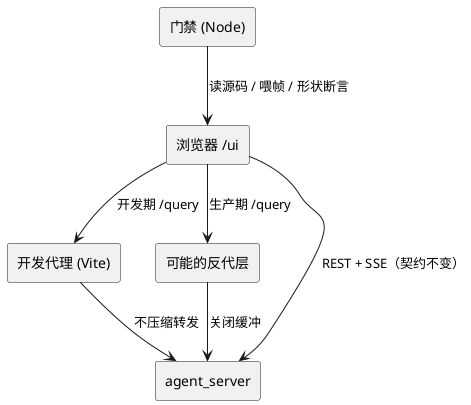

# web/ 前端内部重构 — Design（怎么改 / 对账方案）

> **状态：Proposed（待拍板）。本件是对用户 5-PR 清单的逐项对账结果，不是开工授权。**
> 用户清单里的"PR 1–5"在本件称 **R1–R5**：仓库历史里 PR-0/PR-1/PR-2/PR-4 已被占用（SSE 客户端、对话页、登录面、灯阵页），继续叫 PR 1–5 会让文档指向两个不同的东西。
> **落位说明**：SDD 技能默认路径 `.opencode/specs/` 被本仓 `.gitignore:61`（`.*/`）忽略 ⇒ 放在那里的方案件不入库，违反 AGENTS.md《观测面与现网取证的硬规矩》第 11/13 条"批准依据必须入库"。因此三件方案落在版本控制内的 `docs/plans/web-refactor/`。

---

## 0. 证据基准（2026-11-23 只读核对，全部现取）

| # | 事实 | 位置 |
|---|---|---|
| E1 | 主题存储 key 是 `ap.ui.theme`，不是清单写的 `ap.theme`；`system` = 移除 `data-theme` | `web/src/theme.ts:15,34-44,50` |
| E2 | `index.html` 明确把"不写内联脚本"列为已定案决策，代价是"首帧可能闪一次主题" | `web/index.html:4-8`；`web/src/main.ts:7-10` |
| E3 | 代理目标用 `loadEnv` 而非 `process.env`（仓库故意不装 `@types/node`，后者会 TS2591）；`changeOrigin: false` | `web/vite.config.ts:12-14,26,30,42` |
| E4 | `deploy/` 没有反代配置；`deploy/k8s` 被 gitignore；方案件记载"全仓零 Ingress、NodePort 直通，无 HTTP 反代层" | `.gitignore:145`；`docs/plans/plan-web-frontend-minimal-core-2026-10-29.md:344`；`plan-roles-kb-datasource-console-2026-11-11.md:332` |
| E5 | `verify:sse` 锁客户端与会话层**行为**，不锁代理配置；`vite.config.ts` 把 SSE 缓冲标为未验证风险 | `web/scripts/verify-sse.mjs:25,86,350`；`web/vite.config.ts:19-23` |
| E6 | `/ui/<不存在路径>` 必须 404 是**专门防 SPA fallback 假绿**的判据 | `web/README.md:188`；`applications/agent_server/main.py:809`（`StaticFiles(html=True)`，无 fallback） |
| E7 | 无 `ChatView.vue`；视图切换在 App.vue 的 `activeView/effectiveView` + `ap.ui.view` | `web/src/App.vue:77-117,255-570` |
| E8 | `applyFrame`/`EVENT_HANDLERS` 在 `api/sse.ts`；两个门禁分别 import 它 / 按坐标读它 | `web/src/api/sse.ts:268,364`；`web/scripts/verify-sse.mjs:86,95`；`web/scripts/check-events.mjs:71,154` |
| E9 | 清单的 banner 上限 8 条**正确** | `web/src/stores/session.ts:71-72,117-125` |
| E10 | 根 README 仍写"零构建静态宿主页"，PR5 那条**正确** | `README.md:508` |
| E11 | `utils/markdown.ts` 只支持段落/列表/代码块 + 行内加粗与行内码；表格、多级列表明确"不支持，按段落原样显示" | `web/src/utils/markdown.ts:9-15,62-119` |
| E12 | 真正的弹层只有 `ImageStrip.vue` 的 lightbox（`role="dialog"`，但无 Escape/焦点锁/`aria-modal`）；"可核抽屉"是非模态 `
` | `web/src/components/ImageStrip.vue:45-62`；`web/src/App.vue:537-556` |
| E13 | 当前无 `@layer`；`base.css` 的 `.is-active` 必须排在所有组件布局类之后（同特异度靠顺序赢） | `web/src/styles/base.css:963-966`；`web/src/App.vue:2-6` |
| E14 | `check-tokens` 断言 5 用**精确缩进锚点**匹配 dark 副本 A/B | `web/scripts/check-tokens.mjs:121-124` |
| E15 | `check-ui-consistency` 用正则从 `base.css` 抓"含两条声明的规则块"，并带合成反证 | `web/scripts/check-ui-consistency.mjs:24-59` |
| E16 | 令牌 key 是 `ap.auth.token`（清单正确）；Node v24.12.0 / pnpm 10.33.0 可用 | `web/src/api/auth.ts:37`；`node -v` / `pnpm -v` 现取 |

---

## 1. 实现模型

### 1.1 上下文视图

### 1.2 服务/组件总体架构（现状 → 目标）

| 层 | 现状 | 目标 | 不变的部分 |
|---|---|---|---|
| 首帧主题 | `main.ts` 在 `createApp` 前写属性 | 文档解析阶段同步写属性 + 应用侧复核 | 三档语义、存储 key、属性名 |
| 样式层叠 | 靠 import 顺序 + 注释纪律 | 显式 `@layer` 声明先后 | 三层令牌值、L0/L1/L2 结构 |
| 代理/部署 | 开发代理 6 前缀，生产无反代 | 开发代理加固；生产前置条件文档化 | API/SSE 形状 |
| 状态 | 三个模块级 composable + App.vue 中转 | Pinia stores + 纯归约内核 | 存储档位、capabilities 来源、8 条上限 |
| 视图 | 单组件内 `activeView/effectiveView` | 路由表 + 守卫 + `<RouterView>` | 5 视图、能力码语义、404 判据 |
| 组件边界 | 弹层无键盘退出；文档与注释过时 | 补断言与文档 | Markdown 支持子集（本轮不扩） |

### 1.3 清单逐项对账（核心交付物）

**图例**：✅ 清单正确可直接执行 ｜ ⚠️ 需修正写法 ｜ ❌ 与现状/门禁冲突，需拍板 ｜ ➕ 清单未覆盖但必须同批做

| 清单项 | 判定 | 对账结论与处置 |
|---|---|---|
| R1 主题 key `ap.theme` | ⚠️ | 实际 `ap.ui.theme`（E1）。内联脚本必须读同一 key。 |
| R1 属性名 `data-theme` | ✅ | `dataset.theme` 等价；但脚本必须处理三档：saved=`light` 时也要写覆盖值，否则深色系统首帧仍闪白。 |
| R1 "跟随系统" | ⚠️ | 脚本里 `!saved && preferDark` 只覆盖"无偏好"；saved=`system` 时 theme.ts 会移除属性，脚本不得写死 dark。 |
| R1 内联脚本 | ❌ | 翻转 E2 的已批准决策。需在 D-2 明确拍板；不可当成低风险改动默默做。 |
| R1 `@layer tokens, base, events;` | ⚠️ | 方向对，但只解决**跨层**顺序；base 内部 `.is-active` 与组件布局类同层同权重的问题仍在（E13）。见 §2.4。 |
| R1 包裹 tokens.css | ⚠️ | 若整体缩进，`check-tokens` 断言 5 的锚点（E14）会失配 ⇒ 门禁红。方案：**加 `@layer` 外层但不重排内部缩进**，或同批迁移锚点并加自证。 |
| R1 包裹 base.css | ➕ | `check-ui-consistency` 正则仍能抓到 `.is-active` 块（E15），但必须同批复跑并确认合成反证仍咬。 |
| R2 `process.env.VITE_DEV_BACKEND` | ⚠️ | 会 TS2591（E3）。必须用 `loadEnv(mode, '.', 'VITE_').VITE_DEV_BACKEND`。 |
| R2 `changeOrigin: true` | ⚠️ | 现状 `false`（E3）。改动会影响 `/auth` 的 Host/来源语义，无明确收益 ⇒ **保持 false**。 |
| R2 `proxyReq/proxyRes` 钩子 | ✅ | 可用；需确认 `Accept-Encoding: identity` 与防缓冲头只作用于 `/query`，不动其余 5 个前缀。 |
| R2 检查 `deploy/` Nginx | ❌ | 没有可检查对象（E4）。处置见 D-3：写"部署前置条件"而不是改一个不存在的文件。 |
| R2 `verify:sse` 验证流式 | ❌ | 它不测代理（E5）。处置：把代理形状断言并入 `check-events.mjs`，带合成反证；不新建门禁文件（AGENTS 第 11 条）。 |
| R3 安装 Pinia + 注册 | ✅ | 可行；锁文件必须随 `pnpm add` 机器生成并入库。 |
| R3 抽 `sseReducer.ts` | ⚠️ | 需同时迁移 `verify-sse.mjs` 的 import 与 `check-events.mjs` 的坐标（E8），并改为无兼容 shim 的原子替换。 |
| R3 三个 store 改写 | ⚠️ | `kbHistory.ts` 当前是**纯函数缓存层**（无响应式状态），包成 store 无收益 ⇒ 保留纯函数内核，只在需要响应式的消费点接 store。见 §2.4。 |
| R3 删 App.vue 中转 id | ✅ | 现状确有 `ask(undefined, sid)` 胶水；`conversations.ts` 已 import `session.ts`（E8 之外的事实），Pinia 后可直接调用。 |
| R3 Node 下 `verify:sse` | ➕ | Pinia store 需要 active pinia ⇒ Node 门禁须 `setActivePinia(createPinia())`；否则 §H 会话层用例全崩。 |
| R4 定义路由表 | ✅ | 形状可用；但 `ChatView` 不存在（E7）⇒ 需从 App.vue 拆出对话视图壳。 |
| R4 SPA History Fallback | ❌ | 与 E6 的 404 判据直接冲突。清单自己给了 hash 退路 ⇒ **D-1 推荐 hash**，history 模式需单独拍板改后端 + 改门禁。 |
| R4 `hasFeature` 守卫 | ✅ | 单一问法已在 `session.ts:215`，守卫复用即可，不得新写第二份判定。 |
| R4 移除 `ap.ui.view` | ✅ | 现确为该 key（E7）；路由接管后删除其读写，避免双权威源。 |
| R4 `check:ui-consistency` | ➕ | 菜单 active 类必须复用 `.is-active`，不得生成第二个"选中态"实现，否则门禁红。 |
| R5 markdown 新增测试 | ❌ | `markdown.ts` 不支持表格/多级列表（E11）。"补测试"若指测这些语法，须先写功能（超范围）。D-5 推荐改为测"不支持语法按纯文本不丢字 + 代码块 + XSS 边界"。 |
| R5 弹窗/抽屉无障碍 | ⚠️ | 只有 ImageStrip lightbox 是真弹层（E12）；抽屉是非模态 `
`，不应套 focus trap。D-5b 限定范围。 |
| R5 根 README 更新 | ✅ | E10 确认该行过时，直接改。 |
| R5 清理 App.vue 注释 | ✅ | `App.vue:10` 那句"没有会话历史列表"确已过时（列表已实现于 367-457 行）。 |
| 全量门禁命令 | ✅ | 与 `web/package.json` 的 scripts 一致，Node/pnpm 版本满足（E16）。 |
| PR 编号 | ⚠️ | 与仓库历史 PR-0…PR-4 撞名 ⇒ 本方案统一改称 R1–R5。 |

### 1.4 不变量（任何 R 都不得破坏）

1. API/SSE/错误信封/状态码形状零变更。
2. `/ui/<未知路径>` 返回 404；无 SPA fallback（除非 D-1 另拍）。
3. 令牌只在关标签即失效的档位；写入点唯一。
4. 事件全集派生链（后端 Literal ↔ TS 联合 ↔ handler 键集 ↔ 图例）保持双向。
5. 令牌登记/引用双向、dark 双写同值、`.is-active` 单一实现等门禁判据强度不变。
6. 新增判据必须自带"合成违规能咬"与"真面参与判决"。

---

## 2. 接口设计

### 2.1 总体设计

**对外契约零改动**：`/query` 的 SSE 事件帧、`/auth/*` 的令牌与 role/features 回读、`/sessions`/`/history`、`/kb/*`、`/datasources`、`/health` 全部维持现状。本重构只改前端内部实现线与门禁读取坐标。

**门禁分工保持不变**：
- `check:tokens` = 令牌与视觉结构（脆断言）；
- `check:events` = 事件契约结构 + 存储纪律；
- `check:ui-consistency` = 选中态单一实现；
- `verify:sse` = SSE 与会话层**行为**；
- `verify:markdown` = Markdown 解析**行为**。

两类门禁互替不了：结构门看不见行为漂移，行为门看不见死分支。

### 2.2 接口 / 门禁清单与迁移点

| 门禁 | 现状读什么 | 本方案需要的迁移 | 必须同批自证 |
|---|---|---|---|
| `check:tokens` | 全 `.css/.ts/.vue/.html` 扫色值；`tokens.css` dark 锚点 | `@layer` 后锚点若漂移就改锚点不改判据；仍扫全量 | 探针：注一条色值字面量必须判红 |
| `check:events` | `src/api/sse.ts` 的 `EVENT_HANDLERS`（坐标正则）；存储白名单 `['auth.ts','theme.ts']` | R3 迁到 reducer 文件时同步改 `TS_SSE` 坐标；R2 并入代理形状齿（引用 `vite.config.ts`） | 合成违规：删一个 handler key / 改坏代理头，期望红 |
| `check:ui-consistency` | `base.css` 中同时含蓝边 + raised 底的规则块 | `@layer` 包裹后复跑，确认仍抓到唯一 `.is-active` | 既有 `.rogue.is-active` 合成样本必须仍咬 |
| `verify:sse` | import `src/api/sse.ts` / `src/stores/session.ts` | R3 改 import 到 reducer；Pinia 后加 `setActivePinia(createPinia())` | 正对照 + canary 泄漏判 + 失败必须 rc=1 |
| `verify:markdown` | import `src/utils/markdown.ts`，11 条断言 | R5 扩"不支持语法按纯文本不丢字"等边界 | 新断言对变异（吞字/渲染 HTML）必须能红 |
| `make ci-web` | 汇总上述门 | 不改脚本集合；若新增判据只扩既有脚本 | 步数写在 Makefile，不在散文里抄 |

### 2.3 决策登记（**已全部拍板：2026-11-23 用户「按推荐全部拍板」**）

| ID | 决策 | 决议 | 决议理由与随动义务 | 影响面 |
|---|---|---|---|---|
| **D-1** | 路由模式与 404 判据 | **(a) hash 模式** `/ui/#/chat/<sid>`，保留 404 判据 | 清单本身允许 hash 退路；history + SPA fallback 属 D2，要做须另立 ADR | R4 全部；后端挂载判据不变 |
| **D-2** | 是否翻转 `index.html`"无内联脚本"决策 | **(a) 接受翻转** | 用户清单明确要求消除闪白；随动义务 = 在 `web/README.md` 与视觉件登记翻转理由 | R1；已批准视觉决策被显式推翻 |
| **D-3** | 生产反代加固的载体 | **(a) 只写部署前置条件** | 当前没有反代层（E4），改一个不存在的文件是假动作；真接 ingress 时 no-buffering 列开工前置 | R2；部署文档 |
| **D-4** | 纯归约内核与兼容层 | **(a) 原子迁移、无兼容 shim** | 与"无内部兼容包袱"一致；两个门禁同批改坐标 | R3；两个门禁 |
| **D-5** | Markdown 测试边界 | **(a) 测"不支持语法按纯文本不丢字"** | (b) 是新功能，需另立 Spec，本轮不做 | R5；`verify:markdown` |
| **D-5b** | 无障碍检查范围 | **(a) 仅 ImageStrip lightbox** | 非模态面板套焦点锁会破坏正常 Tab 浏览 | R5 |

> 六项决策均已拍板，R1–R5 的开工前置已解除（仍按 tasks.md 的 R 间依赖顺序推进）。

### 2.4 各 R 的实现要点（how）

**R1 — 首帧主题 + `@layer`**
1. 在 `index.html` `<head>` 加同步 IIFE：key 用 `ap.ui.theme`；三档分别处理——`dark` 写 `data-theme="dark"`，`light` 写 `data-theme="light"`，`system`/无值**不写**（交给媒体查询）。读存储需 try/catch，失败按 system。
2. `main.ts` 保留 `initTheme()` 在 `createApp()` 之前，作为应用侧复核；头注从"已知闪帧"改为"首帧已同步定档，应用侧复核"。
3. `@layer` 声明放在 `tokens.css` 顶部：`@layer tokens, base, events;`。三个文件各自包裹，**不重排内部缩进**（保护断言 5 锚点 E14）。
4. `@layer` 只解决跨层覆盖；base 内部 `.is-active` 的顺序纪律仍保留注释与门禁，不宣称已解除。
5. 同批复跑 `check:tokens` / `check:ui-consistency`；若锚点漂移，改锚点后必须加合成违规自证。

**R2 — SSE 代理与防缓冲**
1. `vite.config.ts` 保持 `loadEnv` 与 `changeOrigin: false`；把 `/query` 从 `proxied` 数组拆出，单独配 `configure` 钩子。
2. `proxyReq` 设 `Accept-Encoding: identity`；`proxyRes` 仅当 content-type 含 `text/event-stream` 时写 `cache-control: no-cache` 与 `x-accel-buffering: no`。其余 5 个前缀不动。
3. 在 `check-events.mjs` 新增一枚代理形状齿：真面读 `vite.config.ts` + 固定合成违规样本（缺头/压缩未关）期望判红；遵循 AGENTS 第 8 条。
4. `web/README.md` 增"生产前置条件"段：若引入 HTTP 反代，SSE 路径须 `proxy_buffering off` + gzip off；当前部署链无反代（E4），故无配置文件可改。
5. `verify:sse` 不假装验证代理；本地联调逐帧输出作为人工验收项记录在工单。

**R3 — Pinia 迁移**
1. `pnpm add pinia --save-exact`；`main.ts` 注册 `createPinia()`，顺序在挂载前。
2. 新建 `web/src/stores/sseReducer.ts`：把 `EVENT_HANDLERS`、`applyFrame`、`initialState`、`StreamSnapshot`/`TimelineEntry` 等纯类型与 `pushBanner`（8 上限、去重、溢出计数）收敛于此；`api/sse.ts` 只保留网络层并 import reducer。无 re-export 兼容层（D-4）。
3. `session.ts` / `conversations.ts` 改写为 `defineStore`；`kbHistory.ts` 保留纯函数缓存，仅在消费点接 store。
4. `conversations` store 直接 `useSessionStore()` 取当前会话与 `resetRound`；删除 App.vue 的 `ask(undefined, sid)` 胶水。
5. 契约保持：`ap.auth.token` 仍在 auth.ts 唯一装配位；能力集不落存储；登录态切换清 banner 但不清时间线。
6. `verify-sse.mjs` 同步改 import 路径，并在驱动会话层前 `setActivePinia(createPinia())`；`check-events.mjs` 改 `TS_SSE` 坐标与 `EVENT_HANDLERS` 正则来源。
7. 门禁：`typecheck` / `lint` / `verify:sse` / `verify:markdown`（后者确认未受影响）。

**R4 — Vue Router**
1. `pnpm add vue-router --save-exact`；新增 `web/src/router/index.ts`，`createWebHashHistory('/ui/')`（D-1 推荐）。
2. 路由表：`/ → /chat`、`/chat/:sessionId?`、`/role`(feature: role)、`/kb`(kb.upload)、`/datasource`(datasource.manage)、`/health`；守卫复用 `hasFeature`。
3. 能力码未到位时不得永久重定向；`/health` 对所有已登录用户开放。
4. 从 App.vue 拆出 `ChatView.vue`（对话三栏 + 提交区 + 过程抽屉），App.vue 退为框架 + `<RouterView>`；删除 `ap.ui.view` 读写。
5. 菜单选中态复用 `.is-active`；`sessionId` 变化时驱动 conversations store 选中会话；未知会话 id 回落到默认选择且不白屏。
6. 保留 `/ui/*` 404 判据；同批验证前进/后退、深链刷新、无权限回落。

**R5 — 组件边界与文档**
1. `verify:markdown` 增：不支持语法（表格、多级缩进列表）按纯文本逐行输出且不丢字；代码块边界；XSS 串当文本；保持"加载失败 rc=1"。
2. `ImageStrip.vue` lightbox：`aria-modal="true"` + `aria-label`、Escape 关闭、打开时锁焦点、关闭时把焦点还给缩略图按钮；非模态 `
` 不套 focus trap（D-5b）。无 DOM 测试库 ⇒ 行为验证沿用既有 CDP harness（gitignored，一次性），结构断言并入既有门禁。
3. `README.md:508` 改为 Vue 3 + Vite + TypeScript 单页应用表述；清理 `App.vue:10` 过时注释。
4. 全量门禁一次跑齐。

---

## 4. 数据模型

### 4.1 设计目标

- 每类状态一个权威源；纯逻辑与响应式壳分离，保证 Node 门禁可直接驱动归约内核。
- 存储档位与写入点数量不因重构变化。

### 4.2 模型实现（目标态）

| 状态 | 现状归属 | 目标归属 | 写入约束 | 存储 |
|---|---|---|---|---|
| 主题档位 | `theme.ts` 模块级 ref | 保持（非 Pinia，首帧无关响应式） | `setTheme` 单一写者 | localStorage `ap.ui.theme` |
| 登录令牌 + role/features | `session.ts` 模块级 ref | `useSessionStore` | 只经 auth.ts 装配；features 不落存储 | sessionStorage `ap.auth.token` |
| SSE 快照 | `session.ts` 的 `snap` | `useSessionStore` 持有；归约在 `sseReducer.ts` | 只由 `ask` 与 reducer 更新 | 无 |
| Banner / foldedCount | `session.ts` | `useSessionStore`；push 逻辑纯函数化 | 上限 8、去重、溢出计数；登录态切换清空 | 无 |
| 会话目录 / 当前 id / 历史 | `conversations.ts` | `useConversationsStore` | 服务端权威；切换时调 session store | 无 |
| 上传历史缓存 | `kbHistory.ts` 纯函数 | 保持纯函数；消费点接 store | 只存元数据；不存正文 | localStorage `ap.kb.uploads`（经白名单写者） |
| 当前视图 / 会话标识 | App.vue ref + `ap.ui.view` | 路由（URL）+ conversations store | 不再写 `ap.ui.view` | URL 表达 |
| 图片预览 | `ImageStrip.vue` ref | 保持局部 | 仅本组件读写 | 无 |

**纯归约内核契约**：`(snapshot, eventName, data) → newSnapshot`，不碰网络/DOM/全局状态；`pushBanner(banners, text, folded) → {banners, folded}` 同样为纯函数。Node 门禁直接喂帧，不需要 Pinia；只有驱动 `useSessionStore` 的用例才建 pinia 实例。

---

## 5. 风险与回滚

| 风险 | 触发 | 缓解 / 回滚 |
|---|---|---|
| 主题首帧脚本与 `theme.ts` 双源漂移 | R1 只改了一处 | 同批断言两处 key 与属性名同源；不一致即红 |
| `@layer` 改层叠优先级导致视觉回归 | R1 | 同批 V4 实拍复取；仅接受"跨层更稳"，base 内部纪律不撤；必要时逐 PR 回滚 |
| 门禁锚点因包裹 `@layer` 失配 | R1/R4 | 改锚点而非改判据；加合成违规自证；按 R 单批回滚 |
| Pinia 化破坏 Node 门禁 | R3 | `setActivePinia` 前置；两个门禁同批迁移；`verify:sse` 失败即停 |
| 路由深链与 404 判据冲突 | R4 | 采用 hash（D-1）；history 需单独 ADR，不在 R4 顺手做 |
| Markdown "补测试"变成扩功能 | R5 | 采用 D-5(a)；表格/多级列表只测"不丢字" |
| PR 体量超 400 行 | 任一 R | 按 R 拆短命分支；R3/R4 若超量，再按"纯内核 / 接线"二次拆，但门禁迁移必须与对应代码同批 |

**分支纪律**：从集成分支切出 → PR < 400 行 → 当日合并并删死枝 → 合 `main` 须用户显式批示；远端先 `git remote -v` 取实际名（本仓无 `origin`）。

---

## 6. 验收口径（"完成"怎么写才可核对）

每个 R 结束时，按 `docs/operations/evidence-format.md` 的五字段给出：改动件名、当时 HEAD sha、逐条门禁命令与 rc、人工验证项（若有）、未达项与理由。

- **完成强度分档**：代码已交 ≠ 门禁已跑 ≠ 验收已过；本方案全程停在"待拍板/未开工"，不写任何"已过"读数。
- **判据新鲜度**：门禁读数只认当次输出（含 HEAD 与件名），禁止把历史读数搬进本批账面（AGENTS 第 9 条）。
- **反证**：新增或迁移的判据必须当场自证能咬（合成违规期望非零 + 真面参与判决），否则按"门禁瞎"处理，不按"本轮没问题"处理。

---

## 7. T0 基线读数（2026-11-23，开工前基准）

> 判据新鲜度：以下读数绑定 **HEAD `4c074f3716e93ecb5c2b60bb10f00ed3d9edac9d`**、工作目录 `web/`、Node v24.12.0 / pnpm 10.33.0。换 rev 或换面须复取，不得把本表当常量引用。

| 门禁 | rc | 关键读数 |
|---|---|---|
| `pnpm typecheck` | 0 | 无输出（vue-tsc --noEmit） |
| `pnpm lint` | 0 | 无输出（eslint .） |
| `pnpm check:tokens` | 0 | 定义 123 / 引用 123；事件 13 类、字段 30 个 |
| `pnpm check:events` | 0 | 消费 14 端点 / 提供 39 / 缺 0；存储白名单 auth.ts, theme.ts |
| `pnpm check:ui-consistency` | 0 | 选中态单一实现 `.is-active`，合成反证已咬 |
| `pnpm verify:sse` | 0 | 153 条断言（不含自测），失败 0；自测注入的 false 被记为失败（已撤销） |
| `pnpm verify:markdown` | 0 | 11 条断言全通过（A5 / B2 / C3） |
| `uv run --no-sync python scripts/check_doc_sync.py` | 0 | 0 警告 |

**未做的验证（照实登记）**：R1 的视觉判据（V4 双主题 × 三断点实拍）、R2 的本地 dev 逐帧联调、R4 的前进/后退/深链人工验证，均未在基线阶段执行；它们分别属于对应 R 的验收项，不在本表"已过"之列。
