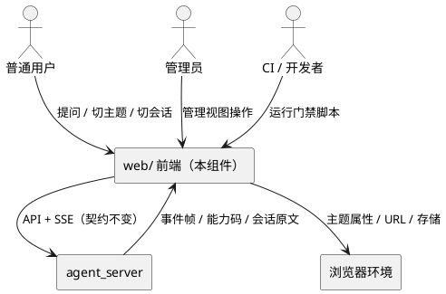
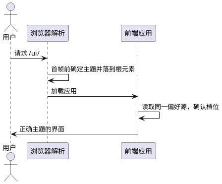
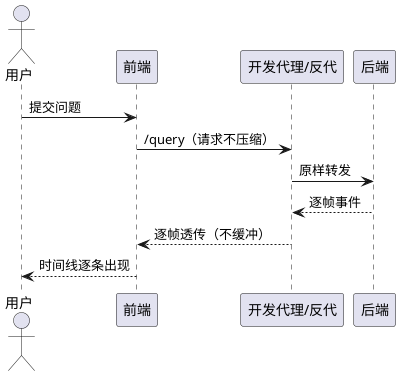
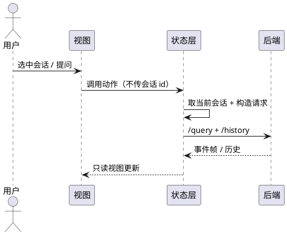
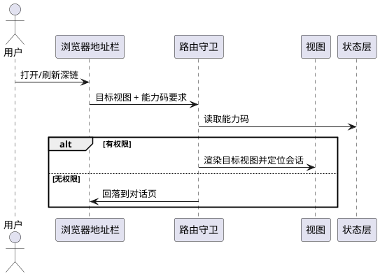
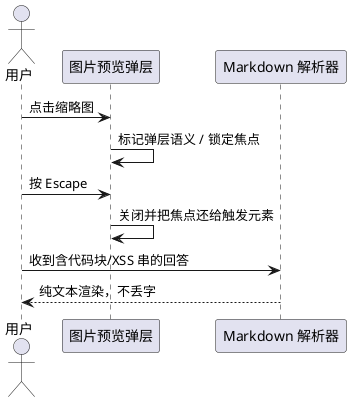

# web/ 前端内部重构 — Spec（做什么 / 为什么 / 验收）

> **状态：Proposed（待拍板）。本件不授权开工，也未改动任何代码。**
> 本件只定义用户可见行为、业务规则与验收条件；"怎么改"见同目录 `design.md`，"按什么顺序改"见 `tasks.md`。
> 用户清单中的 5 个 PR 在本方案中称 **R1–R5**（避开仓库历史 PR-0…PR-4 的命名），映射见 `design.md` §1.3。
> 证据基准：2026-11-23 对当前工作树的只读核对，逐条 file:line 见 `design.md` §0。

---

## 1. 组件定位

### 1.1 核心职责

本组件负责在**不改变前后端协议契约与质量门禁**的前提下，把 `/ui` 前端的内部实现（主题首帧、状态归属、视图导航、组件边界）替换掉，实现用户视角一致的稳定体验。

### 1.2 核心输入

1. **用户的浏览器操作**：刷新、切换主题、切换视图、点击会话、前进/后退、打开图片预览。
2. **后端已约定的响应**：`/query` 的 SSE 事件流、`/auth/*` 凭据端点、`/sessions` 会话端点、`/kb/*`、`/datasources`、`/health`；形状与当前完全一致。
3. **系统环境**：`prefers-color-scheme`、浏览器 sessionStorage/localStorage、当前登录角色与能力码（服务端断言回读）。
4. **既有质量门禁**：`check:tokens` / `check:events` / `check:ui-consistency` / `verify:sse` / `verify:markdown` 的判据。

### 1.3 核心输出

1. 首屏即正确的深色/浅色主题，不再出现可观察的浅色闪帧。
2. 流式问答在开发环境与任何被引入的反代层下都逐帧到达，不出现"一次性吐出"。
3. 会话、登录态、知识库上传历史各自只有一个权威状态源，跨视图不丢、不重复、不串人。
4. 五个核心视图可从 URL 直达、可刷新恢复、可用浏览器前进/后退导航；无权限视图回落到对话页。
5. 仓库文档对 `web/` 的描述与实物一致；Markdown 与安全边界有可复跑的断言。

### 1.4 职责边界（明确不做）

1. **不改任何后端端点、SSE 事件形状、状态码、错误信封**。
2. **不删除、不放宽、不绕过任何既有门禁**；门禁判据因内部结构变化而必须迁移时，同一批内完成迁移并自证能咬。
3. 不引入 SSR、不引入 Node 运行时依赖、不改变静态产物托管方式。
4. 不把"接线"当"启用"：配置文件存在不等于该部署层已启用。
5. 不在本轮实现 Markdown 的新语法特性（表格、多级列表）——见 §6 与 `design.md` D-5。
6. 不在本轮改后端 `/ui/*` 的静态托管语义（404 判据保留）——见 `design.md` D-1。

---

## 2. 领域术语

**主题档位**
: 三档 `system / light / dark`；`system` 的语义是"不写覆盖属性，交给系统媒体查询"，不是写一个名为 auto 的值。

**首帧闪白（FOUC）**
: 深色系统或已选 dark 的用户，在页面第一帧先看到浅色底、随后才切到深色的现象；本组件的验收只看用户可观察结果，不看"代码里调过了"。

**权威状态源**
: 某一类状态的唯一可写与可读来源；其他位置只能是只读视图或纯展示副本。

**能力码（feature）**
: 服务端 `/auth/me` 断言回读的字符串码；前端只用它做**渲染映射**，不自行判定权限。

**会话深链**
: URL 中带 `sessionId`，使用户能把某个会话作为链接保存、刷新后直达、并用浏览器前进/后退在会话间导航。

**纯函数归约内核**
: 对"一份快照 + 一帧事件"算出"新快照"的不碰网络、不碰 DOM、不碰全局状态的逻辑；它必须能被 Node 门禁直接喂帧断言。

**Banner 折叠**
: 一轮提问内的多条诊断提示超过上限时丢弃最旧一条，并显式计数告知用户，禁止静默丢弃。

---

## 3. 角色与边界

### 3.1 核心角色

- **普通用户（viewer）**：提问、看答案与依据、切主题、用会话；不需要也不应看到管理视图入口。
- **管理员（admin）**：除上述外，可进角色/知识库/数据源等管理视图，并可展开过程面板。
- **前端开发者 / CI**：运行门禁、改内部结构，必须在不破坏协议与门禁语义的前提下工作。

### 3.2 外部系统

- **agent_server**：提供 `/auth/*`、`/sessions`、`/history`、`/query`、`/kb/*`、`/datasources`、`/health`，并托管 `/ui/` 静态产物。
- **浏览器环境**：提供存储、媒体查询、History API 与调试面板。
- **CI / 质量门禁**：只用文本与行为断言判断通过与否；门禁本身也是被验收对象（必须能咬）。

### 3.3 交互上下文

---

## 4. DFX 约束（可量化、可验证）

### 4.1 性能

- 首帧主题判定必须在**文档解析阶段同步完成**，不得等待任何网络请求或应用挂载。
- `/query` 流在启用反代的任何层上必须关闭缓冲；验收判据是时间线逐条出现，而不是"最终收到了全部内容"。

### 4.2 可靠性

- 刷新任一受支持视图后，页面必须落到该视图（或明确回落到对话页），不得白屏。
- 浏览器前进/后退必须还原对应视图/会话；不得出现"URL 变了但界面没变"。
- 门禁加载被测源失败必须 rc≠0，禁止吞成跳过。

### 4.3 安全性

- 登录令牌生命周期保持"关标签即失效"；不得因重构迁移到更长效的存储档位。
- Markdown 输出始终以文本节点渲染；不引入 `v-html`。XSS 串必须原样显示为文本。
- 图片预览的 URL 必须经过白名单与伪协议二次校验，预览层不得成为新的注入面。

### 4.4 可维护性

- 任一状态必须能回答"谁写、谁读、谁清空"；禁止同一语义出现两个可写源。
- 每批改动必须同时带上使其可复跑的门禁命令；新增判据必须自证能咬（合成违规期望判红）。

### 4.5 兼容性

- 前后端 API/SSE 契约零变更。
- `/ui/<不存在的路径>` 必须仍返回 404（保留既有反假绿判据）。
- 既有 `check:*` / `verify:*` 判据不改判据强度；只做等价迁移。

---

## 5. 核心能力

### 5.1 无闪白首屏与稳定样式层叠

#### 5.1.1 业务规则

1. **主题偏好必须与首帧同步**：When 页面开始解析，系统 shall 在首帧前把用户偏好（或系统偏好）反映到文档根元素，用户不得看到与目标主题不符的第一帧。
   - 验收条件：深色系统 + 无偏好 → 首帧为深色；深色系统 + 明确选择浅色 → 首帧为浅色。
2. **三档语义不得合并**：While 档位为"跟随系统"，系统 shall 通过不写覆盖值让系统媒体查询生效；禁止写入名为 auto 的覆盖值。
3. **层叠不得依赖脆弱顺序**：相关样式分层必须显式声明先后，使不同层之间的覆盖不再由 import 顺序决定。
   - 验收条件：交换同一层之外的样式文件顺序后，视觉判据结果不变。
4. **禁止项**：禁止通过删除令牌、降低门禁断言或放宽色值限制来换取通过。

#### 5.1.2 交互流程

#### 5.1.3 异常场景

1. **存储被禁用**
   - 触发条件：隐私模式或禁用站点数据。
   - 系统行为：按"跟随系统"处理，不抛错。
   - 用户感知：仍得到正确的系统主题。

### 5.2 流式接口不缓冲

#### 5.2.1 业务规则

1. **开发代理不得压缩 SSE**：When 开发代理转发 `/query`，系统 shall 以不压缩方式请求上游并对 `text/event-stream` 透传防缓冲头。
2. **生产反代若存在必须关闭缓冲**：Where 部署链存在 HTTP 反向代理，系统 shall 对该路径关闭响应缓冲与 gzip。
   - 验收条件：屏上时间线逐条出现；仅"最终收全"不算通过。
3. **禁止项**：禁止把这条风险只写在注释里而不留下可复跑判据。

#### 5.2.2 交互流程

#### 5.2.3 异常场景

1. **上游仍对 SSE 启用 gzip**
   - 触发条件：代理层未生效或上游配置覆盖。
   - 系统行为：判据读代理配置形状并报失败口，而不是靠人眼看"好像卡了"。
   - 用户感知：门禁红，问题在合并前被发现。

### 5.3 单一状态源与会话连贯

#### 5.3.1 业务规则

1. **每类状态只有一个权威源**：会话目录、登录态、上传历史各自 shall 只有一个可写源；组件只持局部 UI 态。
2. **会话切换不得需要组件转交 id**：When 状态层改造完成，会话目录 shall 能直接取得当前会话 id 并驱动提问，不经视图组件中转。
3. **跨轮错误横幅上限固定**：While 同一轮内出现多条诊断，系统 shall 最多保留 8 条，超出丢弃最旧并计数展示；禁止静默丢弃。
4. **登录态切换必须清空上一个人的可见痕迹**：When 登出或掉态，系统 shall 清空会话态与错误横幅；只清横幅不清时间线属错误实现（时间线是已发生的读数）。
5. **令牌持久档位不得变**：凭据 shall 只在关标签即失效的档位保存。

#### 5.3.2 交互流程

#### 5.3.3 异常场景

1. **会话被删或越权**
   - 触发条件：刷新后当前 id 已不在列表。
   - 系统行为：清空该选中态并回填最近活跃会话。
   - 用户感知：不会停留在空白会话。

### 5.4 可深链的视图导航

#### 5.4.1 业务规则

1. **五视图可由 URL 表达**：对话、角色、知识库、数据源、健康 shall 各有稳定路径；对话路径可带会话 id。
2. **刷新直达**：When 用户刷新深链，系统 shall 落到该链接表达的视图与会话，不回落到默认页（无权限者除外）。
3. **无权限回落**：If 目标视图需要能力码而当前会话没有，系统 shall 回落到对话页。
4. **历史导航可用**：When 用户按前进/后退，系统 shall 还原对应视图与会话。
5. **禁止项**：禁止为启用历史模式而放宽"`/ui/*` 未知路径返回 404"的既有判据，除非该项被单独拍板变更。

#### 5.4.2 交互流程

#### 5.4.3 异常场景

1. **能力码尚未回读完成**
   - 触发条件：刷新瞬间 `/auth/me` 未返回。
   - 系统行为：不把无权限视图判成永久无权；待能力码到位后重算。
   - 用户感知：不会闪一下"无权"再跳回，也不会停在白屏。

### 5.5 组件边界与文档一致

#### 5.5.1 业务规则

1. **Markdown 边界可断言**：系统 shall 对代码块、行内码、未闭合标记、XSS 串有可复跑的行为断言。
2. **不支持的语法必须不丢字**：When 输入包含表格或多级缩进列表，系统 shall 按纯文本原样显示，不得吞字或渲染成 HTML。
3. **弹层可键盘退出**：When 图片预览弹层打开，用户 shall 能用 Escape 关闭；焦点不得落到弹层背后的控件。
4. **文档描述与实物一致**：根文档的目录说明 shall 与前端工程现状一致；清理已过时的代码注释。

#### 5.5.2 交互流程

#### 5.5.3 异常场景

1. **XSS 载荷进入回答**
   - 触发条件：模型输出含 ``。
   - 系统行为：解析为文本 token，模板用插值渲染。
   - 用户感知：看到原始字符串，不执行脚本。

---

## 6. 数据约束（逻辑层）

### 6.1 主题偏好

- **档位取值**：仅 `system` / `light` / `dark` 三值；其余一律按 `system` 处理。
- **语义约束**：`system` 表示"不写覆盖值"；写入名为 auto 的覆盖值属于违约。
- **持久化**：允许长效保存；读不到时按 `system` 处理，禁止抛错阻断首屏。

### 6.2 登录令牌

- **生命周期**：关标签即失效；禁止迁移到长效档位。
- **写入点唯一**：只能有一个装配位写令牌与凭据头。
- **回读纪律**：角色与能力码必须由服务端回读，禁止从本地令牌自行推导。

### 6.3 当前视图 / 会话标识

- **视图取值**：`chat` / `role` / `kb` / `datasource` / `health` 五值之一，非法值回落到 `chat`。
- **会话标识**：由服务端签发；前端只持有与传递，不自造。
- **URL 与状态一致**：URL 是视图与会话的对外表达；内部旧视图键在路由接管后不得继续作为独立权威源。

### 6.4 SSE 快照与横幅

- **快照不可变**：一帧入、新快照出；时间线与依据列表禁止回改已落内容。
- **终态纪律**：只看 `done` 帧；出现 error 帧后 `done` 不得覆盖已渲染答案。
- **横幅上限**：8 条；溢出丢最旧并计数展示。
- **清理边界**：登录态切换清横幅，不清时间线。

### 6.5 Markdown 块

- **支持形态**：段落、行内加粗、行内码、有序/无序列表、代码围栏，共四类块 + 两类行内 token。
- **不支持形态**：表格、标题、链接、多级嵌套列表；这些 shall 按纯文本逐行显示且不丢字。
- **安全约束**：输出永远是文本节点；禁止 `v-html`。图片 URL 须二次校验后才进 `:src`。
