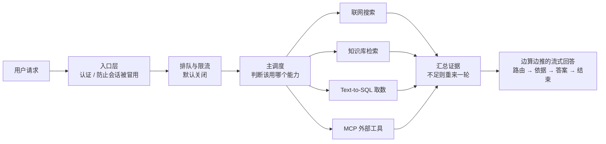

# agent-platform 项目讲解文档

> 事实基线：**2026-10-15**。文中凡涉及"线上跑得怎么样"的读数，都绑定代码版本 `6ac466af`（2026-10-14 复测）；换版本后需重新核。其余与根 `README.md` / `ARCHITECTURE.md` / `AGENTS.md` 对齐，能力状态一律以 §6「诚实边界」为准，不得超实声明。

> **agent-platform 是一个 uv workspace monorepo：3 个共享内核包（agent-core / agent-runtime / shared-schemas）+ 6 个独立应用，用「单 Runtime + 多 Planner」统一 Agent 执行模型，默认对外提供服务的 `agent_server` 以单进程方式调度搜索 / RAG / Text-to-SQL / MCP 工具四条能力链路，并配套生产级准入、调度、追踪与评测检查。**

## 0. 读前速查：本文反复出现的几个词

| 词 | 本文里的意思 |
|----|------------|
| **线上** | 部署在内网测试机上、正在运行的那套服务（不是本地开发环境） |
| **一轮** | 一次「判断该用哪个能力 → 调用它 → 合成回答」。线上默认最多走 **两轮**（第二轮只在第一轮没拿到证据时才跑） |
| **共享包 / 内核** | `packages/` 下被所有应用共用的库；写在这里的逻辑不用各应用重复实现 |
| **只写一遍 · 统一接上 · 自动检查** | 一件横切工作要做全的三步：① 逻辑只写一遍（放共享包，不在各应用复制）② 由框架或统一工厂自动接上，不靠每个调用点"记得调一次"③ 有一条自动检查，漏了就 CI 变红 |
| **三层齐备** | 上面三步全都有。缺任何一步都只是"约定"，迟早被破窗——本文用它给每项能力打分，✅ 才算做全 |
| **门禁 / CI 检查** | 违规时构建直接失败，不依赖人自觉。本文的「16 条门禁」= `scripts/lint_architecture.py` 的 16 条全仓扫描规则（2026-10-16 重取；原写 14，其后至 16 = +L-5 观测装配存在性、+P13 身份装配存在性） |
| **装配 / 收口** | 某个能力是否被所有应用统一接上。"覆盖 2/6"＝六个应用里只有两个接了 |
| **未接线** | 代码和单测都写好了，但主流程里没人调用它。≠ 死代码，不能删 |
| **默认关 / 需显式开启** | 功能存在，但要改配置才生效（英文材料里常写作 opt-in）。本文的 🔽 大多属于这种——所以"有这个能力"不等于"它在跑" |
| **降级** | 某个依赖（模型、搜索、工具）失败时改走备用路径，而不是整体报错 |
| **熔断** | 失败累积到阈值就先跳过该能力，过一会儿试探性恢复，成功则回正常态 |
| **契约** | 跨进程共用的数据结构定义（集中在 `shared-schemas`），改字段必须双方同步 |
| **编号** | 文中 `P4-2` / `P7` / `L-2` / `L-3` 是自动检查规则号（清单见 `ARCHITECTURE.md` §4.1），`ADR-0006` 是决策记录（`docs/adr/`），`ASI01–ASI10` 是 OWASP 的风险编号 |

> 说明：本文是**对外交付的单篇材料**，只放听众需要的事实；运维操作细节、内部工作留痕、以及"给讲者的提示"都不写在这里。

---

## 1. 背景：Agent 生产级要求与本项目定位

> 本章前半段（§1.1–§1.5）讲**业界口径**，与本项目无关，供第一次接触这个领域的听众建立框架；后半段（§1.6–§1.9）回到本项目。

### 1.1 「生产级」是平台属性，不是模型属性

一个反直觉但证据充分的事实：**同一个模型，只替换包裹它的那层运行时与治理设施、不动模型权重，结果可以差一个量级。**

| 证据 | 数字 | 出处（外部公开数据，仅用于给问题定性） |
|------|------|--------------------------------------|
| 只换基础设施，模型权重不动 | TerminalBench 2.0 排名 **30 名开外 → 第 5** | LangChain 公开报告 |
| 同一 GPT-4，只改接口设计 | SWE-bench Lite（300 题）**10.7% → 18.0%**；完整集（2294 题）约 **3.8% → 12.47%** | SWE-agent 论文 arXiv:2405.15793 |
| 错误沿链路累积 | 每步成功率 99% 的 10 步流程，端到端只剩 **约 90.4%** | 概率连乘，行业通用估算 |

还有一条容易被忽略：**模型与平台层是协同进化的**。模型会学会配合它被训练时所用的那套设施，改动工具实现反而可能降低性能。所以设计要能过「面向未来测试」——模型能力变强时，效果应当自然跟进，而不是靠再加一层设施复杂度去喂。

### 1.2 生产级的要求拆成四组

业界常把「包裹模型的那层设施」拆成 11 个组成部分（主循环 / 工具系统 / 记忆 / 上下文管理 / 提示词组装 / 结构化输出 / 状态持久化 / 错误恢复 / 权限护栏 / 验证反馈 / 多 Agent 协作）。对听众而言，记 **四组**更容易：

**① 可靠性——跑得完**

| 要求 | 业界做法 |
|------|---------|
| 主循环与轮次预算 | 机制上常常只是一个 `while`，复杂性全在循环管理里。Anthropic 称其为「笨循环」：**智能住在模型里，平台只管轮次** |
| 状态持久化与检查点 | 类型化状态 + reducer 合并、检查点在超步边界触发、支持中断恢复与时间旅行调试；也有团队直接用 git 提交当检查点 |
| 错误恢复要分类处理 | LangGraph 四档：瞬时错误→退避重试；模型可自纠→把错误当 ToolMessage 回喂；需用户修→中断求输入；意外错误→向上冒泡。**Stripe 生产环境重试上限只设 2 次** |

**② 可控性——拦得住**

| 要求 | 业界做法 |
|------|---------|
| 工具系统 | schema 定义 / 注册 / 参数校验 / 沙盒执行 / 结果捕获。Claude Code 的工具分六类：文件、搜索、执行、网络、代码智能、子 Agent |
| **权限执行与模型推理分离** | 核心原则一句话：**模型决定"尝试什么"，工具系统决定"允许什么"**。Claude Code 独立门控约 40 个离散工具能力，分三阶段（项目信任建立 → 每次调用前检查 → 高风险显式确认）；OpenAI SDK 分三层 输入护栏 → 工具护栏 → 输出护栏，触发即「断路器」停住 Agent |
| 执行隔离 | 独立沙箱内给全权限，比逐步审批更可靠（见 §1.4 模式 1） |
| 高风险节点人工审批 | 只卡高影响 / 不可逆 / 高财务节点；处处弹窗等于没有弹窗 |

**③ 可度量——证得了**

| 要求 | 业界做法 |
|------|---------|
| 上下文管理 | 内容落在窗口中间位置时性能下降**超过 30%**（「迷失在中间」）。五种生产方案：对话摘要、观察屏蔽（隐内容但保留调用痕迹）、轻量标识符（head/grep 代替整文件加载）、子 Agent 压缩摘要（每份 1000–2000 token）、ACON（保推理轨迹弃原始输出，减 26–54% token 而保持 95%+ 准确率）。目标＝**能最大化期望结果概率的最小高信号 token 集合** |
| 记忆系统 | 短期（会话内）/ 长期（跨会话）。Claude Code 三层：始终加载的轻量索引（每条约 150 字符）→ 按需拉取的主题文件 → 只能搜索访问的原始记录。**设计原则：Agent 把自己的记忆当"提示"，行动前对照实际状态验证** |
| 提示词组装与结构化输出 | 分层优先级栈（OpenAI Codex：服务器系统消息 > 工具定义 > 开发者指令 > 用户指令 `AGENTS.md`（32 KiB 上限）> 对话历史）；依赖原生 `tool_calls` 而非解析自由文本 |
| **验证与反馈** | **这是玩具 Demo 和生产 Agent 的分水岭**。三种方式：规则反馈（测试 / lint / 类型检查＝确定性基准真相）、视觉反馈（截图比对）、LLM-as-Judge（管语义但加延迟）。**给模型一种验证自身工作的方式，质量能提升 2–3 倍** |
| 评测与成本 | 任务级基准（GAIA / tau-bench / pass^k）＋ 端到端成功率，而非单次通过率；token 与调用成本要能计量到请求 |

**④ 可审计——说得清**

| 要求 | 业界做法 |
|------|---------|
| 身份：谁做的、替谁做的 | Agent 需要独立身份（NHI），凭证可轮换、可下线；权限来自服务端断言而非调用方自报 |
| 调用与数据来源留痕 | 每次回答可回溯到具体工具调用、检索命中的原文、使用的模型与提示词版本 |
| 决策链可回放 | 全链路 trace 可重放，用于事故复盘与回归对比 |
| 多 Agent 的边界要克制 | 先把单 Agent 做到极致；只在工具数超过约 10 个、或存在明显独立任务域时才拆分（并行检索的收益要 > 约 15× token 成本才值） |

### 1.3 风险面：OWASP Agentic Top 10（2026）

100+ 专家同行评审的分类法。注意 **Agentic 治理 ≠ LLM 治理**：多出来的是行动权、持久状态和协作面。

| | 风险 | | 风险 |
|---|------|---|------|
| ASI01 | Agent 目标劫持（间接注入改写目标） | ASI06 | 记忆与上下文投毒（RAG / 记忆持久偏置未来行为） |
| ASI02 | 工具滥用与利用（合法工具被过度代理） | ASI07 | Agent 间通信不安全（欺骗 / 伪造 / 重放） |
| ASI03 | 身份与权限滥用（越权、Confused Deputy） | ASI08 | 级联失败（单点错误沿 Agent / 工具 / 工作流放大） |
| ASI04 | Agentic 供应链（被篡改的 MCP server / 插件 / 模型） | ASI09 | 人机信任滥用（利用权威偏见批准危险操作） |
| ASI05 | 非预期代码执行与逃逸 | ASI10 | 失控 Agent（对齐漂移、行为隐藏） |

> **编号口径**：旧表里的 Missing Guardrails / Resource Exhaustion / Over-Reliance **不占 ASI0X 编号位**——它们分别归治理总原则（最小代理权 / 最小权限 / HITL）、LLM Top 10 2025 的 LLM10 Unbounded Consumption、LLM09 Misinformation。

配套五条治理原则：**最小能动性 · 最小权限 · 人工审批 · 可观测 · 零信任**（prompt、记忆、工具、其他 Agent 默认一律不可信）。其中第一条是新增项：**不止最小权限——不需要自主的地方就别部署自主，多余的自主性只扩大攻击面。**

### 1.4 实战收敛：三家公司的独立选择

Stripe（Minions）/ Ramp（Inspect）/ Coinbase（Cloudbot）三家的内部编码 Agent 互不商量地走到同一套架构。**这种独立收敛比任何框架的设计文档都有说服力——它是实战淘汰的结果，不是设计出来的。**

| 模式 | 做法 | 为什么 |
|------|------|--------|
| 1. 隔离沙箱，沙箱内全权限 | 每任务一个独立沙箱，仓库 clone 进去，Agent 拥有完整 shell | 边界已隔离就无需逐步审批；出错爆炸半径被封在沙箱内 |
| 2. 精选工具集 | 10–20 个起步，按需添加 | Stripe 有约 500 个工具，团队强调的是「**精心维护** 500 个，不是塞进 500 个」 |
| 3. 工作流优先触发 | 三家都选 Slack 作为第一入口，而非自建 UI | 工程直觉：不是「做更好的 IDE 插件」，而是「融入已有工作流」 |
| 4. 上下文预注入 | 仓库级（`AGENTS.md`）+ 任务级（issue / 线程 / PR）两层直接给全 | 省掉 Agent「摸索需求」的工具调用开销 |
| 5. 子 Agent + 中间件两层编排 | 子 Agent 由模型驱动做拆解；中间件是**确定性**保障（运行中注入消息、兜底确保交付、工具错误处理） | **模型做决策（灵活），中间件做保障（可靠）** |

三条反模式：**更多工具往往意味着更差性能**（Vercel 从 v0 删掉 80% 的工具后效果更好）；懒加载只暴露当前步骤所需的最小工具集（可实现约 95% 的上下文减少）；**不要在平台层堆叠过多确定性逻辑**——Anthropic 随新模型把这些能力内化，会定期**删除**设施里的规划步骤。

### 1.5 落地顺序（别一次做完）

| 阶段 | 目标 | 关键动作 |
|------|------|---------|
| 0 止血 | 单 Agent 先稳 | 接 Trace、高风险节点加人工审批、工具最小权限 |
| 1 记忆 | 跨会话一致 | 文件级持久化起步；再谈分层与遗忘 |
| 2 上下文工程 | 高信噪比 | 写入 / 选取 / 压缩 / 隔离四层；监控上下文利用率（经验阈值约 55% 以上要警惕幻觉率上升） |
| 3 多 Agent | 隔离与围堵 | orchestrator-worker + 断路器 / 检查点 / 回滚，对应 ASI07 / ASI08 |
| 4 评估闭环 | 持续变好 | 基准 + 护栏 + 轨迹回放 + 从失败中学习 |

一句话总纲：**可靠性是设计出来的，用「评估 + 护栏 + 可观测」三件套量化并守住**；多 Agent 是可靠性架构，不是能力堆叠。

> 以上是业界口径。接下来 §1.6–§1.9 说明本项目为什么存在、以及**逐条对上述要求的答卷与差距**，后续各章是答卷的展开。

### 1.6 本项目背景：解决什么问题

1. **能力碎片化**：联网搜索、知识库问答、Text-to-SQL、外部工具调用各自为战，缺少统一编排与统一契约。
2. **微服务化副作用**：拆成微服务后引入 SSE 流式聚合、会话键（thread_id）连环 bug 等适配层问题——本项目选择**单进程多节点 + LangGraph 节点边界隔离**回避这类问题。
3. **生产可靠性缺陷模式**（既往评审实证）：懒加载无锁竞态、降级标志只置位不复位、`asyncio.create_task` 无引用被 GC、客户端 thread_id 会话劫持——本项目逐一对策（见 §3.4）。
4. **企业执行诉求**：任务需要准入限流、跨实例调度、外部异步任务挂起与恢复、执行过程可控（暂停/取消/重试）、成本可计量。

### 1.7 本项目对四类要求的答卷

把 §1.2 的四组要求逐条落到本项目（共 16 条），状态一律为 2026-10-15 实测：**✅ 三层齐备 · 🔽 机制在但默认关或覆盖未收口 · ⚠️ 未接线**。

| 类别 | 生产级要求 | 本项目落点 | 状态（2026-10-15 实测） |
|------|-----------|-----------|------------------------|
| **可靠性**（跑得完） | 主循环与轮次预算 | Planner + `skill_guard`（max_skill_depth / max_steps / 循环检测） | ✅ |
| | 工具系统：注册 · schema 校验 · 结果捕获 | `SkillRegistry` 统一 `discover()` / `delegate()` | ✅ 门禁 P4-2 禁绕过 |
| | 状态持久化与检查点 | LangGraph checkpoint + `/session/revert`（原子回退不删历史，可 redo） | ✅ 回退机制在位；**「这个会话归谁」的校验缺失**（见 §2.2、§6 第 13 行） |
| | 错误恢复：重试 / 回滚 / 熔断复位 | 熔断 closed→open→half-open（成功自动复位）+ LLM 主备降级 | ✅ |
| **可控性**（拦得住） | 最小权限与最小能动性 | 工具白名单 + MCP per-server `tool_allowlist`（拒绝即审计） | ✅ |
| | 安全护栏（入站 / 出站） | 见 §2.2「安全按强度分档」 | 🔽 三层齐备仅 2 面；身份覆盖 2/6 |
| | 高风险节点人工审批 | 流程可挂起存档、外部回调后继续执行，**重复回调不会重复执行** | ⚠️ 但"由人处理"这一类目前没有产出入口；四种可挂起类型里实际只会创建"等外部任务"这一种 |
| | 代码执行隔离 | 沙箱 Docker（`--network=none --read-only --user=nobody` 等） | ✅ Docker 档 / 🔽 Docker 缺失时静默降级 subprocess |
| **可度量**（证得了） | 评测基线与回归阻断 | `eval/` 15 条 golden，路由基线 100%，CI 阻断 | ✅ |
| | 决策链可回放 | 追踪状态机 + 跨服务传递同一条链路标识 | ✅ 机制在 / 🔽 默认关闭 |
| | 成本可计量 | 按请求数 / token / 花费三个维度做窗口计量 | 🔽 默认关闭，且三项预算默认 0＝**开了也不限** |
| | 准入与过载保护 | Durable Admission + 会话并发协调 | 🔽 `ADMISSION_ENABLED` 默认 false |
| **可审计**（说得清） | 身份：谁做的、替谁做的 | 客户身份由服务端判定（校验令牌后生成会话键，不信客户端自报） | 🔽 只接到 6 个应用中的 2 个，且默认**只记录不拦截**；外部工具调用的审计里"是谁发起的"目前是固定标识，**答不了"替哪个客户调"** |
| | 调用与数据来源留痕 | 证据汇总环节 + 失败时的执行现场快照 | ✅ 技能 / 工具版本可回溯 / 🔽 **"当时用的哪个模型、哪版提示词"这两栏默认路径无值**，见 §2.4 |
| | 记忆 / 上下文不被投毒 | `input_guard`（PII 脱敏 + injection 检测，先脱敏再查缓存） | 🔽 实现在 kernel，默认关、装配 2/6 |
| | 风险分类可锚定 | OWASP Agentic Top 10（ASI01–ASI10）→ 模块映射 | ⚠️ 映射未入库，见 §6 第 11 行 |

> 本项目的差距大多不在「有没有对应机制」，而在**默认值、覆盖面与退化路径**——上表 🔽 项的形状只有三种：代码已在共享包但**默认不生效**（成本预算、观测、准入、输入消毒）、**装配未收口**（身份与消毒各 2/6 应用）、**降级不设防**（沙箱缺 Docker 时静默走 subprocess）。这是平台型项目的典型形态，所以本文把它写成验收口径，而不是功能清单。
>
> **有一句例外要说在前面**：上表里「回退时校验会话归属」这一项**不属于这三种——那道校验根本没写**，只在代码注释里声明了意图。全表只有这一项是"缺机制"，所以单独登记在 §6 第 13 行，不与上面三种形状混谈。

### 1.8 目标

- **统一 Runtime，不统一 Agent**（Plan-F）：`agent-runtime` 承载运行时中间件，Planner 策略可插拔（`DeterministicPlanner` / `AgenticPlanner`），应用按需选择执行模型。
- **零配置就能起，能力全部按需开启**：`DATABASE_URL=` 留空即可启动；数据库、模型、搜索、外部工具、调度**都默认关闭**，要用才打开。
- **企业执行平台**：一次任务的完整链路是「排队与准入 → 调度分配 → 选择决策方式 → 实际执行 → **留下现场快照与成本账**」（代码已接线，逐步开启，见 §6 诚实边界）。
- **工程质量可证**：CI 常驻 lint 门禁 + 10 个 pytest session + 启发式评测门禁，回归即阻断。

### 1.9 演进阶段（路线图口径）

| 阶段 | 内容 | 状态 |
|------|------|------|
| Phase 1 | 主调度 + 联网搜索 + 知识库问答 + Text-to-SQL + 记忆 + 缓存 + 熔断 + 评测检查 | ✅ 完成 |
| Phase 2 | 同会话排队互不冲突 + 可存活的排队限流 + 会话回退 + 分布式追踪 + 外部工具接入 | ✅ 完成 |
| Plan-F | 单 Runtime 多 Planner 架构收口（中间件层上收 + 可插拔 Planner） | ✅ 完成 |
| V3（企业执行平台） | 调度分配 / 挂起与恢复 / 执行控制面 / 成本治理 / 现场快照取证，代码已接线 | ⚠️ 调度开关默认关闭，端到端双实例故障转移验收未完成 |
| Phase 3 产品化 | 前端界面、检索/存储增强、会展业务功能 | ⬜ 未开始 |

> 上表是**能力口径**。带日期的交付窗口是另一套口径（一期四阶段 10/09–12/04、七条判定标准），见 §5 Q11。**两套不得混用：能力「已接线」≠ 交付「已达标」。**

---

## 2. 核心功能与亮点

### 2.1 一条主链路：主调度带四个能力（默认对外服务的是 `agent_server`）



| 能力 | 怎么做的 |
|------|----------|
| 联网搜索 | 接 Tavily 搜索接口；外面套了熔断保护，超时或报错自动走备用路径 |
| 知识库混合检索 | 文档导入 → 按语义切块 → **同时**做「按意思找」（向量检索）和「按字面找」（关键词检索）→ 两路结果**按排名融合排序**（两种检索的打分尺度不同，不能直接比大小） |
| Text-to-SQL 取数 | 先喂三样材料（表结构 + 业务口径说明 + "问题↔SQL"对照范例）→ 生成的 SQL 过白名单校验（只放行单条查询）→ **执行时数据库连接设为只读，改不了数据** |
| MCP 外部工具 | 多个工具服务器统一管理；每个服务器单独维护工具白名单、单独熔断；每次调用留审计记录 |
| 路由（选哪条能力） | 先让模型做结构化判断；判断失败退回按关键词的规则判断（评测基线 100%） |
| 流式返回 | 从"选了哪条路"到"最终答案"分段推送，不等全部算完 |

### 2.2 可靠性与横切能力

- **同一个会话不会打架**：同一会话的请求排队串行处理，不同会话之间照常并发——**这一条默认就开着**（下面那条「排队和限流是存得住的」不一样，那个默认关闭）。会话正忙时新来的请求**二选一**：排队等前一个说完 / 直接拒绝。曾经还有第三种「合并成新问题」，但代码里它早就退化成了排队、名不副实，所以被专门改了一次代码把它从策略清单里删掉了。
- **排队和限流是存得住的**：队列写在数据库里，可按「每个用户 / 每个会话 / 全局」三个维度分别限流，支持优先级，服务崩溃重启后队列不丢；**队列里不保存问题原文**（脱敏要求）。
- **会话可以退回**：回到某一条之前的状态，且**不删除历史记录**（所以还能再往前滚做对比）；每次操作写审计，审计里的操作人取服务端判定的租户，不取传来的密钥原文。⚠️ **「不允许跨用户回退」目前只是代码注释里写的意图，没有实现**：这个接口把调用方传来的会话号**原样**交给回退逻辑，全程没有一步在问"这个会话归谁"（`packages/agent-runtime/agent_runtime/revert.py:26-45`）——而隔壁那个"按会话取回原文"的接口，是先由服务端把会话号重算一遍再用的（`applications/agent_server/api/session_router.py:33`）。后果与修法见 §6 第 13 行。
- **链路可追踪，且状态可诊断**：追踪子系统对外报**三态**——「我主动关掉的」「想开但坏了（带具体原因）」「真的在往外导」，健康检查里一眼分清是哪一种（另有一个"还没走到装配那一步"的启动前读数）；跨服务传递同一条链路标识；**我们自己的链路属性只记问题的长度和一段哈希**。⚠️ 这句的范围要说准：模型调用节点的输入输出由框架自动埋点，**确实会进观测后端**，见 §6 第 12 行。
- **熔断器**：某个能力连续失败到阈值就先跳过它，过一会儿放行一个请求去试探，成功就恢复正常——**不会出现"一旦降级就永远降级"**（这正是既往评审发现的缺陷之一）。
- **模型主备切换**：主模型超时或报错，自动改用备用模型。
- **语义缓存**：这次问的和上次意思相同，就直接返回上次的答案，**不再重跑整条流程**。
- **上下文压缩**：多轮对话超过长度阈值时，自动把较早的消息压成摘要（做法参考 Claude Code / Codex / OpenCode）。
- **安全做到什么程度**（分三档说，别说「安全三件套」——三档覆盖面不同；逐条状态见 §1.7）：
  - **做全的**：① **报错不泄露内部信息**——6 个应用都经同一个工厂创建，统一的异常处理是"由构造保证"的，谁绕过就直接 CI 变红，而且这条规则**故意不设豁免名单**（要加豁免必须先在方案文档里说理）；② **文件路径不能越界**——所有读写路径必须过同一把校验函数（门禁 P7）。
  - **机制齐了、覆盖还在推进**：③ **租户身份由服务端判定**（从凭据推出这是哪个客户，不信客户端传来的会话号）；④ **输入消毒**（手机号 / 邮箱 / 身份证等先脱敏，常见提示注入模式做拦截）。两者都已在共享包实现，但**只接到 6 个应用中的 2 个，且默认只观察不拦截 / 默认关闭**。
  - **要说清的短板**：SQL 的"只放行查询"校验在共享包里，而**"数据库连接设为只读"这一半是各应用自己写的**，共享包不担保——漏接的那个应用就没有第二道保险。

### 2.3 一套运行时，多种决策方式（内部代号 Plan-F）

核心主张是**统一运行时，不统一 Agent**：所有应用共用同一层执行设施，但"这一步该怎么做决定"的策略可以换。

- `agent-runtime` 这层不依赖任何具体应用（依赖方向单向，见 §3.2）——所以它能被六个应用共用。
- **给决策方式定的护栏**：限制**最多能套几层技能、最多走多少步、有没有在原地打转**（识别"同一个动作反复做"）。只约束需要组合调用的路径，简单直答不受影响。
- **技能（Skill）体系**：技能分四型——一段函数、一个子 Agent、一个远程服务、一条固定工作流；MCP 外部工具和沙箱执行各通过一个注册函数挂进来。对外只有两个入口：**有哪些能力**（`discover`）和**把活派出去**（`delegate`）。
- 两种决策方式（按写好的流程走 / 让模型自己决定）**共用同一套推送事件格式和会话状态格式**——换决策方式不用改前端解析，也不用改存储。

### 2.4 V3 企业执行平台（⚠️ 默认关闭，仅作能力陈述）

- **ExecutionScheduler**：任务排队放在数据库里，多个服务实例同时抢活也**不重复执行、不丢任务**；领取任务时带一个"领取凭证"，过期的凭证写不进去——**作用是防止两个实例都以为任务在自己手里**。
- **十态状态机**：PENDING / RUNNING / WAITING / WAITING_EXTERNAL / WAITING_HUMAN / PAUSED / CANCEL_REQUESTED / CANCELLED / SUCCEEDED / FAILED，**不在合法转换表里的状态变化会被直接拒绝**（比如已取消的任务不能被拉回运行）。
- **AwaitableTask**：流程遇到外部异步任务（等审批、等第三方回调）就先**挂起并存档**，对方回调后从存档点继续；**同一个回调重复来不会重复执行**。
- **Control Plane**：对一次执行提供 inspect / pause / resume / cancel / retry / terminate 六种操作，状态不允许的操作返回 409 而不是静默忽略。
- **Cost Governance**：按请求数 / token / 成本三个维度做滑动窗口计量，超配额返回 429。
- **现场快照与任务回收**：执行失败时留下可回放的现场快照——当时跑到哪一步、状态是什么、调了哪个技能 / 工具及其版本。**「用的哪个模型、哪版提示词」这两栏要如实说**：数据结构里字段留着，但默认路径填不进值（注入的模型对象不带模型名，提示词版本则没有任何生产代码往里写），所以现场快照**今天答不出"当时用的哪个模型"**。推给用户的过程明细里同样不带这两栏；那里另外三类（资料原文、异常原文、费用）才是**刻意外发的取舍**，理由逐条写在代码注释里，不许"顺手补上"。**长时间没心跳的任务由回收器清理，不会一直占着执行槽**。

### 2.5 六大应用矩阵（同一内核，不同定位）

| 应用 | 定位 | 端口 / 入口 |
|------|------|------------|
| `agent_server` | 单进程调度平台（默认的运行环境 / 参考实现） | :8000，`agent_server.main:app` |
| `agent_federation` | 多 Agent 联邦网关（护栏 + 两级意图分类 + 问法改写 + 语义缓存 + Planner + 编排 3 个子服务） | `python -m api.server` |
| `knowledge-service` | 通用 RAG 知识库服务（PDF/MD 导入 → Milvus 向量库 + Neo4j 图库，多路检索 + 重排 + 融合 + 知识图谱问答） | :8900 |
| `nl2sql-service` | 通用 Text-to-SQL 服务（LangGraph 异步 12 节点管线；库表结构与业务术语做成可配置参数，换一套数据不改代码） | :8000 |
| `kefu-service` | 客服智能体（9 个命令 + 3 个流程 + GraphRAG，兼容 Agent Protocol 的 `/invoke`） | :8003 |
| `exhibition-agent` | 会展行业 Agent 骨架（按内部数仓的接口契约对接；**指标计算口径有硬约束，不允许绕过**） | 独立起进程；容器化文件待补（见 §3.1） |

---

## 3. 技术架构与实现方案

### 3.1 仓库形态：Platform + Applications monorepo

```text
agent-platform/                    # uv workspace（根 pyproject 含 [tool.uv.workspace]）
├── packages/                      # 平台 SDK（库，被 workspace=true 依赖）
│   ├── agent-core/                # 基础原语：tracing / guardrails / sql 守卫 / llm / memory / events / config / intent / resilience
│   ├── agent-runtime/             # 执行模型：planner / skills / workflow / admission / scheduler / V3 / memory 体系 / sandbox
│   └── shared-schemas/            # 跨进程数据/协议契约（QueryRequest / QueryResponse / ThreadState ...）
├── applications/                  # 6 个应用：都有 pyproject + README，容器化只有 2 个自带（见下）
├── tests/ eval/                   # 根项目测试 + 评测门禁
└── docs/ scripts/ Makefile        # 仓库级资产
```

- `agent_server` 是**根项目本体**（自身目录里没有 `pyproject.toml`，由根 `pyproject.toml` 的 wheel 配置管理，容器化用**根 `Dockerfile`**）；其余 5 个应用是独立 workspace 成员。
- **六个应用都容器化了吗——没有**（2026-10-15 逐目录核过）：六个应用**都有** `pyproject.toml` + `README.md`，但**只有 `agent_federation` 与 `knowledge-service` 两个自带 `Dockerfile` + `docker-compose.yml`**；`nl2sql-service` / `kefu-service` / `exhibition-agent` 三个**没有容器化文件**，要上线得先补 `Dockerfile`，或复用根镜像加各自的启动命令。⇒ 「六个独立应用、能各自单独起进程」是实的；「六套都已经容器化了」不实。

### 3.2 依赖方向（架构红线）

```text
application → agent-runtime → agent-core        （单向，不可反向）
任意层 ────────────────→ shared-schemas         （数据契约单一事实来源）
```

| 红线 | 内容 |
|------|------|
| 1 | `agent-core` 不得 import runtime / 任何 application；`agent-runtime` 不得 import 任何 application |
| 2 | Application 之间不得 import 内部模块，仅经 HTTP + `shared-schemas` 契约交互 |
| 3 | `agent-core` 不依赖任何 Web 框架或应用配置（不 import LangGraph / FastAPI / 应用 config）——所以它能被单独复用 |
| 4 | 禁止再造 Runtime：应用需要的 Planner / Skill / Workflow 必须从 `agent-runtime` 消费 |
| 5 | 跨进程通信必须走 `shared-schemas`，禁止各自定义导致字段漂移 |

红线由 `scripts/lint_architecture.py` **16 条不变量**（P 系列 + L 系列）全仓扫描强制，违规即 CI 失败；另有 `tests/governance/` 行为级门禁（身份不进 tool schema、禁 `tenant_id="default"` 隐式缺省、每张业务表必含 `tenant_id` 等）。

### 3.3 横切能力：客户身份由服务端判定

| 该做的三步 | 实现在哪 | 做了什么 |
|-----------|---------|---------|
| 只写一遍 | `agent-runtime/identity.py` | 签发与校验访问令牌（非对称签名，服务端持私钥）；网关调用子服务时用带签名的内部请求头传身份；**支持换密钥**（按密钥编号挑对应公钥，可平滑轮换） |
| 统一接上 | `identity_middleware.py` | 在 `agent_server` 无条件挂载；联邦侧**必须挂在安全网关中间件之后**——顺序错了身份校验就会漏，所以这个顺序被两种测试钉住（检查代码结构 + 跑真实行为） |
| 自动检查 | 决策记录 ADR-0006 / ADR-0007 + `tests/governance/` | 客户身份**不允许出现在让模型填的参数表里**（否则模型能自己编一个）；跨客户隔离用真实数据库跑回归，**环境缺数据库就判失败，不许"跳过当通过"** |

目前默认是**只观察、不拦截**（对现有行为零改动）。把开关拧成强制（`DEPLOY_ENFORCE_IDENTITY=true`）之后，如果既没有校验用的公钥、又没声明"就一个租户"，服务会**直接拒绝启动**，而不是悄悄放行。

### 3.4 关键实现方案

| 主题 | 怎么做 |
|------|------|
| 知识库混合检索 | 按语义切块 →「按意思找」和「按字面找」两路同时召回 → **按名次融合**（两种打分尺度不可比，只比名次）；默认返回 4 条 |
| SQL 的两道保险 | 第一道在共享包里：语法层白名单，只放行单条查询；第二道**由各应用自己写**：数据库连接设为只读。最多返回 100 行 |
| 会话防冒用 | 启用 API Key 后**忽略客户端传来的会话号**，改用服务端从凭据推出的身份生成会话键（密钥本身不参与生成，所以不会因换密钥而丢历史） |
| 冷启动竞态 | 服务启动时先把连接池预热、加锁初始化——避免多个请求同时"第一次加载"同一个对象（既往评审发现的缺陷之一） |
| 后台任务不能被回收 | 统一用 `spawn_background` 起后台任务（集合里持有引用 + 完成回调）——避免"任务对象被垃圾回收，活儿静默没干"（同样是既往缺陷） |
| 追踪只有一个入口 | 追踪状态机只在启动装配点初始化：业务模块不许自己再起一个（门禁 L-3），也不许各自从应用对象上取（L-2）——**同一个进程里出现两套追踪，跨服务的链路就会静默断掉** |
| 沙箱执行 | 用 Docker 隔离跑代码：无网络、根文件系统只读、限内存与 CPU、禁止提权、非 root 用户；**没有 Docker 的机器上会悄悄降级成普通子进程**，只留一条日志——既不拦也不报进健康检查，所以只适用于开发 |

### 3.5 质量门禁（工程可信度的证据）

```bash
make ci        # lint + 10 个 pytest session + 启发式 eval（CI 主门禁）
make test      # 9 个常规 session + 1 个 --extra otel 真 SDK session
make eval      # 15 条 golden set 启发式评测（路由准确率基线 100%，CI 阻断回归）
```

- `scripts/lint_architecture.py`：16 条架构不变量（白名单外即失败）。
- `scripts/check_doc_sync.py`：文档引用路径存在性校验（判定基准 = `git ls-files`，非本机 FS）。**它是 CI 里 `make ci` 之后的独立一步**，所以"改文档引用的路径"这件事也有自动检查兜着。
- 另有两条**不阻塞主门禁**的定时/手动工作流：跑真模型的评测、以及双实例高可用编排检查。它们失败不会让 PR 变红——这是刻意的（要 Key、要环境）。
- CI 不调用模型、不需要 LLM API Key 即可全绿。

---

## 4. 使用流程与操作说明

### 4.1 环境准备（唯一受支持入口）

```bash
uv sync --all-packages --extra dev     # 必须 --all-packages！默认 uv sync 只装根包，会卸载其它 member 包
```

可选 extras：`otel`（OTel SDK + OTLP）、`mcp`（MCP SDK）、`pdf`（PDF 解析）、`agentic`（让模型自己决定下一步的那种决策方式所需的那个应用包——**默认的四条链路不需要它**，不装也能全绿）、`eval`（检索质量评测那套较重依赖，日常开发不装）、`dev`（pytest + ruff）。

### 4.2 零依赖冒烟（开发模式，30 秒验证）

```bash
DATABASE_URL= uvicorn agent_server.main:app --port 8000
curl http://127.0.0.1:8000/health
# {"status":"ok","storage":"memory","llm":false,...}  —— 无 PG / 无 LLM Key 亦可启动
```

### 4.3 完整模式（Docker）

```bash
cp .env.example .env    # 填入 LLM_API_KEY / SEARCH_API_KEY 等（.env 已被 gitignore，切勿提交）
docker compose up -d    # pgvector + 服务（仅发布 127.0.0.1:8000）
```

### 4.4 核心 API 演示

```bash
# ① 问答（SSE 流式）—— 主链路演示
curl -N -X POST http://127.0.0.1:8000/query \
  -H "Content-Type: application/json" -H "X-Priority: high" \
  -d '{"question": "什么是检索增强生成"}'
# 事件流：admission → coordination → route → evidence → answer → done

# ② 知识库导入（RAG）
curl -X POST http://127.0.0.1:8000/import -F "file=@document.md"

# ③ Text-to-SQL 训练三件套
curl -X POST http://127.0.0.1:8000/sql/train -H "Content-Type: application/json" \
  -d '{"ddl":"CREATE TABLE orders(id INT, region TEXT, amount DECIMAL)",
       "documentation":"region 取值 east/west；GMV = amount 求和",
       "question":"上季度华东区 GMV","sql":"SELECT SUM(amount) FROM orders WHERE region = '"'"'east'"'"'"}'

# ④ 会话回退 / 精确回忆
curl -X POST http://127.0.0.1:8000/session/revert -H "Content-Type: application/json" \
  -d '{"session_id":"thread-xxx","checkpoint_id":"cp-yyy"}'
curl "http://127.0.0.1:8000/history?session_id=thread-xxx&keyword=GMV&limit=10" -H "X-API-Key: $API_KEY"
```

| 参数 | 说明 |
|------|------|
| `question` | 问题文本（1–2000 字符） |
| `priority` | `high` / `normal` / `low`，默认 `normal` |
| `thread_id` | 会话 ID；**启用 API_KEY 时忽略**，按服务端断言租户派生 |
| `traceparent` | W3C Trace Context 透传 |

### 4.5 核心配置（环境变量，pydantic-settings 校验，`extra="ignore"`）

| 变量 | 默认 | 说明 |
|------|------|------|
| `API_KEY` | `""` | 非空启用认证 + 会话防劫持 |
| `DATABASE_URL` | `""` | PG 连接串；空 = 内存模式（仅开发） |
| `LLM_API_KEY` / `LLM_MODEL` / `LLM_FALLBACK_MODEL` | `""` / `gpt-4o-mini` / `gpt-4o-mini` | 空 key = 启发式路由模式；主备自动切换（**备胎默认和主胎同一个型号**，真要主备分离得自己改这个值） |
| `SEARCH_API_KEY` | `""` | Tavily Key |
| `SQL_DSN` | `""` | 业务库连接串（sqlite / postgresql） |
| `EMBEDDING_MODE` | `auto` | 有 key 走远端，否则内置确定式 mock（仅开发/测试） |
| `COORDINATION_ENABLED` | `true` | 会话串行协调**默认就是开着的**——与下面三个"需显式开启"的开关不同 |
| `COORDINATION_POLICY` | `queue` | `queue` / `reject` 二选一（原有第三种 `coalesce` 因名不副实已移除） |
| `ADMISSION_ENABLED` / `OTEL_ENABLED` / `MCP_ENABLED` | `false` | 均需显式开启 |
| `SCHEDULER_ENABLED` | `false` | V3 调度开关（验收未完成前不得生产开启） |

完整清单见 `.env.example`。

### 4.6 测试与评测（本地验证）

```bash
uv run pytest tests/ -q                                   # 根套件
uv run pytest applications/agent_server/tests -q           # 应用层集成测试
uv run --package agent-federation-app python -m pytest applications/agent_federation/tests/unit/ -q
python eval/run_eval.py                                    # 启发式路由评测
python eval/run_eval.py --fail-below 0.8                   # CI 门禁用法
```

> Windows 注意：本机无 `make`，直接用等价的 `uv run pytest ...` / `uv run --with ruff ruff check .`。

---

## 5. 常见问题（FAQ）

**Q1：没有 PostgreSQL、没有 LLM Key 能跑吗？**
能。`DATABASE_URL=` 空即内存模式；无 LLM Key 走启发式路由 + 直答链路。`/health` 会如实上报各组件状态。

**Q2：`agent_server` 和 `agent_federation` 是什么关系？**
两个**平行**的应用，没有上下级关系。前者是单进程调度平台（默认对外提供服务、当参考实现看）；后者是多 Agent 联邦网关（把子 Agent 做深的那条路，本地或远程可切换）。两者共用同一层基础能力，侧重不同：一个证明"平台怎么搭"，一个证明"编排怎么做深"。

**Q3：V3 的 scheduler / control plane 现在能开吗？**
代码已接线但**默认关闭**。`scheduler_enabled=True` 前必须知晓：端到端双实例物理故障转移验收未完成，缺口清单见 `docs/TODO.md` §2（已完成 4 · 部分 4 · 未接线 2）。**不得当作已上线能力对外声明。**

**Q4：多租户隔离怎么保证？**
身份由**服务端判定**：中间件从凭据里解析出是哪个客户，挂到"本次请求"的上下文上，业务代码拿不到也改不了这个值，**不能自己声明"我属于某客户"**。有三道自动检查兜着：禁止用 `default` 这种隐式缺省租户、每张业务表必须带租户列、跨客户隔离用真实数据库跑行为回归（环境缺数据库就判失败，不许"跳过算通过"）。

**Q5：知识库检索为什么要"融合排序"？**
两路召回各有尺度：一路按**意思**接近（向量相似），一路按**字面**命中（关键词）。它们的分数不能直接比大小，硬比会被其中一路的打分方式带偏。所以用排名融合（RRF）：只看"在这一路里排第几"，用名次加权。**无参数、不怕分数漂移**，是业界常用做法。

**Q6：想加一种新能力（比如新工具）怎么做？**
按技能体系接：把它实现成四种技能之一（一段函数 / 一个子 Agent / 一个远程服务 / 一条固定工作流）并注册进去，决策方式通过统一的两个入口使用它——**查有哪些能力**、**把活派出去**。外部 MCP 工具可以自动转成"远程服务"型技能。**不允许绕过"派活"入口直接调用底层执行**——那会跳过步数与深度限制，有门禁拦着（P4-2）。

**Q7：为什么 `uv sync` 之后跨包测试失败了？**
默认 `uv sync` 只装根包及其依赖并**卸载其它 member 包**。必须 `uv sync --all-packages --extra dev`。

**Q8：追踪会记录用户问题原文吗？**
分三层说，糊成一句"不会"会被当场戳破：

1. **我们自己的链路属性不记原文**：只记问题长度 + 一段哈希（`sha256` 前 16 位；同一个问题算出同一个哈希，用途是**把"用户报的那一次"和某条链路对上**，不是还原内容）。排队与限流的队列里也不存问题全文。
2. **但模型调用节点里确实有原文**：框架自动埋点会把提示词和回答写进 span 属性（现网实测到 6339 字符的完整提示词、316 字符的完整回答），这些属性沿同一条链路进观测后端。**这一条已拍板＝接受**（内部部门演示场景，观测面不加鉴权），代价是**上台必须主动说一句**：「观测面含原文，仅限可信内网人群。」
3. **推给用户的那条流是干净的**：过程明细里不含资料原文、不含异常原文、不含费用——这三类是**刻意的取舍**，理由逐条写在代码注释里，不许"顺手补上"。也不含模型与提示词版本，但那一类不是取舍，是**默认路径根本没有值可填**（见 §2.4）。

要看某次对话的原文，走**按会话精确取回**的接口（带鉴权、归属由服务端判定），而不是去观测后端捞——那面的访问面比业务库宽得多。

**Q9：本地修改文档引用路径后要注意什么？**
`scripts/check_doc_sync.py` 以 `git ls-files`（版本控制清单）为存在性判定基准——本机有而没入库的路径引用会判红；引用前先确认目标已入版本库。

**Q10：这是多 agent 吗？**
线上跑的是**「按写好的流程走一遍」**那一套（代码里 `planner` 的默认值就是 `deterministic`，部署清单没有覆盖它）。**但这不等于"只回答一轮"**：第一轮没拿到证据时会再走一轮，上限两轮——演示屏上那两条一模一样的「判断该用搜索 → 证据不足」就是这第二轮。

能让模型自己决定下一步、还能派子任务的形态，仓库里有三套，**都不在默认链路上**：

| 形态 | 实质 | 演示为什么看不到 |
|------|------|-----------------|
| `graph` 方式 | 多步骤的有向图（上限 20 步 / 最深套 4 层技能） | 需要一次命中**至少两个能组合的技能**且模型可用，否则退回按流程走。**这是多步编排，不是子 agent** |
| `agentic` 方式 | **真子 agent**（deepagents + 3 个子 agent） | **执行它的那部分代码不在演示镜像里**（镜像只打包了四个目录）⇒ 线上把它设为 `agentic` 会立刻报错 |
| `agent_federation` | 一个独立应用，自带任务接口 | 与 `agent_server` 是**两条互不调用的链路**：既没有代码引用，也没有 HTTP 调用 |

两个必须点破的误区：**设成"自动判断"（`auto`）也走不到自主模式**（那个自动判断的开关默认关闭，且没有任何正式代码把它打开）；**`subagents/` 目录不是子 agent**（是 4 个普通函数，被注册成"能力"后按流程调一次）。还有一条同名不同物：调度开关 `scheduler_enabled` 打开后，差别只是**多一层排队和并发限制**，**不改变上面说的"走几轮"这件事**，与多 agent 无关。

> **上台口径**：「统一运行时 + 可替换决策方式的骨架在位，本次演示按写好的流程走，证据不足会再来一轮、最多两轮；能自主编排的有两套，一套要一次命中两个以上可组合技能才触发，另一套的执行代码不在这个镜像里。」**不得说「多 agent 编排已具备」，也不得说「只有一轮问答」。**

**Q11：什么时候交付？一期二期怎么分？**
口径在 `docs/plans/plan-production-delivery-roadmap-2026-10-09.md`。一期四个阶段：**阶段 0 对账（10/09–10/16）→ 阶段 1 平台收口（10/17–10/30）→ 阶段 2 横向能力铺满（10/31–11/13）→ 阶段 3 交付可用能力（11/14–12/04）**，交付判定日 **12/04**。

分界线是该文 §四的**七条生产交付判定标准**，规则是**七条全部达标才宣布交付**。当前多数为「部分达标」，其中第 5 条「任一客户的数据在所有路径下不跨客户可见」卡在隔离覆盖 2/6（见 §6 第 7 行）；第 2 条若因环境不可达拿不到结论，只能写「标准环境已验证、多物理机待环境」。

二期＝公司几十个业务系统的接入，**整体后置到 12/04 之后**启动（有五条启动条件）。⇒ 交付介绍里**不得出现**「已支持几十个业务系统接入」。

---

## 6. 注意事项 / 诚实边界（对外声明必须带上）

| # | 事项 | 口径 |
|---|------|------|
| 1 | **V3 那套企业执行能力算不算"上线了"** | 调度开关默认关；**"两台实例其中一台真挂了、任务被另一台自动接走"这条没做过实物验收**。十项能力已逐条对账（2026-10-09，见 `docs/TODO.md` §2）＝**4 项已完成 · 4 项部分 · 2 项没接上**。已完成：外部动作"只生效一次"的契约、执行状态机、失败现场可回放、技能生命周期。部分：防止两个实例都以为任务在自己手里的领取凭证（5 个落点做了 3 个）、外部任务的恢复查询、排队侧的优先级/公平性/背压/卡死处理（这四项里只差"重新排期"没接）、执行控制面（8 个操作做了 6 个，缺"重新入队"和"恢复"）。没接上：执行状态跨实例迁移、大参数外置存储。⇒ **不得把这十项整体当缺口排期**（会把已完成的代码重做一遍）。可演示「打开配置后的链路」，**不可声明「已上线」** |
| 2 | 健康检查已覆盖执行平台四个组件（2026-10-14） | `/health` 现在报的是**实际跑起来的状态**（调度器 / 控制面 / 成本治理 / 取证快照），不是"配置里想不想开"。仍缺的是**跨请求的汇总监控与仪表盘**：没有指标注册中心，错误率 / 超时率 / 降级率没有基线可比 |
| 3 | 有五个模块"写好了但没接上" | 人工任务 / 执行恢复 / 状态迁移 / 大参数外置 / 会展侧技能路由——代码和单测都在，但主流程里没人调用它们（见 `docs/TODO.md` §3）。**不等于死代码，不能删** |
| 4 | 没配模型 Key 时，"按意思找"用的是占位算法 | 向量化这一步在没有 Key 时会退化成一套固定算法（同一句话永远算出同一串数）。流程能跑通，但它**不认识语义**——这时检索结果准不准没有参考意义。开发/测试可以，**生产检索必须配真模型** |
| 5 | 密钥纪律 | `.env` 不入库；真实密钥只填本地 `.env` |
| 6 | 身份这一层只接到 2/6 个应用 | 中间件目前只在 `agent_server` 与 `agent_federation` 挂载；会展、客服、Text-to-SQL 三个应用还没接（知识库服务用它自己那套租户头）。**将来把"租户身份必须校验"从只观察改成强制拦截之前，必须先把这三个接上**，否则它们仍会接受客户端自己声明的身份 |
| 7 | 数据隔离：**列有了，风险换到了"身份由谁说了算"** | 客户数据表（知识库分块、SQL 的表结构 / 业务文档 / 范例）**都已带上租户列**，检索与读写也都按「租户 + 工作空间」两个条件过滤；"记忆表把用户列写成了工作空间"这条老债已由数据库迁移拆出独立列（迁移前要求先在真实多租户库上确认老列没被写入过真实用户 id）。**现在真正的风险是租户值从哪来**：这一层读的是**请求自己声明的租户** ⇒ 谁传 `tenant_id=victim` 就能读到那个租户的数据分块；另外**语义缓存在租户为空时不加过滤条件**（默认路径就会走到，不是有人故意伪造）。今天只有一个租户，所以没有实际泄漏；**第二个租户写进来的那一刻就会串** |
| 8 | 默认只把服务开在自己这台机的端口上 | 那套默认的 compose 只发布 `127.0.0.1:8000`——局域网里别人连不到，这是刻意的。要对外提供服务得**自建反向代理 + 认证**，别直接把这个端口放出去 |
| 9 | 评测有两套口径，别混着说 | 门禁里那 15 条「这个问题该走哪条能力」的判断，跑的是**不调模型的规则版**（CI 每次必跑、不需要 Key）。让模型自己做同一判断的那版**要真实 Key 才跑得起来**，CI 里没有它的结论。⇒ 可以说"路由判断有基线、回归即阻断"；**不能说"模型的路由质量已被 CI 守住"** |
| 10 | 内网测试环境的四条硬规矩 | ① **代码不是用 `git push` 部署的**——是打包出差分文件再拷进去，所以那台机器上的仓库状态与本地不同源，改完代码若没走构建与分发脚本，**跑的仍是旧版本**；② 那台机器的系统 Python 版本低于项目要求、也没装依赖管理器 ⇒ **要跑测试得进容器复用项目自带的虚拟环境，不要重装依赖**；③ **镜像换一台机器构建**：那台机器只有一块慢盘，构建时铺上万个文件会把同机的向量库连带拖崩（实测踩过）；④ 分发镜像时**每台机器都要显式列上**，漏一台的话任务被调度过去就直接起不来。配置从哪读、三机现状与可复核命令见 `docs/operations/env-126-inventory.md` |
| 11 | §1.7 里所有 🔽 的共同原因：**不是缺机制，是默认值 / 覆盖面 / 退化路径** | 租户身份与输入消毒只接到 2/6 应用且默认不生效；成本预算三项默认 0＝**开了也不限**；排队、追踪、外部工具、调度全部默认关闭；输出侧发现问题**只告警不拦截**（与输入侧不对称）；沙箱在没有 Docker 的机器上**悄悄降级**成普通子进程。⇒ 对外统一说「**机制完整、覆盖渐进**」，**不得说「平台级安全已完备」**。另：OWASP 的 ASI01–ASI10 与我们模块的**逐条对应关系尚未写进仓库**，被追问具体编号时只能给五条治理原则，给不出编号级对照 |
| 12 | **观测面含原文，且这一面没有鉴权** | 模型调用节点的属性里带着完整提示词与回答（现网实测 6339 / 316 字符），而链路查询界面监听 `0.0.0.0:16686` **无认证** ⇒ 能连到该端口的内网人都读得到资料原文与答案。**已拍板＝接受**（需求方 2026-10-14 定：内部部门演示，鉴权不鉴权的没事），但**接受的前提是上台主动说**：「观测面含原文，仅限可信内网人群。」**不得**改口说成"追踪不记录用户内容"。根治的两条路都还没做：① 把查询界面收回 `127.0.0.1` 或前面加反代认证；② 关掉 SDK 往链路属性里写输入输出——**动手前必须先核实这个开关在所用 SDK 版本里真的存在，不许凭猜测配置**。登记与实测细节见 `docs/operations/minimal-release-runbook.md` 台账 ㉓ |
| 13 | **回退接口不判断"这个会话归谁"——这是全篇唯一"缺机制"的一项** | 不是缺开关：`/session/revert` 把调用方传来的会话号**原样**当会话键用（`applications/agent_server/api/session_router.py:72`、`packages/agent-runtime/agent_runtime/revert.py:36`），`operator` 只写进审计表、**从不与被回退会话的归属比对**；路由里那条"越权返回 403"的分支是**死码**（回退逻辑只返回"检查点不存在"和"回退失败"两种错误）。后果有两层：**状态被改写**（持有部署密钥的人报出别人的会话号，就能把那个会话退回旧状态，后续对话按旧状态继续）＋**少量原文外泄**（返回摘要里带着**那个检查点**最后一条消息的前 100 字与消息条数）。今天只有一个租户 ⇒ 撞不上；**第二个租户写进来的那一刻就是越权入口**。修法已在方案里定型（让该接口走与"按会话取原文"同一条服务端重算 + 归属判定链），见 `docs/plans/plan-memory-identity-workspace-2026-10-14.md` §1.6 与阶段目标。**被追问时的口径**：说"回退的归属校验还没接、已在方案里"，**不得**说"跨用户回退已被禁止"。 |

---

## 7. 总结与延伸材料

1. **架构**：三个共享包定地基（基础原语 / 执行设施 / 数据结构定义），六个应用共用同一层执行设施；依赖只能单向，且有 16 条自动检查锁着——谁反向引用就直接 CI 变红。
2. **能力**：一个进程内调度联网搜索、知识库问答、取数、外部工具四条链路；排队、回退、追踪、熔断这些"生产可靠性"是做在共用层里的，**不是每个应用各自写一遍**。
3. **边界**：企业执行平台（调度 / 挂起恢复 / 成本治理）代码已接上、默认关闭、验收未完成——对外只讲「渐进开启的路线」，不讲「已上线」。

延伸材料：

- 入门：根 `README.md`（快速开始 + API 参考）
- 架构：`ARCHITECTURE.md`（分层契约 + 红线 + 门禁登记表）、各应用 README
- 决策：`docs/adr/`（ADR-0005 执行记忆契约 / 0006 隔离维度 / 0007 服务端断言租户身份）
- 工程细节：`docs/plans/`（Plan-F / V3 骨架 / 隔离加固 / 可观测治理等方案文档）
- 待办与缺口：`docs/TODO.md`（含实测状态列）
- 运维：`docs/operations/`（测试 playbook / 126 环境清单）
