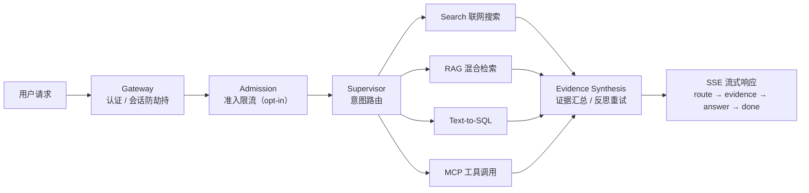

# agent-platform 项目讲解文档

> 用途：面向外部受众（技术评审 / 新成员入职 / 合作方介绍）的系统性讲解材料。
> 事实基线：2026-10-12，与根 `README.md` / `ARCHITECTURE.md` / `AGENTS.md` / `CHANGELOG.md` 对齐；能力状态以「诚实边界」章节为准，不得超实声明。

---

## 0. 讲解动线建议（先读这页）

| 受众 / 时长 | 推荐路线 | 重点章节 |
|-------------|----------|----------|
| 技术评审 45 min | 背景 → 架构分层 → 主链路演示 → 质量门禁 | §1 §3 §4 §5 |
| 新成员 30 min | 快速开始 → 目录结构 → 一条请求的生命周期 | §3 §4 §6 |
| 管理层 15 min | 背景目标 → 六大应用矩阵 → 演进阶段与边界 | §1 §2 §7 |
| 合作方 20 min | 核心能力 → API 演示 → 集成方式（联邦契约 / REST） | §2 §4 |

一句话开场（电梯陈述）：

> **agent-platform 是一个 uv workspace monorepo：3 个共享内核包（agent-core / agent-runtime / shared-schemas）+ 6 个独立可部署应用，用「单 Runtime + 多 Planner」统一 Agent 执行模型，默认宿主 agent_server 以单进程 Supervisor 编排搜索 / RAG / Text-to-SQL / MCP 工具四条能力链路，并配套生产级准入、调度、追踪与评测门禁。**

---

## 1. 项目背景与目标

### 1.1 背景：解决什么问题

1. **能力碎片化**：联网搜索、知识库问答、Text-to-SQL、外部工具调用各自为战，缺少统一编排与统一契约。
2. **微服务化副作用**：拆成微服务后引入 SSE 流式聚合、会话键（thread_id）连环 bug 等适配层问题——本项目选择**单进程多节点 + LangGraph 节点边界隔离**回避这类问题。
3. **生产可靠性缺陷模式**（既往评审实证）：懒加载无锁竞态、降级标志只置位不复位、`asyncio.create_task` 无引用被 GC、客户端 thread_id 会话劫持——本项目逐一对策（见 §3.4）。
4. **企业执行诉求**：任务需要准入限流、跨实例调度、外部异步任务挂起与恢复、执行过程可控（暂停/取消/重试）、成本可计量。

### 1.2 目标

- **统一 Runtime，不统一 Agent**（Plan-F）：`agent-runtime` 承载运行时中间件，Planner 策略可插拔（`DeterministicPlanner` / `AgenticPlanner`），应用按需选择执行模型。
- **零配置冒烟，全能力 opt-in**：`DATABASE_URL=` 空即可启动，PG / LLM / 搜索 / MCP / 调度等全部为可选能力。
- **企业执行平台**：`Admission → Scheduler → Dispatch → Planner → Execute → Forensic/CostGov` 主链路（代码已接线，渐进开启，见 §7 诚实边界）。
- **工程质量可证**：CI 常驻 lint 门禁 + 10 个 pytest session + 启发式评测门禁，回归即阻断。

### 1.3 演进阶段（路线图口径）

| 阶段 | 内容 | 状态 |
|------|------|------|
| Phase 1 | Supervisor + Search + RAG + Text-to-SQL + 记忆 + 缓存 + 熔断 + 评测门禁 | ✅ 完成 |
| Phase 2 | 会话并发协调 + Durable Admission + 会话回退 + OTel 追踪 + MCP Client | ✅ 完成 |
| Plan-F | 单 Runtime 多 Planner 架构收口（中间件层上收 + 可插拔 Planner） | ✅ 完成 |
| V3（企业执行平台） | Scheduler / AwaitableTask / Control Plane / CostGov / Forensic，代码已接线 | ⚠️ `scheduler_enabled` 默认 `False`，端到端双实例故障转移验收未完成 |
| Phase 3 产品化 | 前端界面、检索/存储增强、会展业务功能 | ⬜ 未开始 |

---

## 2. 核心功能与亮点

### 2.1 一条主链路：Supervisor 四能力（默认宿主 agent_server）



| 能力 | 实现要点 |
|------|----------|
| 联网搜索 | Tavily API + 熔断器保护，超时/错误自动降级 |
| 混合检索 RAG | 文档导入 → 语义切分 → pgvector 向量检索 + BM25 关键词检索 → **RRF 融合排序** |
| Text-to-SQL | 训练三件套（DDL + 业务文档 + 问题-SQL 范例）→ sqlglot 白名单守卫 → **连接级只读执行** |
| MCP 工具 | 多 server 管理（stdio + SSE）、工具白名单、per-server 独立熔断、调用审计 |
| 路由 | LLM 结构化路由，失败回退确定性启发式（评测门禁基线 100%） |
| 流式 | route → evidence → answer → done 全链路 SSE |

### 2.2 生产可靠性亮点（Phase 2 + 横切）

- **会话并发协调**：per-session `asyncio.Lock` 互斥，同 session 串行 / 异 session 并发，支持 coalesce / queue / reject 三策略。
- **Durable Admission**：PG 持久化准入队列 + 三维滑动窗口限流（per-user / per-session / global）+ 优先级调度 + 崩溃恢复；**不存储问题全文**（脱敏约束）。
- **会话回退（revert）**：Checkpoint 级原子回退，不删历史 checkpoint（支持 redo），跨用户禁止，异步审计。
- **OTel 分布式追踪**：DISABLED / DEGRADED / ACTIVE 三态语义，W3C traceparent 透传，**仅记录问题长度 + SHA-256 前 16 位**（脱敏），exporter 可插拔，与 Langfuse 共存。
- **熔断器状态机**：closed → open → half-open，冷却窗口到期放行试探，**成功后自动复位**（对策「降级不复位」缺陷）。
- **LLM 主备降级**：主模型超时/错误自动切换 fallback。
- **语义缓存**：余弦距离阈值判定同义命中，命中跳过编排直接返回。
- **上下文压缩**：多轮会话 token 超阈值自动摘要旧消息（参考 Claude Code / Codex / OpenCode）。
- **安全三件套**：SQL 双保险（白名单 + 只读）、认证启用时**服务端断言租户**（`tenant-<id>`，不从密钥派生、忽略客户端 thread_id）、路径 containment 守卫。

### 2.3 Plan-F：单 Runtime 多 Planner

- `agent-runtime` 中间件层零依赖具体应用（依赖方向单向，见 §3.2）。
- **Planner 协议**：`PlannerRuntime.skill_guard` 提供 max_skill_depth / max_steps / 循环检测（语义指纹），仅约束 agentic 组合路径。
- **Skill 体系**：Function / Agent / Remote / Workflow 四型 `SkillKind`，MCP / Sandbox 经特化注册函数挂载；`SkillRegistry` 统一 `discover()` / `delegate()` 入口。
- 两种 Planner 实现共享同一 `StreamEvent` 契约与 `ThreadState` checkpoint 格式：`DeterministicPlanner`（agent_server）、`AgenticPlanner`（agent_federation）。

### 2.4 V3 企业执行平台（⚠️ 默认关闭，仅作能力陈述）

- **ExecutionScheduler**：PG 队列 + `FOR UPDATE SKIP LOCKED`，跨实例并发不重不丢；`claim_token` fencing 防脑裂。
- **十态状态机**：PENDING / RUNNING / WAITING / WAITING_EXTERNAL / WAITING_HUMAN / PAUSED / CANCEL_REQUESTED / CANCELLED / SUCCEEDED / FAILED，非法转换拒绝。
- **AwaitableTask**：执行链在外部异步任务处挂起，外部回调 `POST /api/callback/{task_id}` 后从 checkpoint 恢复注入结果继续执行（幂等，重复回调 no-op）。
- **Control Plane**：`/api/executions/{id}` 提供 inspect / pause / resume / cancel / retry / terminate 六操作，非法状态转换返 409。
- **Cost Governance**：按请求数 / token / 成本三维滑动窗口计量，超限 429。
- **ForensicContext + SchedulerReaper**：执行现场取证快照 + 租约过期孤儿回收。

### 2.5 六大应用矩阵（同一内核，不同定位）

| 应用 | 定位 | 端口 / 入口 |
|------|------|------------|
| `agent_server` | 单进程 Supervisor 平台（默认 Runtime 宿主 / 参考实现） | :8000，`agent_server.main:app` |
| `agent_federation` | 多 Agent 联邦网关（guardrail + L1/L2 意图分类 + 改写 + 语义缓存 + Planner + 3 子服务编排） | `python -m api.server` |
| `knowledge-service` | 通用 RAG 知识库服务（PDF/MD 导入 → Milvus + Neo4j，多路检索 + 重排 + 融合 + 知识图谱问答） | :8900 |
| `nl2sql-service` | 通用 Text-to-SQL 服务（LangGraph 异步 12 节点管线，元知识参数化） | :8000 |
| `kefu-service` | 客服智能体（9 命令 + 3 Flow + GraphRAG，Agent Protocol 兼容 `/invoke`） | :8003 |
| `exhibition-agent` | 会展行业 Agent 骨架（契约 v1.2 直连 exhibition-warehouse REST，INV-10 指标口径不可绕过） | 独立部署 |

---

## 3. 技术架构与实现方案

### 3.1 仓库形态：Platform + Applications monorepo

```text
agent-platform/                    # uv workspace（根 pyproject 含 [tool.uv.workspace]）
├── packages/                      # 平台 SDK（库，被 workspace=true 依赖）
│   ├── agent-core/                # 基础原语：tracing / guardrails / sql 守卫 / llm / memory / events / config / intent / resilience
│   ├── agent-runtime/             # 执行模型：planner / skills / workflow / admission / scheduler / V3 / memory 体系 / sandbox
│   └── shared-schemas/            # 跨进程数据/协议契约（QueryRequest / QueryResponse / ThreadState ...）
├── applications/                  # 6 个独立可部署应用（各自 pyproject / Dockerfile / compose / README）
├── tests/ eval/                   # 根项目测试 + 评测门禁
└── docs/ scripts/ Makefile        # 仓库级资产
```

- `agent_server` 是**根项目本体**（无自身 pyproject，由根 wheel 配置管理）；其余 5 个应用是独立 workspace 成员。
- 上游蓝本：`agent-core` 受开源包 `Light-Towers/reliable-agent` 启发，是**自研实现等价内核**（非 pip 依赖），本地为 superset（额外提供 pgvector 语义记忆）。

### 3.2 依赖方向（架构红线）

```text
application → agent-runtime → agent-core        （单向，不可反向）
任意层 ────────────────→ shared-schemas         （数据契约单一事实来源）
```

| 红线 | 内容 |
|------|------|
| 1 | `agent-core` 不得 import runtime / 任何 application；`agent-runtime` 不得 import 任何 application |
| 2 | Application 之间不得 import 内部模块，仅经 HTTP + `shared-schemas` 契约交互 |
| 3 | `agent-core` 内核零宿主依赖（不 import LangGraph / FastAPI / 应用 config） |
| 4 | 禁止再造 Runtime：应用需要的 Planner / Skill / Workflow 必须从 `agent-runtime` 消费 |
| 5 | 跨进程通信必须走 `shared-schemas`，禁止各自定义导致字段漂移 |

红线由 `scripts/lint_architecture.py` **14 条不变量**（P 系列 + L 系列）全仓扫描强制，违规即 CI 失败；另有 `tests/governance/` 行为级门禁（身份不进 tool schema、禁 `tenant_id="default"` 隐式缺省、每张业务表必含 `tenant_id` 等）。

### 3.3 横切关注点：服务端断言租户身份层

| 层 | 实现 | 要点 |
|----|------|------|
| 单一实现 | `agent-runtime/identity.py` | RS256 `mint_token`/`verify_token`、网关→子服务 HMAC 内部头、kid→PEM 公钥轮转 |
| 全局装配 | `identity_middleware.py`（纯 ASGI） | agent_server 无条件挂载；联邦侧须注册在 `SecurityGuardsMiddleware` 之后（装配序由测试 AST + 行为双锁） |
| 强制门禁 | ADR-0006 / ADR-0007 + `tests/governance/` | 身份不得进 LLM tool schema；跨租户隔离真 PG 行为回归（缺 PG 即 FAIL，不许 skip 凑绿） |

默认 observe 档零行为变更；`DEPLOY_ENFORCE_IDENTITY=true` 且无验签公钥又未声明 `SINGLE_TENANT` 则 fail-fast 拒绝启动。

### 3.4 关键实现方案（讲解可展开的点）

| 主题 | 方案 |
|------|------|
| RAG 混合检索 | 语义切分 → pgvector 稠密 + BM25 稀疏 → **RRF（Reciprocal Rank Fusion）** 融合排序；`RAG_TOP_K` 默认 4 |
| SQL 安全双保险 | sqlglot 白名单守卫（语法层）+ 连接级只读执行（数据库层）；`SQL_MAX_ROWS` 默认 100 |
| 会话防劫持 | API_KEY 启用时忽略客户端 thread_id，按服务端断言主体派生 `tenant-<id>`（凭据不参与派生） |
| 懒加载竞态 | lifespan 预热 + 连接池加锁初始化 |
| 后台任务 GC | 统一 `spawn_background`（集合持引用 + done 回调） |
| 观测一致性 | OTel 内核状态机统一装配，禁业务模块私起 tracer（L-3），禁散点 `app.state` 取 tracer（L-2） |
| 沙箱执行 | Docker 容器隔离（`--network=none --read-only --memory=512m --user=nobody`），Docker 不可用降级 subprocess |

### 3.5 质量门禁（工程可信度的证据）

```bash
make ci        # lint + 10 个 pytest session + 启发式 eval（CI 唯一门禁）
make test      # 9 个常规 session + 1 个 --extra otel 真 SDK session
make eval      # 15 条 golden set 启发式评测（路由准确率基线 100%，CI 阻断回归）
```

- `scripts/lint_architecture.py`：14 条架构不变量（白名单外即失败）。
- `scripts/check_doc_sync.py`：文档引用路径存在性校验（判定基准 = `git ls-files`，非本机 FS）。
- CI 不调用模型、不需要 LLM API Key 即可全绿。

---

## 4. 使用流程与操作说明

### 4.1 环境准备（唯一受支持入口）

```bash
uv sync --all-packages --extra dev     # 必须 --all-packages！默认 uv sync 只装根包，会卸载其它 member 包
```

可选 extras：`otel`（OTel SDK + OTLP）、`mcp`（MCP SDK）、`pdf`（PDF 解析）、`dev`（pytest + ruff）。

### 4.2 零依赖冒烟（开发模式，30 秒验证）

```bash
DATABASE_URL= uvicorn agent_server.main:app --port 8000
curl http://127.0.0.1:8000/health
# {"status":"ok","storage":"memory","llm":false,...}  —— 无 PG / 无 LLM Key 亦可启动
```

### 4.3 完整模式（Docker）

```bash
cp .env.example .env    # 填入 LLM_API_KEY / SEARCH_API_KEY 等（.env 已被 gitignore，切勿提交）
docker compose up -d    # pgvector + 服务（仅发布 127.0.0.1:8000）
```

### 4.4 核心 API 演示（按讲解顺序）

```bash
# ① 问答（SSE 流式）—— 主链路演示
curl -N -X POST http://127.0.0.1:8000/query \
  -H "Content-Type: application/json" -H "X-Priority: high" \
  -d '{"question": "什么是检索增强生成"}'
# 事件流：admission → coordination → route → evidence → answer → done

# ② 知识库导入（RAG）
curl -X POST http://127.0.0.1:8000/import -F "file=@document.md"

# ③ Text-to-SQL 训练三件套
curl -X POST http://127.0.0.1:8000/sql/train -H "Content-Type: application/json" \
  -d '{"ddl":"CREATE TABLE orders(id INT, region TEXT, amount DECIMAL)",
       "documentation":"region 取值 east/west；GMV = amount 求和",
       "question":"上季度华东区 GMV","sql":"SELECT SUM(amount) FROM orders WHERE region = '"'"'east'"'"'"}'

# ④ 会话回退 / 精确回忆
curl -X POST http://127.0.0.1:8000/session/revert -H "Content-Type: application/json" \
  -d '{"session_id":"thread-xxx","checkpoint_id":"cp-yyy"}'
curl "http://127.0.0.1:8000/history?session_id=thread-xxx&keyword=GMV&limit=10" -H "X-API-Key: $API_KEY"
```

| 参数 | 说明 |
|------|------|
| `question` | 问题文本（1–2000 字符） |
| `priority` | `high` / `normal` / `low`，默认 `normal` |
| `thread_id` | 会话 ID；**启用 API_KEY 时忽略**，按服务端断言租户派生 |
| `traceparent` | W3C Trace Context 透传 |

### 4.5 核心配置（环境变量，pydantic-settings 校验，`extra="ignore"`）

| 变量 | 默认 | 说明 |
|------|------|------|
| `API_KEY` | `""` | 非空启用认证 + 会话防劫持 |
| `DATABASE_URL` | `""` | PG 连接串；空 = 内存模式（仅开发） |
| `LLM_API_KEY` / `LLM_MODEL` / `LLM_FALLBACK_MODEL` | `""` / `gpt-4o-mini` | 空 key = 启发式路由模式；主备自动切换 |
| `SEARCH_API_KEY` | `""` | Tavily Key |
| `SQL_DSN` | `""` | 业务库连接串（sqlite / postgresql） |
| `EMBEDDING_MODE` | `auto` | 有 key 走远端，否则内置确定式 mock（仅开发/测试） |
| `COORDINATION_POLICY` | `queue` | coalesce / queue / reject |
| `ADMISSION_ENABLED` / `OTEL_ENABLED` / `MCP_ENABLED` | `false` | 均为 opt-in |
| `SCHEDULER_ENABLED` | `false` | V3 调度开关（验收未完成前不得生产开启） |

完整清单见 `.env.example`。

### 4.6 测试与评测（本地验证）

```bash
uv run pytest tests/ -q                                   # 根套件
uv run pytest applications/agent_server/tests -q           # 应用层集成测试
uv run --package agent-federation-app python -m pytest applications/agent_federation/tests/unit/ -q
python eval/run_eval.py                                    # 启发式路由评测
python eval/run_eval.py --fail-below 0.8                   # CI 门禁用法
```

> Windows 注意：本机无 `make`，直接用等价的 `uv run pytest ...` / `uv run --with ruff ruff check .`。

---

## 5. 常见问题（FAQ）

**Q1：没有 PostgreSQL、没有 LLM Key 能跑吗？**
能。`DATABASE_URL=` 空即内存模式；无 LLM Key 走启发式路由 + 直答链路。`/health` 会如实上报各组件状态。

**Q2：`agent_server` 和 `agent_federation` 是什么关系？**
并行 sibling，不构成上下级。前者是单进程 Supervisor 平台（默认 Runtime 宿主），后者是多 Agent 联邦网关（本地子 Agent 或远程服务可经 `AGENT_MODE=local|remote` 切换）。二者共享 `agent-core` 内核，侧重点分别是「平台参考实现」与「编排深做」。

**Q3：V3 的 scheduler / control plane 现在能开吗？**
代码已接线但**默认关闭**。`scheduler_enabled=True` 前必须知晓：端到端双实例物理故障转移验收未完成，缺口清单见 `docs/TODO.md` §2（已完成 4 · 部分 4 · 未接线 2）。**不得当作已上线能力对外声明。**

**Q4：多租户隔离怎么保证？**
服务端断言租户：身份由中间件从凭据解析写入 ContextVar，业务代码不可自报 tenant；`tenant_id="default"` 隐式缺省有门禁拦截；每张业务表必含 `tenant_id`（治理测试强制）；跨租户隔离有真 PG 行为级回归。

**Q5：RAG 检索为什么用 RRF？**
pgvector 稠密召回与 BM25 关键词召回的分数不可直接比较，RRF 按排名倒数加权融合，避免分数尺度漂移，是业界常用的无参数融合方案。

**Q6：`agent-core` 和 GitHub 上的 `reliable-agent` 什么关系？**
受其启发的自研等价内核，非 pip 依赖（`dependencies=[]`，全仓无引用）；本地能力是 superset（多了 pgvector 语义记忆）。

**Q7：想加一种新能力（比如新工具）怎么做？**
走 Skill 体系：实现为 `SkillKind.Function/Remote/Workflow` 之一注册进 `SkillRegistry`，Planner 经统一 `discover()` / `delegate()` 入口调用；MCP 工具可自动编译为 `SkillKind.REMOTE`。禁止绕过 `delegate()` 直调 `registry.execute()`（P4-2 门禁）。

**Q8：为什么 `uv sync` 之后跨包测试失败了？**
默认 `uv sync` 只装根包及其依赖并**卸载其它 member 包**。必须 `uv sync --all-packages --extra dev`。

**Q9：OTel 追踪会记录用户问题原文吗？**
不会。仅记录问题长度 + SHA-256 哈希前 16 位；Admission 队列同样不存问题全文。

**Q10：本地修改文档引用路径后要注意什么？**
`scripts/check_doc_sync.py` 以 `git ls-files`（版本控制清单）为存在性判定基准——本机有而没入库的路径引用会判红；引用前先确认目标已入版本库。

---

## 6. 注意事项 / 诚实边界（对外声明必须带上）

| # | 事项 | 口径 |
|---|------|------|
| 1 | **V3 能力状态** | `scheduler_enabled` 默认 `False`；端到端双实例故障转移验收未完成；10 项缺口（Fencing / Effect Contract / priority+fairness+backpressure 等）未闭合。**可演示「配置开启后的链路」，不可声明「已上线」。** |
| 2 | `/health` 覆盖盲区 | 当前**不上报 V3 组件状态**（scheduler / control_plane / cost_governance / forensic），已登记待办 |
| 3 | 未接线半成品 | human_task / execution_recovery / state_migration / payload_externalization / skill_router(exhibition) 已实现未接线，见 `docs/TODO.md` §3 |
| 4 | Embedding mock | `EMBEDDING_MODE=auto` 无 key 时用确定式 mock，**仅开发/测试**，不可用于生产检索 |
| 5 | 密钥纪律 | `.env` 不入库；真实密钥只填本地 `.env` |
| 6 | 身份层覆盖 | `IdentityMiddleware` 仅覆盖 agent_server / agent_federation 2/6 应用；exhibition / kefu / nl2sql 未接入，`TENANT_JWT_ENFORCE` 硬切换前须补齐 |
| 7 | 隔离维度债务 | `chunks` / `sql_*` 表仅 workspace 隔离（跨租户可见风险已定级 P0 处置中）；`memories.user_id` 位实装 workspace_id（TD-13） |
| 8 | compose 暴露面 | docker-compose 只发布 `127.0.0.1:8000`，生产暴露需自建反代 + 认证 |
| 9 | 评测集口径 | 15 条 golden 为启发式路由基线；LLM 结构化路由评测需配置真实 Key 后运行（`--llm`） |
| 10 | 内网环境 126 | 代码通道是 `git bundle` + `scp`（非 git push）；宿主 Python 3.10 + 无 uv，跑测试须用容器 bind 项目 `.venv`；改 ConfigMap 的 `LLM_*` 不生效（live deployment 已写字面值）——详见 `docs/operations/env-126-inventory.md` |

---

## 7. 讲解收尾：三句话总结 + 延伸材料

1. **架构一句话**：3 个内核包定契约（core 原语 / runtime 执行 / schemas 数据），6 个应用消费同一 Runtime，依赖单向 + 14 条 lint 不变量锁死。
2. **能力一句话**：单进程 Supervisor 编排搜索 / RAG / SQL / MCP 四链路，生产可靠性（并发协调 / 准入 / 回退 / 追踪 / 熔断）内建于中间件层而非散落应用代码。
3. **边界一句话**：V3 企业执行平台代码已接线、默认关闭、验收进行中——对外只讲「渐进开启路线」，不讲「已上线」。

延伸材料（按听众深度递进）：

- 入门：根 `README.md`（快速开始 + API 参考）
- 架构：`ARCHITECTURE.md`（分层契约 + 红线 + 门禁登记表）、各应用 README
- 决策：`docs/adr/`（ADR-0005 执行记忆契约 / 0006 隔离维度 / 0007 服务端断言租户身份）
- 工程细节：`docs/plans/`（Plan-F / V3 骨架 / 隔离加固 / 可观测治理等方案文档）
- 待办与缺口：`docs/TODO.md`（含实测状态列）
- 运维：`docs/operations/`（测试 playbook / 126 环境清单）

---

*本文档为讲解材料，能力状态声明以仓库 `README.md` / `AGENTS.md` / `docs/TODO.md` 实时口径为准；如发现冲突，以仓库文档修正本文。*
