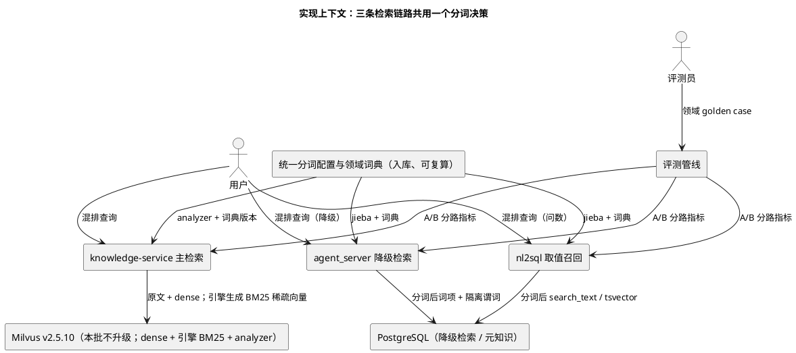

# 中英混排检索分词改造 — Design / Plan

> 对应 `spec.md`。本文回答"怎么做"：方案、接口、数据模型、迁移与验收。
> 本文引用的代码行号基于 2026-11-25 工作区，实施前需复跑核对。

# **1. 实现模型**

## **1.1 上下文视图**

## **1.2 服务/组件总体架构**

### **1.2.1 总体决策**

1. **主检索链路**：把现在的「dense + learned sparse（BGE-M3 sparse / api 模式本地 md5-TF 近似）」中的词法路，换成 **Milvus 内置 BM25 Function + jieba analyzer + 领域词典**。dense 路保持不变；多路召回（embedding / hyde / kg / web）、RRF(k=60)、cross-encoder rerank 保持原顺序。
2. **降级检索链路**：保留 pgvector + BM25 的实现形态，但把 `tokenize()` 的手写正则替换为 **jieba + 同一份领域词典**（中文按词切，英文按词元），保持租户 / 工作空间 / 知识库 / 软删除谓词不变。
3. **取值召回链路**：默认 `tokenizer` 从 `bigram` 改为 `jieba`，安装 `[tokenizer]` extra；依赖缺失时告警并记录实际分词器（不得静默降级）；存量 `value_info` 行按 `tokenizer` 标记识别并重建。
4. **分词配置入库**：analyzer 配置、词典版本、集合版本、评测读数必须落在版本控制清单内，受既有文档同步门禁保护；禁止只住在本机 gitignored 目录。
5. **集合版本化**：analyzer 在集合创建时固定，变更必须新建集合并双写 / 重灌，**禁止原地改配置**。
6. **单一实现（治本）**：两个 Python 服务的分词收敛到 `agent-runtime` 的一个共享模块（用 optional extra 声明 `jieba`，遵守 `applications → agent-runtime → agent-core` 单向依赖；不放入零依赖的 `agent-core`）。Milvus 侧 analyzer 配置由同一份源生成，三方不再各自维护算法。
7. **单一装配点（治本）**：共享模块提供唯一入口 `get_tokenizer()` / 等价工厂，三个服务不得自建分词实现；"接不上就报错"由构造保证，而不是靠每个调用点记得调一次。
8. **行为等价门禁（治本）**：门禁口径从"版本号相等"升级为"同一批混排样本在三侧产出词项集合相等"；加一条架构不变量 lint，禁止服务内出现本地分词实现。两者各只保留一把，避免"同一件事两把尺"。

### **1.2.2 关键事实与证据（实施前复核）**

| 事实 | 当前读数 | 证据 |
|---|---|---|
| Milvus 服务端版本 | v2.5.10 | `applications/knowledge-service/docker-compose.yml:117`；`docs/operations/env-126-inventory.md:190` |
| pymilvus 锁版 | 3.0.3（SDK 与服务端不同代，POC 需验兼容） | `uv.lock:5213-5227`；`applications/knowledge-service/pyproject.toml:30` |
| 主链路融合权重 | dense 0.8 / sparse 0.2 | `applications/knowledge-service/knowledge_service/conf/retrieval.yaml:7-9` |
| 手写分词（主链路 api 模式） | 英文正则 + 中文重叠 bigram + md5 token id + TF | `applications/knowledge-service/knowledge_service/lm/sparse_vectorizer.py:28-91` |
| 手写分词（共享镜像） | 与上同源，token id 空间必须一致 | `packages/agent-runtime/agent_runtime/vector_sparse.py:1-87` |
| agent_server 默认后端 | `milvus`，pgvector 为降级 | `applications/agent_server/config.py:98-105` |
| 手写分词（降级路） | 英文按词 + 中文 bigram | `applications/agent_server/rag/store.py:37-46` |
| nl2sql 默认分词 | `bigram`，jieba 为可选 extra | `applications/nl2sql-service/nl2sql_service/conf/settings.py:98-99`；`applications/nl2sql-service/pyproject.toml:49-52`；`applications/nl2sql-service/nl2sql_service/tokenizer.py:23-49` |
| nl2sql 重建标记 | `value_info.tokenizer` 列已存在 | `applications/nl2sql-service/nl2sql_service/migrations/005_value_info_table_name.up.sql:8-18` |
| Milvus 官方能力（本批所需） | v2.5.x 已具备 jieba tokenizer（支持 `_default_` + 自定义词典）与内置 BM25 Function；`multi_analyzer_params` / `run_analyzer` 是 2.5.11+ 的便利能力，本方案采用单一 analyzer，不依赖它们 | `https://milvus.io/docs/v2.5.x/jieba-tokenizer.md`；`https://milvus.io/docs/v2.5.x/full-text-search.md` |
| Milvus 官方能力 | 内置 BM25 Function + `SPARSE_INVERTED_INDEX`/`metric_type=BM25`；hybrid search 中词法腿由引擎从原文生成 | `https://milvus.io/docs/v2.6.x/full-text-search.md`；`https://milvus.io/docs/v2.6.x/multi-vector-search.md`（2.6 文档用于确认机制，POC 在 v2.5.10 实测） |
| Milvus 3.0 风险 | 3.0.3 起有破坏性变更（V1 REST 路由移除、导入权限 `ImportBinlog`、Pulsar producer 默认 exclusive）；Storage V3 属 3.0 架构变更、非 3.0.3 特有 | `https://milvus.io/docs/release_notes.md`（v3.0.3 / v3.0.5） |

### **1.2.3 为什么不用 language_identifier 自动路由**

`language_identifier` 是"整段文本检测一种语言 → 选一个 analyzer"，而需求明确是**中英混排同时支持**。短混排查询（如 `HAK-180 烫金机怎么用`）的语言检测结果不稳定，一旦判成中文就会丢掉英文词项边界。

采用**单一 jieba analyzer + 领域词典**：官方示例 `"milvus结巴分词器中文测试"` 输出 `['milvus', '结巴分词器', '中', '文', '测', '试']`，证明同一 analyzer 可同时保留英文整词与中文词典词。英文词干化（stemming）在本方案中不做——领域召回以型号 / 术语精确匹配为主，语义相近由 dense 路承担；如后续确需英文词干，再评估双 analyzer 双 BM25 通道 + RRF。

### **1.2.4 实现设计文档**

#### **A. 集合版本（服务端保持 v2.5.10）**

- **本批不升级 Milvus 服务端**。所需能力（BM25 Function、jieba tokenizer、自定义词典）在 v2.5.10 已具备；`multi_analyzer_params` / `run_analyzer` 属 2.5.11+，本方案不依赖。现网 K8s 的引擎大版本升级、存量 `platform_doc_v3_bge_m3` 在新引擎上的兼容验证与服务端级回退，另立工单 / ADR，不纳入本批（见 plan §7）。pymilvus 3.0.3 与 v2.5.10 的组合兼容性必须在 POC 实测，不靠文档推断。
- 新建集合版本（建议 `platform_doc_v4_bm25_jieba`，沿用现有 `{prefix}_{schema_version}_{embedding_model}` 命名思路），schema 含：
  - 主键；
  - 原始文本 `VARCHAR`，`enable_analyzer=True`，挂 jieba analyzer 配置；
  - 稠密向量 `FLOAT_VECTOR`，沿用现有维度与 COSINE/IP 口径；
  - 词法稀疏向量 `SPARSE_FLOAT_VECTOR`，由 `Function(function_type=BM25, input=[原文], output=[稀疏字段])` 自动生成，**应用侧不再写入该字段**；
  - 既有租户 / 工作空间 / 知识库 / 状态字段保持不动。
- 索引：dense 沿用 `AUTOINDEX+COSINE/IP`；稀疏字段用 `SPARSE_INVERTED_INDEX + metric_type=BM25`（可调 `bm25_k1` / `bm25_b`、`inverted_index_algo`）。
- 领域词典按 Milvus jieba tokenizer 的 `dict` 约定注册（`dict: ["_default_", "<custom>"]`，`mode=search`，`hmm=true`）。**注册方式必须在 POC 中验证**：文档给出的是词典名列表，具体挂载路径 / 加载方式需实测确认，不得凭猜测写进实施方案。
- **词典规模必须实测**：POC 以 ≥10,000 词条实测注册耗时、检索加载耗时与 `run_analyzer` 替代品（临时集合检索）延迟；配置侧在 8,000 词开始告警、10,000 词拒绝新增，告警与拒绝必须在真实注册路径上生效，而不是只校验配置文本。
- 变更 analyzer 必须产生新集合；旧集合至少保留 **14 个自然日且跨一次完整部署窗口**用于回退。

#### **B. knowledge-service 主链路改造**

- `node_search_embedding.py` 与 `node_search_embedding_hyde.py`：不再调用 `generate_embeddings()` 取 `sparse` 字段；稠密仍按 `EMBEDDING_MODE` 走 local BGE-M3 或 API。查询侧只传原文 + 稠密向量。
- `clients/milvus_utils.py` 的 `create_hybrid_search_requests` / `hybrid_search`：增加 BM25 腿的构造分支——词法腿以原文作为 `data`、`anns_field` 指向 BM25 稀疏字段、`metric_type=BM25`；融合仍用 `WeightedRanker(dense_weight, sparse_weight, norm_score=True)`。**POC 必须验证 `AnnSearchRequest` 直接传原文在 hybrid 场景可用**；官方全文检索示例支持原文 + `anns_field=sparse`，hybrid 组合按同一机制验证后方可落地。
- `import_process` 入库侧：停止写入应用侧 sparse 向量，改由引擎 Function 生成；维度 / 字段名与集合版本对齐。
- 多路召回（embedding / hyde / kg / web）、`node_rrf.py`、`node_rerank.py` 不改行为；`retrieval.yaml` 的 dense/sparse 权重保留为可调配置，语义含义从"dense/learned sparse"改为"dense/BM25"。
- 退役 `lm/sparse_vectorizer.py` 与 `agent_runtime/vector_sparse.py` 的正则实现：先在读点摘除，再保留文件一个周期供历史读数复跑，最后删除。`sparse_consistency.py` canary 在新链路下不再作为主门禁（BM25 由引擎生成），但保留为历史链路读件。
- **一致性守护并入 T14**：不再在这里单造"版本号一致"lint——它与 Spec 5.3 的"词项集合相等"口径不一致。改由 T14 的**行为等价门禁**统一承担：同一批混排样本在三侧产出词项集合必须相等，注入版本或词典不一致时 rc≠0。旧 `sparse_consistency.py` canary 仅作历史读件，不再新增门禁。

#### **C. agent_server 降级链路改造**

- `rag/store.py:37-46` 的 `tokenize()` 替换为 jieba 单源实现（中文按词、英文按词元、小写归一），与 KS 共用同一份领域词典版本。
- `pg_backend.py` 的检索行为不变（pgvector + BM25 + RRF(60) + 可选 rerank）；仅词项来源改变。
- 注意：PostgreSQL 的 `tsvector` 无中文 analyzer，jieba 输出词元直接进入 `to_tsvector('simple', ...)`；这条路定位为降级，允许能力子集（不做英文词干）。
- 需在根 / 应用依赖中声明 jieba，避免"配了但缺包静默降级"。

#### **D. nl2sql 取值召回改造**

- `conf/settings.py:98-99` 与 `conf/app_config.yaml:53-54` 默认值改为 `jieba`；`pyproject.toml:49-52` 的 `[tokenizer]` extra 进入部署安装清单。
- `tokenizer.py` 现状已是"告警一次后降级 bigram"（`tokenizer.py:33-42`），本项只补强：把实际分词器写入可检索日志 / 指标，禁止"配了 jieba 实际跑 bigram"却无从追溯。
- `migrations/005` 已有的 `value_info.tokenizer` 标记作为重建依据。采用**影子存储**切换：重建期间查询侧继续按当前生效配置（旧分词器）对外服务，新分词结果写入影子列 / 影子表；校验通过后原子切换生效配置，旧存储保留一周期回退。**不得**排除旧行导致对外空召回。需补一条迁移或运维脚本完成影子重建、标记更新与原子切换。
- A/B 评测按取值召回的 recall@K 对比，不允许新旧分词行混读。

#### **E. 迁移与回滚**

1. POC（在 v2.5.10 上）：验证词典注册方式与 ≥10k 词条规模、临时集合检索的分词输出、hybrid BM25 腿传原文、pymilvus 3.0.3 与该服务端的组合兼容。
2. 建新集合 + 导入领域词典 + 双写 / 重灌。
3. 评测管线按路跑 A/B；领域 golden case 必须包含：产品型号、领域黑话、缩写、中英混排、纯英文问句。
4. 灰度切换 `DocumentStore` 配置与 KS 集合名；保留旧集合与旧配置可一键回退。
5. 观测至少 14 个自然日且跨一次完整部署窗口后清理旧实现（按 B 节的分阶段退役）。

#### **F. 验收判据**

- 分词可验证：在临时集合上用约定混排样本实测检索，词项输出断言 100% 通过（v2.5.10 无 `run_analyzer`，不用它做判据）。
- 词典规模可验证：≥10k 词条注册与查询耗时有读数；8k 告警、10k 拒绝在真实路径上自证能咬。
- 行为等价可验证：同一批混排样本在三侧产出词项集合相等；注入版本或词典不一致时门禁 rc≠0，恢复一致后 rc=0（自证能咬）。门禁口径与 Spec 5.3 的验收口径一致，不再只看版本号。
- 单一装配可验证：架构不变量 lint 断言服务内无本地分词实现，对合成违规样本 rc≠0。
- 效果不回退：领域 golden case 上词法路 recall@5 / recall@10 不低于基线；融合后指标不低于基线。基线必须**当轮同环境复取**，评测入口为 `applications/knowledge-service/eval/run_route_ablation.py`（层 1 通道消融 + 层 2 dense/sparse 消融），不是根 `eval/run_eval.py`（后者是路由评测，不产出检索分路指标）。
- 隔离不回退：租户 / 工作空间 / 知识库隔离用例全绿（现有测试集复跑）。
- 可回退：回退演练在 10 分钟内恢复旧集合与旧配置。
- 无手写分词残留：检索读点扫描零命中（待退役件除外）。

# **2. 接口设计**

## **2.1 总体设计**

1. 对外检索响应形状（候选 id / source / heading / content / score）保持不变；`DocumentStore` 协议三件套（add_documents / retrieve / delete_document）保持不变。
2. 变化集中在三处内部接口：**词法请求的构造**（从传预计算稀疏向量改为传原文 + 引擎生成）、**分词器的提供方式**（从手写函数改为统一分词器 + 词典）、**分词器配置来源**（从硬编码改为配置 + 版本）。
3. 配置变更必须可复算：同一配置版本在任意环境得到同一分词行为。
4. **单一装配点**：`get_tokenizer()`（或等价工厂）是唯一允许获取分词能力的入口；三个服务只从该入口装配，不允许自建分词函数、正则切词或词典读取逻辑。
5. **单一事实源**：分词器配置、领域词典版本、Milvus analyzer 配置由同一份入库配置生成，禁止各服务各写一份。

## **2.2 接口清单**

| 接口 / 配置点 | 现状 | 目标 | 兼容策略 |
|---|---|---|---|
| `agent_runtime` 共享分词模块（T14 新增） | 无；三处各自实现 | 唯一 `get_tokenizer()` + 词典版本单源；optional extra 声明 jieba | 依赖方向 `applications → agent-runtime → agent-core`，不反向 |
| 行为等价门禁 + 架构不变量 lint（T14 新增） | 无 | 同一样本三侧词项集合相等；禁止服务内本地分词实现 | 与 Spec 5.3 同口径；合成违规自证 rc≠0 |
| KS `node_search_embedding` / `node_search_embedding_hyde` | 生成 dense + sparse 并传入 | 只生成 dense，词法腿传原文 | 新旧集合并行，切换后生效 |
| KS `milvus_utils.create_hybrid_search_requests` | dense 请求 + 预计算 sparse 请求 | dense 请求 + BM25 原文请求 | 按集合版本分支，不混用 |
| KS `milvus_utils.hybrid_search` | `WeightedRanker(0.8, 0.2)` | 同签名，权重含义改为 dense / BM25 | 配置默认值不变 |
| KS 导入侧稀疏写入 | 写入应用侧 sparse 向量 | 不写，由引擎 Function 生成 | 新集合才生效 |
| `agent_server/rag/store.py:tokenize` | 手写正则 | jieba + 领域词典单源 | 旧读点摘除后保留文件一周期 |
| `agent_server/rag/pg_backend.py` | pgvector + BM25 + RRF | 行为不变，仅分词来源改变 | 完全兼容 |
| `nl2sql_service/conf/settings.py:tokenizer` | 默认 `bigram` | 默认 `jieba` | 存量行按标记重建 |
| `nl2sql_service/tokenizer.py:tokenize` | 缺包告警一次后降级 bigram（现状，非静默） | 补强：实际分词器写入可检索日志 / 指标 | 日志可检索 |
| `nl2sql migrations/005 tokenizer` 标记 | 已存在 | 作为重建依据并补重建脚本 | 标记空值按旧分词处理 |
| 评测管线 | 融合后总指标 | 增加按路 recall@K 与分词断言 | 旧读数仅作历史基线 |

# **4. 数据模型**

## **4.1 设计目标**

1. 分词配置与领域词典**单一事实源、可复算、可追溯**：两个 Python 服务共用一份实现，Milvus analyzer 由同源配置生成，避免"同一算法三份实现"造成的静默失效。
2. 新旧分词版本的数据**可并存但不混读**，保证切换原子性与可回退性。
3. 评测读数**绑定版本与时间**，防止上一轮读数被当作本轮依据。

## **4.2 模型实现**

### **4.2.1 Milvus 新集合（v4）逻辑模型**

| 字段 | 类型 / 约束 | 说明 |
|---|---|---|
| `id` | 主键 | 沿用现有主键生成方式 |
| `text` | VARCHAR，`enable_analyzer=True` | 原始文本，BM25 Function 输入 |
| `dense_vector` | FLOAT_VECTOR，维度与现有集合一致 | 语义路，COSINE/IP 沿用 |
| `bm25_sparse` | SPARSE_FLOAT_VECTOR | 由 BM25 Function 自动生成，禁止应用写入 |
| `tenant_id` / `workspace_id` / `knowledge_id` / `status` | 与现有集合一致 | 隔离与软删除谓词不变 |

### **4.2.2 领域词典（入库配置）**

| 项 | 约束 |
|---|---|
| 词条 | 唯一；中文产品名、型号、缩写、英文术语 |
| 版本 | 语义化版本号，变更即升版 |
| 注册方式 | 按 Milvus jieba tokenizer 的 `dict` 约定挂载；POC 实测确认 |
| 使用范围 | KS analyzer、agent_server jieba、nl2sql jieba 共用同一版本 |
| 事实源 | 由 T14 的共享配置单源生成，三侧不得各写一份；Milvus analyzer 配置由同源派生 |

### **4.2.3 nl2sql `value_info` 重建规则**

| 项 | 规则 |
|---|---|
| `tokenizer` 标记 | 空或旧值 → 待重建；等于当前配置 → 可用 |
| `search_text` / `tsvector` | 由当前分词器重新生成 |
| 重建期间 | 旧配置继续对外服务；新结果写入影子存储，校验通过后原子切换；旧存储保留一周期回退 |

### **4.2.4 评测记录（入库）**

| 项 | 约束 |
|---|---|
| `case_id` | 唯一，含类别标签（领域词 / 型号 / 混排 / 纯英文） |
| `split` | semantic / lexical / fused 三路分别记录 |
| `metrics` | recall@5、recall@10 |
| `binding` | 分词器版本、集合版本、判决时间、HEAD sha |

## **4.3 决策级别与 ADR**

- 本方案判为 **D1（可逆、中影响）**：AI 给出方案与证据，由人批准后实施；集合并存与回退演练保证可逆。
- **全局解三层齐备性**：单一实现 = T14 共享分词模块；全局装配 = T14 唯一 `get_tokenizer()` 入口；强制门禁 = T14 行为等价门禁 + 架构不变量 lint（均为入库件并自证能咬）。三层缺任一层即退化为约定，T14 因此是本方案从"治标"到"治本"的必经工单，不可作为可选优化删去。
- 因涉及向量库检索路线的架构性变更（ADR-0009 仍为未决），实施前建议补一条 ADR，登记"词法路由 Milvus 内置 BM25 + jieba、dense 保持、旧 learned sparse 退役"的选择与放弃理由。ADR 纳入工单 T1，不阻塞后续 POC 准备。
