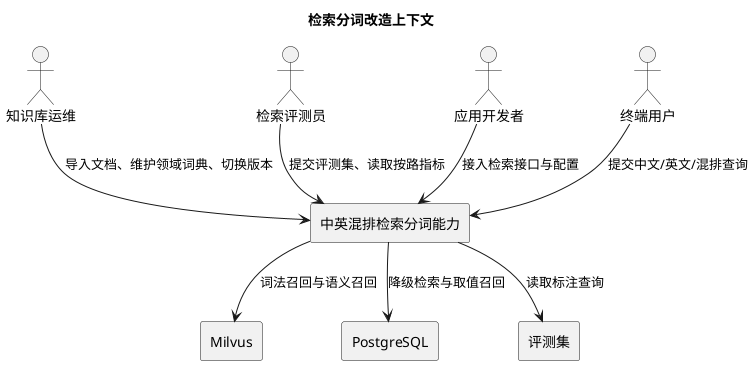
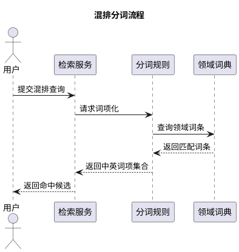
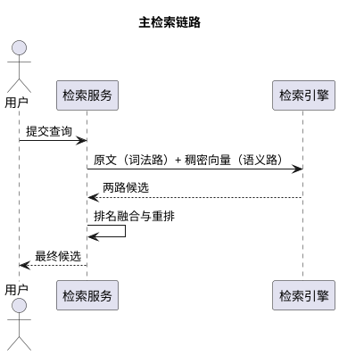
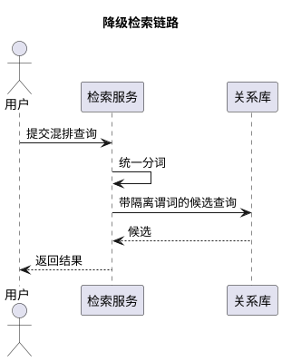
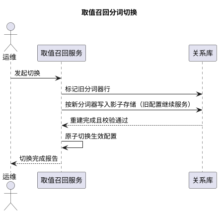
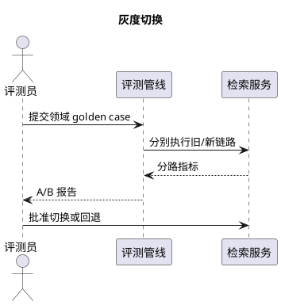

# 中英混排检索分词改造 — Spec

> 范围：knowledge-service 主检索链路、agent_server 的 pgvector 降级检索链路、nl2sql-service 的取值召回链路。
> 本文只定义"做什么 / 为什么 / 验收"，技术方案见同目录 `design.md`，工单见 `tasks.md`。

# **1. 组件定位**

## **1.1 核心职责**

本组件负责为三个检索服务提供**统一、可验证的中英混排分词与词法召回能力**，使检索结果对领域术语、产品型号、缩写和混排问句稳定可召回，并消除应用侧手写正则分词带来的不可解释与不一致。

## **1.2 核心输入**

1. **用户查询文本**：中文、英文或中英混排的自然语言问句，可含产品型号、缩写、领域黑话。
2. **知识库文档文本**：导入侧的原始分块正文，语言分布与查询侧一致或混合。
3. **领域词典**：产品名、型号、行业术语的有序词表，带版本标识。
4. **开关与回退指令**：运维对"新分词链路是否启用 / 是否回退"的显式指令。

## **1.3 核心输出**

1. **词项化结果**：查询与文档经同一分词规则得到的可检索词项，供词法召回使用。
2. **词法召回候选**：按词项相关性排序的候选分块 / 取值行。
3. **分词验证结果**：对给定样本的分词输出与领域词命中断言。
4. **A/B 评测报告**：按召回通道记录的效果数据与切换判决。

## **1.4 职责边界**

**不负责**：

1. 不训练或替换稠密向量模型，不改变语义向量的生成方式。
2. 不改变问答生成、答案组织、前端展示逻辑。
3. 不新增独立的全文检索引擎（不引入 Elasticsearch），词法能力由现有向量库承担。
4. 不修改多租户隔离、鉴权、软删除等既有安全语义。
5. 不承担离线数据清洗与业务数据补录。

# **2. 领域术语**

**中英混排文本**
: 同一段文本中同时包含中文与英文 / 数字词元的输入，例如"HAK-180 烫金机怎么用"。备注：不是"先判语言再选一种分析器"的单语文本。

**分词器（analyzer）**
: 将原始文本切分为可检索词项、并可附加大小写归一等处理的规则集合。备注：分词器在索引构建时确定，变更需要重建索引。

**领域词典**
: 由产品名、型号、行业术语构成的有序词表，用于保证领域词在分词时不被拆碎。备注：词典必须有版本，变更可追溯。

**词法召回**
: 依据词项精确匹配与词频统计对候选排序的召回方式。备注：与语义向量召回并列，不互相替代。

**语义召回**
: 依据稠密向量的连续相似度对候选排序的召回方式。备注：本项目保留既有实现，不在本次改造范围内变更。

**学习式稀疏向量**
: 由模型输出、维度对齐词表且大部分为零的向量表示。备注：本项目当前实现为本地近似，非 SPLADE 模型；本次改造后不再作为默认词法路。

**集合版本**
: 向量库中一组固定 schema 与分词配置的数据集合标识。备注：分词配置变更必须产生新版本，不允许原地改写。

**分词一致性**
: 写入侧与查询侧使用同一分词规则与同一词典版本的状态。备注：不一致会导致词法召回静默失效，必须以可观测断言守护。

**降级检索链路**
: 主向量库不可用时启用的备用检索实现。备注：降级链路同样必须支持中英混排分词，但允许能力子集。

# **3. 角色与边界**

## **3.1 核心角色**

- **知识库运维**：导入文档、维护领域词典、执行集合版本切换与回退。
- **检索评测员**：维护领域 golden case，执行 A/B 评测并给出切换判决。
- **应用开发者**：在业务服务中接入新的检索接口与配置项。

## **3.2 外部系统**

- **Milvus**：承载稠密向量、词法召回与引擎侧分词。
- **PostgreSQL**：承载 agent_server 的降级检索与 nl2sql 的元知识。
- **评测集（golden case）**：提供领域术语、型号、混排问句的标注查询与期望结果。

## **3.3 交互上下文**

# **4. DFX约束**

## **4.1 性能**

1. 检索端到端 P95 不得高于改造前基线的 **110%**；同时必须按路记录词法召回耗时，便于定位回退来源。
2. 分词配置不得在每次查询时从零构建；同一进程内必须复用已编译的分词规则与词典。
3. 领域词典规模上限暂定 **10,000 词**；达到上限的 80%（8,000 词）时必须告警，超出时必须拒绝新增而不是静默截断。该上限必须在服务端的真实注册路径上实测有效，而非只在配置文本中校验。

## **4.2 可靠性**

1. 新旧集合必须至少并存 **14 个自然日且跨一次完整部署窗口**，切换失败时可在 **10 分钟**内回退到旧集合；该时长仅指集合 / 配置层回退，不含引擎面故障。
2. 分词规则不可用时，系统必须给出可读降级提示，禁止返回空结果并伪装成"无命中"。
3. 写入侧、查询侧以及三个服务对分词器配置与词典版本的引用必须一致；必须提供可执行的门禁检测该一致性，不一致时判红并告警，禁止静默退化为纯语义召回。

## **4.3 安全性**

1. 本次改造不得削弱租户隔离、工作空间归属、知识库归属与软删除过滤。
2. 领域词典与分词配置属于服务侧资产，不得通过用户查询接口写入。

## **4.4 可维护性**

1. 分词器配置、词典版本、集合版本必须入库并可被脚本复核。
2. 两个应用服务必须共用**单一分词实现**与唯一装配入口；各服务禁止自建分词函数、正则切词或词典读取逻辑。
3. 各检索侧的分词行为必须**等价**：同一批约定样本产出的词项集合必须相等，而不只是配置版本号相同。
4. 应用侧不得保留手写正则分词实现；若因兼容暂留，必须显式登记为待退役并在读点不可达。
5. 每次评测报告必须记录分词配置版本与判决时间。

## **4.5 兼容性**

1. 对外的检索响应形状、错误语义保持不变，调用方无需改解析逻辑。
2. 存量数据允许通过重建索引迁移；迁移期间新旧数据可并存，但不得出现同一查询混读两个分词版本。
3. nl2sql 的存量取值行必须携带分词器标识，换分词器后旧行可被识别并重建。

# **5. 核心能力**

## **5.1 混排分词与领域词典**

### **5.1.1 业务规则**

1. **混排切分规则**：分词必须对中英混排文本同时产出中文词项与英文词项。
   a. 验收条件：When 输入"HAK-180 烫金机怎么用"，The system shall 产出可独立命中的"HAK-180"与"烫金机"词项。
2. **领域词完整规则**：已登记领域词必须作为完整词项输出，不得被拆成单字或字符二元组。
   a. 验收条件：Where 领域词典包含某产品型号，When 该型号出现在查询或文档中，The system shall 输出该型号的完整词项。
3. **大小写归一规则**：英文词项必须大小写无关。
   a. 验收条件：When 同一英文词以不同大小写出现，The system shall 生成相同的可检索词项。
4. **禁止手写分词规则**：应用侧禁止为检索目的手写正则字符切分。
   a. 验收条件：When 代码审查或门禁扫描检索链路，The system shall 报告零处用于检索分词的手写正则实现（已登记待退役的降级路径除外）。
5. **禁止项**：禁止按"整段文本判一种语言再选单一语言分析器"的方式处理混排查询。
   a. 验收条件：When 查询同时含中文与英文，The system shall 不因语言检测结果丢弃其中一种语言的词项。

### **5.1.2 交互流程**

### **5.1.3 异常场景**

1. **领域词典缺失**
   a. 触发条件：配置的领域词典无法读取。
   b. 系统行为：回退到内置通用词典并告警，不静默使用空词典。
   c. 用户感知：检索继续可用，但运维侧出现明确告警。
2. **空查询或纯标点查询**
   a. 触发条件：查询无有效词元。
   b. 系统行为：不发起词法召回，返回可读提示。
   c. 用户感知：收到"查询无可检索内容"类提示。
3. **词典版本不一致**
   a. 触发条件：写入侧与查询侧引用不同词典版本。
   b. 系统行为：停止词法召回并报出版本冲突。
   c. 用户感知：检索降级为语义召回并附带降级说明。

## **5.2 主检索链路词法召回**

### **5.2.1 业务规则**

1. **引擎生成规则**：词法召回的稀疏表示必须由检索引擎依据原文生成，应用侧禁止预计算并传入。
   a. 验收条件：When 文档入库或查询发起，The system shall 仅提交原文与稠密向量，不提交手写稀疏词权重。
2. **融合不变规则**：既有的多路召回、排名融合与重排顺序必须保持不变。
   a. 验收条件：When 主链路执行检索，The system shall 保持语义路、词法路、扩展路与重排阶段的相对顺序不变。
3. **权重可配规则**：语义路和词法路的融合权重必须来自配置，不得硬编码。
   a. 验收条件：When 运维修改配置，The system shall 在不改代码的前提下改变融合行为。
4. **禁止项**：禁止把"引擎侧词法召回"与"学习式稀疏向量召回"混称为同一种能力。
   a. 验收条件：When 输出检索说明或监控标签，The system shall 区分两种词法实现。

### **5.2.2 交互流程**

### **5.2.3 异常场景**

1. **词法索引未就绪**
   a. 触发条件：新集合词法索引尚未完成。
   b. 系统行为：不切换流量，保持旧集合服务。
   c. 用户感知：无变化。
2. **引擎不可用**
   a. 触发条件：检索引擎连接失败。
   b. 系统行为：按既有降级策略返回可读提示，不抛未处理异常。
   c. 用户感知：收到明确的"检索暂不可用"提示。

## **5.3 降级检索链路分词**

### **5.3.1 业务规则**

1. **同能力规则**：降级链路必须使用与主链路一致的中英混排分词能力，不得回退到字符二元组近似。
   a. 验收条件：When 对约定混排样本分别执行主链路与降级链路，The system shall 输出完全相同的中文词项集合（逐词集合相等），且领域词保持完整。
2. **隔离不变规则**：降级链路必须保持租户、工作空间、知识库与软删除过滤。
   a. 验收条件：When 降级链路执行检索，The system shall 只返回当前租户与当前归属范围内的候选。
3. **禁止项**：禁止在降级链路上引入新的第三方检索引擎。

### **5.3.2 交互流程**

### **5.3.3 异常场景**

1. **分词依赖缺失**
   a. 触发条件：降级链路所需分词依赖未安装。
   b. 系统行为：显式告警并使用已登记的临时方案，禁止静默降级到字符二元组。
   c. 用户感知：检索可用但质量下降，运维侧可见告警。

## **5.4 取值召回分词与重建**

### **5.4.1 业务规则**

1. **默认分词规则**：取值召回默认必须使用中文分词器，不再使用字符二元组。
   a. 验收条件：When 系统以默认配置启动，The system shall 使用中文分词器处理取值文本。
2. **可观测降级规则**：分词依赖缺失时必须告警并记录实际使用的分词器，禁止静默切换。
   a. 验收条件：When 分词依赖缺失，The system shall 产生一条可检索的告警记录。
3. **存量重建规则**：存量取值行必须按分词器标识被识别，并在**影子存储**中按新分词器重建；重建完成前，查询侧继续按当前生效配置（旧分词器）对外服务。
   a. 验收条件：When 重建进行中，The system shall 保持旧配置对外服务、用户可感知行为无变化，且影子存储中的新结果不参与正式召回。
   b. 验收条件：When 影子存储重建完成并通过校验，The system shall 原子切换生效配置到新分词器，并保留旧存储至少 14 个自然日且跨一次完整部署窗口供回退。
4. **禁止项**：禁止在同一查询中混读新旧分词器产出的召回结果，禁止以"待重建"为由让对外召回变空。

### **5.4.2 交互流程**

### **5.4.3 异常场景**

1. **重建中断**
   a. 触发条件：重建任务中途失败。
   b. 系统行为：保持旧配置对外服务，影子存储作废并重试；正式召回不受影响。
   c. 用户感知：无变化。
2. **标识缺失**
   a. 触发条件：存量行没有分词器标识。
   b. 系统行为：一律视为旧分词器并按待重建处理。
   c. 用户感知：无变化。

## **5.5 A/B 评测与灰度切换**

### **5.5.1 业务规则**

1. **按路度量规则**：评测必须按召回通道分别记录效果指标，禁止只看融合后总指标。
   a. 验收条件：When 执行 A/B 评测，The system shall 输出语义路、词法路与融合后的分路指标。
2. **不回退规则**：领域术语与混排问句的召回指标不得因切换而下降。
   a. 验收条件：When 新链路与旧链路对比，The system shall 在领域 golden case 上不出现 recall@K 下降。
3. **分词可验证规则**：混排样本的分词输出必须有可复核的断言。
   a. 验收条件：When 提交混排样本，The system shall 输出可复核的词项列表并判定领域词是否完整。
4. **可回退规则**：切换必须保留回退路径与回退判据。
   a. 验收条件：When 切换后出现指标回退，The system shall 能在十分钟内恢复到旧链路。
5. **禁止项**：禁止把上一轮评测读数当作本轮切换依据。

### **5.5.2 交互流程**

### **5.5.3 异常场景**

1. **评测集缺领域词**
   a. 触发条件：golden case 未覆盖领域术语或混排问句。
   b. 系统行为：拒绝给出切换判决并要求补样本。
   c. 用户感知：评测报告标注"不足以判决"。
2. **读数过期**
   a. 触发条件：评测读数未绑定版本与时间。
   b. 系统行为：判为无效读数，不参与切换判决。
   c. 用户感知：评测报告标注"读数过期"。

# **6. 数据约束**

## **6.1 查询**

1. **原文**：必须保留用户原始文本，不得在分词前改写语义。
2. **语言**：可以是中文、英文或混排，不要求调用方声明语言。
3. **分词器版本**：评测与诊断记录必须携带实际使用的分词配置版本。

## **6.2 文档分块**

1. **原文**：必须为非空的文本片段。
2. **归属**：租户、工作空间、知识库归属必须随分块保留。
3. **状态**：软删除状态必须在词法召回前生效。

## **6.3 领域词典**

1. **词条**：必须唯一，禁止同词重复登记。
2. **版本**：每次变更必须产生新版本标识。
3. **来源**：必须可追溯到人工维护记录，禁止由用户查询自动生成。

## **6.4 评测记录**

1. **样例标识**：必须唯一且可追溯。
2. **分路指标**：必须分别记录语义路、词法路与融合后的指标。
3. **判决绑定**：必须绑定分词配置版本、集合版本与判决时间。
